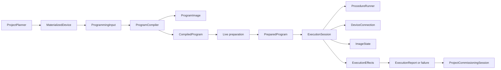
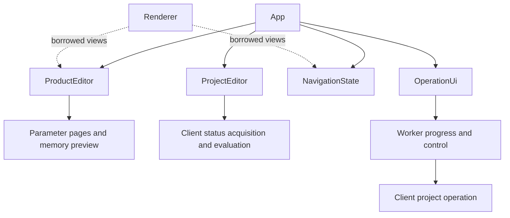
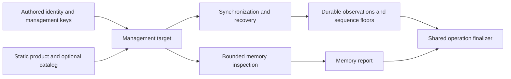

# zweidraehte-client

The host-side KNX client provides bus access, explicit management services and
ETS-style configuration downloads. It supports KNX/IP tunneling and USB, with
Data Secure above the connector. The device and client stacks share the pure
transport state machine and packet codecs in `zweidraehte-proto`.

`IndividualAddress` and `GroupAddress` implement allocation-free `FromStr` with
typed bounds errors. Individual addresses use `area.line.device`; group addresses
accept three levels, two levels, or a decimal raw value. The library usage example
is a compiling `no_run` doctest.

ETS runtime bindings use the same protocol `GroupAddress`.
The TUI keeps a three-level-only input adapter, including its existing acceptance
of zero; project validation determines which bindings can be commissioned.
Numeric group-address constructors reject out-of-range components with a panic,
including in release builds, instead of masking them. Text input uses the fallible
protocol parser. All valid 16-bit addresses retain their wire representation.

Runtime binding iteration retains insertion order and the first/sending binding.
Wire-table generation belongs to the client compiler, whose profile-specific
ordering must not be replaced by a universal sort.

## Crate boundaries

| Owner | Responsibility |
| --- | --- |
| `zweidraehte-proto` | Allocation-free addresses, packet codecs, table formats and the pure transport state machine, shared with embedded stacks |
| `zweidraehte-ets-files` | XML/packages, checked product selection, editable product evaluation, translations, parameter descriptions and keyring file formats |
| `zweidraehte-project` | Authored project data, keys, mutable deployment state, journals and writer exclusion |
| Client `configuration` / `commissioning` | Installation lowering, exact profile selection, compilation and live execution |
| Client `project` | Product acquisition, key resolution, planning, status and persisted programming outcomes |
| CLI / TUI | Commands, interaction and presentation over the shared project operations |

The boundaries follow ownership and lifetime. Editable product data belongs to
ETS-files; bus conversations belong to the client; durable outcomes belong to
the project. Concrete owners and borrowed views keep these responsibilities
reusable without an inheritance hierarchy or a second frontend implementation.

## Bus ownership

`KnxBus` owns the driver task and connector. Group traffic uses the bus directly.
`DeviceConnection` owns one connected management conversation and its private,
driver-issued connection ID. Stale handles cannot send, change keys, consume
secure sequence numbers or close a replacement conversation—even at the same
address. Closing a handle after its conversation ends is locally successful.
`NetworkManagement` provides addressing, discovery and connectionless services.

`bus/` contains the handles, management services, framing and private driver.
The driver uses the shared protocol `BasicConnection` directly and applies each
transport transition before processing follow-up actions. A connected request
has one completion mode: acknowledgement or response (optionally service-specific).
A secure connection is exposed only after synchronization completes. Retries reuse
the pending encoded frame; a new synchronization attempt gets a new challenge.
Tunnel-specific state lives beside the IP connector.

`connector::BusTarget` (also exported at the crate root) holds an endpoint before
it is opened. It is available without `cli`: use `BusTarget::Ip(address)` in a
bus-only build, or `BusTarget::Usb(selector)` with `usb`. Both accept a prepared
`SecurityStore` through `connect_with_security`; `connect` uses an empty store.
Neither method reads CLI arguments, environment variables or credential files.
The existing direct `KnxBus` constructors remain useful when no endpoint value
needs to be stored, and custom connectors still use `with_connector*`.

`cli::TargetArgs` and `OptionalTargetArgs` only translate arguments into this
value. Import `zweidraehte_client::BusTarget` instead of the former
`zweidraehte_client::cli::BusTarget`. USB's optional variant and match arm live
together in `connector/target.rs`, so a build cannot select an unavailable
connector and no disabled-feature runtime fallback is needed.

## Configuration and compilation

`Device::from_product` binds an editor to a checked `SelectedProduct`.
Untranslated instances share a lazily built program and lookup tables through
that selection. Parameter values, bindings, visibility and module expansion
remain local; translated editors start from the original document. Resolved
geometry remains an owned per-evaluation value. The selection retains its cached
definition until the selection and its editors are dropped; see
[product selection](docs/ETS_FILES.md#product-selection) for this tradeoff.
`Device::evaluate` checks edits, derivation, effective settings and geometry;
its borrowed `EvaluatedProduct` prevents mutation while the result is in use.
It retains the sorted active module instances and final allocator arguments used
for geometry. `modules()` lends that roster; `into_parts()` transfers it with
the resolved product. Client lowering consumes those parts without walking
expanded editor modules again or cloning their arguments.
`ResolvedDevice::from_evaluated` combines that result with
`InstallationConfiguration`, which contains no encoded parameters or objects.
The resolved device owns the product, evaluated
configuration, module geometry and exact procedure-selector values. Its consuming
`into_materialized(keys)` conversion creates the flat compiler configuration once.
`LoweredDeviceConfiguration::new(address, apdu_ceiling)` makes the optional APDU
ceiling explicit; `Some(15)` imposes the standard-frame limit, while project
configuration retains its authored optional limit.

`EvaluatedProduct::parameter_overlays()` owns programming selection, effective
values and storage/type resolution. It yields memory defaults first, visible
references and legacy/property values next, then derived replacements. Values
borrow the evaluation where available. This remains separate from authored
settings export; sorting or collapsing overlays would change union writes.
The client encodes each value and checks competing refs for byte equality,
since distinct semantic values can round to the same stored bytes. Derived
values replace the first matching entry so property lowering sees them too.
`procedure_selector(id)` supplies the exact requested root/module value and its
dynamic activity, including hidden active controls. The client collects the
procedure dependencies and enforces which types `choose` can compare; neither
path navigates editor internals.

Sparse images expose checked presence, occupied-end and contiguous-range queries.
Compilation and transfer scheduling use those queries when they need only
geometry; byte and mask materialization remains explicit.

Product fingerprints use the explicit [version 3 format](docs/PRODUCT_FINGERPRINT.md).
Master Data keeps its separate exact-document identity. Old deployment image
baselines are discarded on load; credentials and counters remain durable.

`MaterializedDevice` holds that product, configuration, modules and resolved keys.
Application security lives only in
`ResolvedKeyMaterial`. Requested APDU limits belong to configuration; observed
limits belong to preparation evidence.

`ProgrammingInput::preview` and `ProgrammingInput::compile` use the same private
`ProgramCompiler`. It borrows the input and owns the selected profile, procedure
and image while compilation is in progress:

1. Resolve the exact catalog profile and validate product compatibility.
2. Select the requested controls and contributions.
3. Build the public desired image, ownership masks and private payload.
4. Bind control operands and final verification reads.
5. Validate the complete program and its APDU requirements.

The implementation is grouped under `commissioning/compiler/`: selection,
image construction, procedure binding and immutable compiled output. Fixed feature
emitters are inherent compiler methods, called explicitly in Data Secure, IP,
then topology order. The parsed procedure remains available until image-dependent
operands can be bound. Catalog loading, resource views, resolved profiles and
profile rules live together under `commissioning/catalog/`.

Catalog acquisition (`ProgrammingCatalog::from_xml`, `from_file` and `load`)
returns `ProgrammingCatalogLoadError`: `MasterData` retains the original ETS
I/O/XML/network error, while `Policy` retains a `CompileError` for unsupported
commissioning policy. Profile resolution still returns `CompileError`, including
its kind and authored control path. Inspection constructors continue to accept
documents outside the live compiler's supported schema range.

Project adapters preserve these as `Error::CatalogLoad` and `Error::Catalog`;
the former string-only `Error::MasterData` variant is removed. Library callers
can match the variants and inspect `Error::source()` without parsing a message.
CLI reports and TUI worker/status messages render the cause chain at their
presentation boundary. Execution diagnostics, cleanup failures and physical
effects retain their separate existing representation.

`CommunicationTables` assembles all three communication tables through
`TableCodec::encode`. Each codec returns bytes, owned bits and the normalized
entry count. A closed enum selects the concrete format from the exact catalog
resource; native descriptor pointers and flags stay inside the object codec.
`TablePlacement` separately handles authored locations or BCU1 shared allocation.
Image construction applies the same capacity checks and patches for every format.

Association byte coding lives in proto's `AssociationTableFormat` trait and
`AssociationTableView<F>`, generalized from the former BCU-only view. Client
compilation still chooses indexed slots, sorted rows or primary-first ordering;
the shared codec only writes the selected byte/word count and byte/word SAPs.
Both device stacks decode through the same bounded view. Unused BCU slots and
RT6's empty-table identity mapping retain their distinct realization rules.
Association and compact group-object views select their format through
zero-sized marker types. Device families also select sending-association rules
through associated types, so table access is monomorphized without runtime
format fields. Only the host compiler dispatches from product data to a concrete
codec. The codecs borrow caller-owned storage and need neither `std` nor allocation.

Base and evaluated object flags share `ComObjectFlagFields` packing in proto.
The named fields preserve bit 5 without prematurely choosing read-on-init or
segment-selection semantics. Module conversion reuses ETS-files'
`MaterializedModule::from` while retaining deterministic instance sorting.

`ProgramImage` is the only preview result. `projected_regions()` borrows native
region metadata and projects public bytes in display order, preserving reserved
bytes and ownership masks. `table_spans()` and `requirements()` expose table
placement and pending observations. There is no separate preview object graph.

`CompiledProgram` becomes immutable when the compiler returns it. Its fields
are writable only within the compiler; consumers inspect borrowed accessors.
Network controls and conservative APDU bounds are complete before live binding.
Offline compilation drops the private secret payload.

`Commissioner::prepare` observes the live device and produces a `PreparedProgram`
bound to its identity, credentials, evidence and bus instance. Live baseline
checks borrow the compiled program and return a differential decision. That
decision, baseline bytes and `execution_address()` belong to the prepared binding;
`ExecutionReport` retains the executed address and decision.
`Commissioner::execute` accepts only that prepared value. Offline compilation
cannot authorize device writes.

## Execution ownership



`commissioning/runtime/` holds `Commissioner`, prepared binding, live preparation,
execution and cleanup. `ExecutionSession` belongs here because its lifetime is
one commissioning operation: its image knowledge, credentials, effects and
cleanup have meaning together. General management callers use `DeviceConnection`;
project persistence uses `ProjectCommissioningSession`. These are distinct
lifetimes, not interchangeable kinds of session.

`Commissioner::execute` consumes the prepared value and
orchestrates its `ExecutionSession` directly. The session checks the
bus binding and cancellation, revalidates evidence, configures the network,
runs the application procedure, verifies its result and performs cleanup before
publishing an outcome. `ProcedureRunner` owns control iteration, tool variables,
error handlers, cancellation and progress. Its report contains only procedure
diagnostics. One cleanup-combination operation retains both the primary and
cleanup diagnostics, including at required intermediate disconnects.

Each runtime transfer checks its resolved range and negotiated chunk geometry
before changing Verify Mode or invalidating observations. Private writes and
verification reads carry a borrowed observation policy and group-key rows;
their zeroizing payload owner remains alive across I/O. Authored public reads
share cache handling, while retry and error-handler decisions stay in the runner.

`ImageState` keeps three distinct kinds of bytes:

- Desired bytes describe what the product and project own.
- Working buffers hold authored fills, copies and materialized transfers.
- Known device bytes come from completed transfers and observations.

Pointer aliases, caches, stamps and restart snapshots belong to the same image
owner. `ImageState::begin_program` binds desired bytes, native regions and stamp
policy. Its methods own all observation updates and invalidation. A local transfer rejection preserves existing knowledge. Once dispatch
may affect the device, invalidation remains conservative.

Final readback supplies missing evidence through compiler-bound public ranges.
Properties and pointer resources require an exact readable catalog declaration.
Unobserved or different owned bits produce `Unverified`. Private payloads and
their verification reads are excluded from public images and stamps.

`ExecutionEffects` owns mutation status, affected and cleared sections, address
assignments with serial identity, credential transitions, group-key exposure and
erasure, and network-phase results. Reports and execution failures each own one
value, available through `effects()`. Pure image and operand checks return
`ImageError` or `CompileError`. Internal I/O returns `Diagnostic`, with an authored
path and typed cause but no effects. Cleanup failures contain diagnostics;
finalization attaches accumulated effects once, after cleanup. Validated download
stamps appear once on `ExecutionReport`. Progress callbacks display observations;
they do not establish persistence facts. An ignored reset failure cannot prove
erasure, and an address reset cannot prove application or key erasure.

## Access and execution example

`ManagementAccessOptions` contains plaintext permission and an optional legacy
access key. Device Tool Keys and FDSKs come from `MaterializedDevice`.
Discovery and raw diagnostics share `KnxBus` credential acquisition. It tries
Tool Key, then FDSK, then plaintext when permitted. Raw plaintext access validates
DD0; commissioning validates it during profile discovery. The synchronized entry
point forces fresh synchronization; sender probes supply only a Tool Key.
Each candidate
creates a session with concrete access; secure variants own their required key.
Profile observation resolves authorization before binding the program. Active
credentials, legacy authorization keys and replacement Tool Keys use redacted,
zeroizing storage. Bootstrap retains its replacement key separately and rejects
missing material before execution.

```rust
use zweidraehte_client::commissioning::{
    Commissioner, CommissioningCancellation, ExecutionReport,
    ManagementAccessOptions, PreparationOptions, ProgrammingInput, Result,
};

async fn program_device(
    commissioner: &Commissioner<'_>,
    input: ProgrammingInput,
) -> Result<ExecutionReport> {
    let cancellation = CommissioningCancellation::default();
    let access = ManagementAccessOptions::new().allow_plaintext(false);
    let prepared = commissioner
        .prepare(input, PreparationOptions::new(access), &cancellation, |_| {})
        .await?;
    println!("Target: {}", prepared.execution_address());
    println!("Baseline: {:?}", prepared.differential());
    let report = commissioner.execute(prepared, &cancellation, |_| {}).await?;
    println!("Changed sections: {:?}", report.effects().affected_sections());
    Ok(report)
}
```

For a `CommissioningError`, inspect `error.effects()` and
`error.diagnostic().cleanup_failures()`. A confirmed assignment supplies recovery identity
through `error.effects().learned_target()`. Use the project session to persist
these outcomes; progress callbacks are optional.

Connectors and bus services return `BusResult<T>` / `BusError`; those errors
contain no project or commissioning outcomes. `project::Error`
converts upward at project boundaries. `project::Error::ProjectBatch` owns a boxed
`ProjectBatchFailure`, including completed physical reports. Diagnostics retain
raw device codes, optional legacy mappings and original bus/I/O source chains.
Product errors pass through configuration and client adapters by value; the
ETS owner boxes only the rare, large AP2 conflict payload. Error messages and
typed causes are preserved.

Raw management accepts a borrowed `ManagementCredentials` view. Obtain it from
`ResolvedKeyMaterial::management_credentials()` or assemble it from serial,
Tool Key and FDSK references. `configuration` owns `ResolvedKeyMaterial`,
`ResolvedIpSecureConfiguration` and application security values; `project` owns
key lookup, generation and provenance. Secret accessors borrow redacted,
zeroizing storage. The two resolved-value aliases in `security` remain for
the external oracle; `project::resolve_project_key_material` is the resolver.

## Project programming

`ProjectCommissioningSession::plan_keyring_import` resolves source entries into
a validated `KeyringImportPlan`, retaining writer exclusion through review and
application. Its consuming `apply` rechecks inputs, commits keys, records sequence
observations and compacts. CLI and TUI share matching and conflict checks;
structured failures preserve partial persistence outcomes. Runtime keyring
matching uses a separate policy for connecting to a device. ETS-files owns
password protection and file parsing.

`ProjectOperationInputs::load` owns a saved project snapshot, products, catalogs,
and decrypted keyring for one `ProjectInputRequest`. CLI load/unload/dry-run and
TUI load/unload use this path. Loading and `plan()` leave project files untouched;
the bundle lends its planner for inspection and `ProjectProgrammingInputs` for execution.
Status and operation acquisition share product caching and catalog selection.
Complete packages retain their own Master Data; an explicit fallback is read
and watched only when a product needs it. Automatic Master Data acquisition
retains the existing external cache/download policy.

`ProjectSetupRequirement` identifies initialization, recovery, missing credentials,
tool-key generation and physical target selection without exposing secrets.
Missing credentials stop planning with `Error::ProjectSetup`; `requirements()`
inspects the remaining setup needs of a successfully configured plan, including
explicit target overrides. Frontends own prompts, initialization policy and
authorization to generate keys. `initialize()` rechecks captured inputs under
writer exclusion, then refreshes project revisions. `begin_session()` rechecks
them under exclusion again and retains the writer for execution. Changes to
authored source, credentials, state or explicit external inputs require reloading
with `Error::OperationInputsChanged`; setup cannot silently adopt new inputs.

`ProjectPlanner` borrows one short-lived project snapshot, its products, catalogs,
state and key sources. One evaluation path resolves each requested device and
required secure peer, credentials, SIAT, catalog, manifest and missing observations.
Status views and batch planning consume those entries; preview uses the same
materialized input. Required peers do not become physical programming targets.
Planning binds each product's catalog once and retains it through preparation.
Catalog acquisition is explicit: use the owned input bundle or call
`ProjectProgrammingCatalogs::load_for` before creating a borrowed planner.
Without supplied catalogs, only product-bound documents are available; missing
inputs return `Error::MissingCatalog`.
`project/product.rs` owns product loading and evaluation; `project/mod.rs` owns
planning; `project/session.rs` owns batch execution; `project/operation.rs` owns
bus lifetime and finalization; `project/persistence.rs` owns outcome journaling
and persisted image conversion.

`ProjectProduct` shares one immutable `SelectedProduct` per exact package digest
and catalogue item. Its borrowed `program()`, `product()` and `document()` views
belong to that same selection; mutable runtime values remain per device.
Generated or loose XML uses `product::SelectedProduct::from_document`, which is
available without archive support and checks the application count and supplied
hardware relation. Editors retain that selection alongside their baggage.

Persistence borrows the report's confirmed public image directly. It computes
credential commitments once for success and recovery events; loaded deployment
records still undergo canonical-image, fingerprint and stamp validation.
Project and ETS imports share checked `SecretBytes` merging, preserving all
corroborating provenance. The unused eager `EtsKeyringSource` adapter was removed;
commissioning resolves the selected keyring topology through the project resolver.

`ProgrammingBatchPlan` owns planned devices and their execution options.
`configure` sets access and differential defaults for the intent supplied to
`plan_commissioning`. Evaluated devices, manifests and profile identity expose
read-only accessors; changing semantic intent requires another evaluation.
`set_target` overrides physical discovery without expanding application scope.
An explicit programming-button target restores address assignment when it was
part of the original intent and automatic planning reused a current address.

Serial acquisition uses the exact product mask's catalog management model,
including descriptor-qualified identifiers. `SerialAddressingSupport` preserves
unknown evidence explicitly. BCU1 and non-managed products do not support the
shortcut; missing entries and unknown models fall back to programming-button
discovery for address assignment, or the existing address for other operations.
Only supported products with a nonzero resolved serial use serial targeting.
The TUI uses this same result, including serials resolved from keys or keyrings.
This static choice precedes discovery; programming still validates the live profile.

`ProjectStatusInputs` acquires saved project state, explicit keyring/catalogue
inputs, and immutable products through one library path shared by CLI status/check
and TUI refreshes. A draft is paired with its exact saved base. Content checks
bracket loading and evaluation; changed inputs return `StatusInputsChanged`.
`ProjectStatusCache` shares products by package store, digest and catalogue leaf,
and caches explicit Master Data by content through the same resource acquisition
code as project operations. Complete packages retain their own Master Data.

`ProgrammingSnapshot` keeps its view, computed scope and input revision together.
The ephemeral revision covers authored model/source, products, selected catalogues,
key metadata/credentials and complete durable evidence; it is not deployment
evidence or a persisted fingerprint format. Partial views can merge only under
the same revision; another revision replaces the whole view. Missing rows are
unknown. Borrowed `ProjectPlanner` inputs can produce snapshots without file I/O.

The TUI evaluates drafts on a worker thread, invalidates the complete view on
edits, and rejects superseded request generations. Before displaying a queued
result it checks the captured files again, without reparsing products. Operations
trigger a whole refresh from their original affected scope on failure and success.
There is deliberately no reuse of unrelated rows across different revisions.

The TUI composes four sibling owners. `ProductEditor` owns the runtime product,
language resources, derived rows and lazy preview caches. Its commands invalidate
those caches; rendering borrows an immutable `ProductView`. Parameter presentation
and memory projection live below that owner. `ProjectEditor` owns the optional
authored context, saved base, draft commands, status cache and worker generation.
Keeping this controller alive in standalone mode prevents a context replacement
from accepting an old worker result. Draft DPT inference uses evaluated product
objects independently of which tabs have rendered.

`NavigationState` holds cursors, focus and presentation preferences. `OperationUi`
holds dialogs and worker progress; the library operation still owns bus execution.
`App` coordinates their commands and cross-component effects, including status
refresh after an edit and serial reconciliation after an operation. There is no
`Deref` chain or mutable product view.



`ProjectOperationRequest` consumes the concrete batch plan and runs both selected
and affected CLI/TUI operations through `ProjectCommissioningSession::program_queued`.
It keeps the initial target order and explicit overrides, validates
static inputs, then replans, prepares, executes and persists one target at a
time. Later targets see earlier durable outcomes. Automatic stale-device queues
may skip targets that become current; explicit full operations do not. A later
failure retains prior physical reports, including a successful operation whose
journal write failed. This queue is not atomic and does not preflight every
live device before the first mutation. The explicit prepared-batch API remains
available for callers choosing snapshot preparation and live revalidation.
Explicit `generate_missing_tool_keys()` authorization materializes missing Tool
Keys under the project writer before bus access. Preparation includes required
sender synchronization.

`ProjectOperation` owns the session and bus. Its explicit async finalizer
reconciles learned serials, disconnects, and compacts, attempting every remaining
phase after an error. `ProjectBatchFailure` retains earlier reports and the
failing target's physical effects, plus typed state/finalization errors. Reports
carry affected IDs, learned targets, and successfully persisted serial updates.
The TUI keeps this typed result alongside its display summary. Serial updates
use the same project writer and compare the exact opened source before writing.

`ProjectManagementTarget::resolve` merges only identity, Tool Key and FDSK using
the same credential rules as programming. Invalid edited parameters, object
links, missing group keys and incomplete desired IP configuration cannot prevent
management access. Static products and supplied catalogs determine serial
addressing support; absent catalog evidence uses the known address and needs no
catalog download. Ambiguous serial answers remain errors.

`ProjectOperation::synchronize` owns active-device synchronization and explicit
recovery. `ProjectSynchronization::Recover` requires a session opened with
`begin_recovery`. It reads PID 59 and SIAT, journals observations and advances the
client floor monotonically. An explicit floor permits unavailable receivers;
malformed observations, ambiguous identity and persistence errors still fail
recovery. Credential fallback preserves I/O failures so a failed sequence journal
cannot be mistaken for an unavailable receiver. Ordinary synchronization reports
unavailable devices without claiming they were observed.

`read_device_memory` reads absolute product segments without compiling desired
bytes. `DeviceConnection::read_memory_range` checks the complete range and splits
requests using the smaller interface/target APDU, the service header, and actual
secure-management overhead. Commissioning shares both this budget calculation
and the target APDU probe. Single-request memory methods remain available.

Management returns separate typed reports. `ProjectManagementFailure<T>` retains
partial observations or completed memory segments, the primary error and all
finalization errors. Programming and management share bus disconnect, recovery
completion and compaction; programming additionally reconciles its own learned
identities. The CLI handles arguments, output and blob files, exporting completed
segments even when a later read fails.



Custom management callers can still borrow `bus()` and `session()`, then call
`finish` or `finish_recovery`. Callers owning a bus themselves use
`ProjectCommissioningSession::finish_programming`; it reconciles and compacts
without disconnecting their bus. Cancellation is cooperative: await completion
to receive all outcomes. Dropping a future cannot perform async finalization.

`zweidraehte_project::ProjectStore` is a read-only snapshot. Consume it with
`into_writer()` to acquire a `ProjectWriter`, which owns exclusion and reloads
durable inputs while rejecting changed authored intent. The writer owns all
credential, journal, recovery, and authored mutations. Its `keys_mut()` returns
a borrowed `ProjectKeys` capability that cannot outlive exclusion.
`ProjectStore::initialize()` is a short-lived writer operation returning a new
snapshot; `ProjectWriter::initialize()` retains ownership for a larger edit.
Opening a snapshot leaves key-file permissions unchanged; the writer repairs
them to owner-only access on Unix.

The TUI's key edits and generated group keys, and the CLI's add-device FDSK
writes, use this same owner. Editors check their saved source before initializing
or editing keys. `update_authored_with_keys()` validates both source versions,
publishes credentials first, then updates source under the retained lock.
`ProjectStoreError::EditAfterKeyCommit` reports a later failure with credentials
already published, including partial initialization. Reopen and reconcile before
retrying: exclusion does not make the key, source, and state files one atomic
transaction, and a key-file I/O error can itself follow a rename.

`ProjectCommissioningSession` shares the `ProjectWriter` with every sequence
adapter and keyring import plan. `sequence_store()` and `prepare_security(keyring)`
retain exclusion even after session drop or `finish()`; the final writable handle
releases it. Explicitly disconnect the bus before finishing a session. Use
`inspect` for read-only planning; its callback cannot export a mutex guard.
Recovery uses narrow observation and sequence-floor methods.
Security composition is available without the `cli` feature.

The session executes prepared batches and persists results. Recreate a planner after changing project
state; queued programming does this between devices so later decisions include
earlier outcomes. The project container format is unchanged; deployment evidence
uses version 3. Older image baselines become unknown while independent section
and credential evidence and secure sequence counters survive migration.

## Application and inspection APIs

The crate root provides bus access, credentials and common protocol values.
Higher-level APIs have one owning namespace:

| Namespace | Public responsibility |
| --- | --- |
| `configuration` | Evaluated product lowering, installation/topology inputs and resolved key material. |
| `commissioning` | Inputs, previews, compiled/prepared programs, catalogs, images, reports and errors. |
| `commissioning::inspection` | Procedure and operand vocabulary for diagnostics, conformance and the compatibility oracle. |
| `project` | Product acquisition, planning, status, execution, persistence and their `Error`/`Result`. |

Project APIs are no longer duplicated at the root: import, for example,
`project::{ProjectPlanner, ProjectProduct}`. Topology configuration types belong
to `configuration`, without a second export through `commissioning`. Bus response
parsing and compiler, execution and binding machinery remain internal.

The standalone `DeviceConfiguration::into_lowered` shortcut is removed.
Normal callers obtain `MaterializedDevice` through
`ResolvedDevice::from_evaluated(...).into_materialized(keys)`. The expert
`MaterializedDevice::new` constructor remains available for adapters supplying
already evaluated or synthetic facts. It groups those facts without proving
they describe one consistent evaluation. Compilation validates programming
constraints; it does not independently verify a caller's dynamic evaluation.
Inspecting or constructing a procedure does not bypass live preparation before
execution.

## Cargo features and dependency limits

The client has no default features. Its base API provides KNX/IP and custom
connectors, group traffic, management and Data Secure without ETS, project,
JavaScript, USB or clap dependencies.

| Feature | Adds |
| --- | --- |
| `usb` | USB HID connector and `KnxBus::connect_usb*`. |
| `commissioning` | Product lowering, compilation and live commissioning; ETS product/Master Data and shared project values, without project parsing or storage. |
| `keyring` | ETS `.knxkeys` import, including `SecurityStore::import_keyring`; no commissioning or project dependency. |
| `project` | Project planning, status, execution and persistence; includes `commissioning`, `keyring`, project storage and ETS archives. |
| `javascript` | Product calculation execution via Boa; includes `commissioning`. Without it, products needing JavaScript return the existing unsupported-calculation error. |
| `cli` | Shared clap arguments, including the existing USB and keyring options; includes `usb` and `keyring`. |
| `master-data-download` | Fetching/caching Master Data; includes `commissioning`. Without it, supply Master Data explicitly. |

Feature gates select modules and their re-exports. USB bus constructors live
with the connector; ETS keyring import lives in a separate security adapter.
Project-only mutation helpers stay in child modules beside the private values
they update. No fields or enum variants change with features.

Bus operations use `BusError`/`BusResult`. Product lowering now returns
`configuration::ConfigurationError`/`ConfigurationResult`; project operations
convert these into `project::Error`/`project::Result`. CLI keyring loading uses
`cli::SecurityArgsError` so its password errors do not depend on project storage.

The CLI and TUI explicitly select `cli`, `project`, `javascript` and
`master-data-download`; configuration conformance selects the latter three.
Examples require `--features cli`. The sibling compatibility oracle needs
`commissioning,javascript`; its temporary security re-exports remain available
under `commissioning`. Package signing and RSA remain outside the client's
dependency requirements.

`zweidraehte-util::secret` owns `SecretBytes`, shared by secure bus access,
configuration, ETS keyrings and project storage. Its opt-in `secrets` feature
uses `no_std` plus `alloc`; default utility builds require neither allocation
nor hashing/zeroization dependencies. It has no parser, filesystem, executor,
UI or network dependencies. The existing project path re-exports the
same type; there is no second representation or conversion. Redacted debug
output, zeroization and SHA-256 fingerprints are unchanged. `key16` and
`key16_ref` return `SecretLengthError`; project storage and its client adapters
map that value error to the existing `KeyStoreError::InvalidLength`.

This removes the ETS keyring's dependency on project parsing and storage.
The remaining installation and commissioning values belong to
`zweidraehte-project`, where they are available with `default-features = false`:

| Values | Consumers and contract |
| --- | --- |
| Key IDs, scopes, kinds, epochs and metadata | Resolved-key provenance and credential commitments; preserve project identity and existing encodings. |
| `state` mask/object/resource identities, image spaces and stamps | Catalogs, images and execution evidence; preserve tagged representations and absent/zero/positive occurrence distinctions. |
| Programming manifests, sections, commitments and semantic fingerprints | Compiler and persistence; preserve fingerprint domains, ordering and legacy decoding. |
| Commissioning deployment records | Persistence adapters; version 3 records retain section and credential evidence independently of image baselines. |
| Installation, RF/IP and topology values | Configuration lowering; authored parsing/rendering stays with the project. |

The project crate adds capabilities with two features:

| Features | Available API and dependencies |
| --- | --- |
| None | Shared values, key records, manifests and evidence; Serde/JSON compatibility and hashing, without project parsing or filesystem dependencies. |
| `syntax` | Lossless authored parsing, rendering and validation; adds Pest. |
| `storage` (default, includes `syntax`) | Key access/transactions, project snapshots, journals and writer exclusion; adds TOML, filesystem locking and OS randomness. |

Feature gates sit only on the `syntax` and `storage` modules and their root
re-exports. `syntax/` owns authored documents and their parser, renderer and
validator; `storage/` owns key files, project persistence and journal replay.
Shared `model`, `keys` and `state` contain no feature conditions.

The crate retains its existing default API and persisted formats. Key metadata
and records are independent of storage; `KeyStoreError` and `ProjectStoreError`
stay with their storage operations. Shared values keep their existing type
identity, serde tags, fingerprint domains and legacy decoding.

Offline commissioning uses only the shared project values. Check these
boundaries with isolated downstream consumers, since workspace feature
unification and test-only dependencies can hide unwanted dependencies.
`BusTarget` belongs to the connector API; it does not require the `cli` feature.

## Verification

Run Cargo work serially:

```sh
cargo test -p zweidraehte-project --no-default-features
cargo test -p zweidraehte-project --no-default-features --features syntax
cargo test -p zweidraehte-client --no-default-features
cargo test -p zweidraehte-client --no-default-features --features commissioning
cargo test -p zweidraehte-client --features cli,project,javascript
cargo test -p zweidraehte-client -p zweidraehte-project -p knx-config -p knxproj-tui
cargo test --workspace --no-run
cargo xtask conformance configuration
```

The configuration suite launches real local DUT processes and requires Unix
socket access. Do not run another Cargo command while it is running: the runner
respawns binaries from `target/`. The sibling `zweietscompat/tools/rust-oracle`
is a separate workspace and must also be checked after API changes. Its adapter
consumes checked selections and evaluated products. Validate local changes
with its explicit local-source override; its published Git pin can be updated
only after the corresponding client revision is published.

See [ETS compatibility](docs/ETS_COMPATIBILITY_MISSION.md) for the oracle boundary
and limits of those comparisons. Deferred gaps are recorded in the local,
git-ignored `SESSION.md`.
