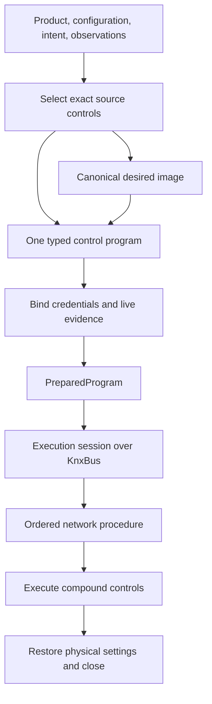
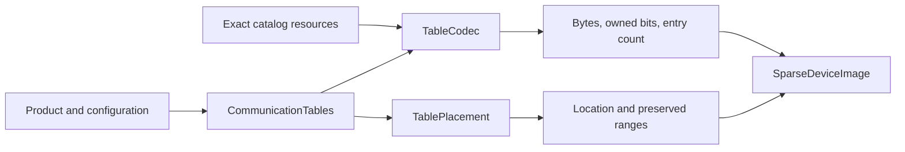

# Master-Data-Driven Commissioning Engine

The commissioning engine turns versioned KNX Master Data, product data, and
project configuration into one exact, inspectable plan for one physical
device. Its catalog covers the project-20 through project-23 Master Data,
including entries which require product data or an extension and entries
which are not programmable. Project authoring and executable target media are
limited to classic TP, RF, and IP; exact profile and connector capability
checks still apply. Powerline entries remain available for lossless parsing
and catalog audit, but PL project authoring and bus execution are deliberately
excluded. KNX IoT profiles are also outside the scope.

The central safety rule is simple: profile selection and compilation must
finish before any device mutation starts. A missing variant, unknown token,
unsupported resource flavour, unavailable extension, or inadequate APDU
limit is therefore a preparation error, not an invitation to try a similar
procedure on the bus.

This document describes the engine internals. See
[`DEVICE_PROGRAMMING.md`](DEVICE_PROGRAMMING.md) for project files,
credentials, and operator workflows, and [`ETS_FILES.md`](ETS_FILES.md) for
the XML and archive layers.

See [CLIENT.md](../CLIENT.md) for crate boundaries, concrete owners and public
API examples. The separate [compatibility lab](ETS_COMPATIBILITY_MISSION.md)
compares compiler output through those APIs.

## Compile, preview, prepare, execute

Offline callers use `input.compile(&selection)` for immutable controls and
`input.preview(&selection)` for the desired image. Live callers construct
`Commissioner::new(&bus)`, prepare one request, inspect the returned
`PreparedProgram`, and consume it with `execute`. Only preparation can
construct that execution gate.

```rust
let input = ProgrammingInput::new(
    device,
    CommissioningIntent::Download(DownloadMode::Full),
    options,
).facts(observed_facts);
let image = input.preview(&selection)?;
let program = input.compile(&selection)?;
```



The selected controls retain their authored paths and error handlers. Static
choices and product merges are resolved once. A segment declaration and all
its implicit transfers form one compound control: ignoring a failure skips
the remainder of that control. Cancellation and mandatory restoration cannot
be suppressed by its handler.

`compiler/mod.rs` coordinates exact source selection, image producers,
and binding of the same typed operands. Relative addresses retain a pointer
read at execution because allocation or restart can change the base. A wide
plain pointer selects Classic or Extended Memory from its observed address and
transfer extent; pointer width alone does not prove Extended Memory support.
Secure memory retains its required service. Preflight uses the same service
definitions and includes the larger reachable header, so its result is
explicitly conservative rather than a claimed exact minimum.

An Automatic preview can return pending observations with no image bytes.
Once its required facts are available, it builds the complete desired image
before section selection. Scoped unload previews use only their selected
controls' image demand. Public previews discard private secret payloads.
`ProgramImage::projected_regions` exposes the same result in display order,
including reserved bytes and ownership masks; `table_spans` and `requirements`
retain placement and pending observations. Frontends borrow these views without
reconstructing another preview representation. See [CLIENT.md](../CLIENT.md)
for the concrete compiler, catalog, session and project owners.

## Fixed family and feature behavior

Exact Master Data mask, variant, management style and resource realizations
select supported BCU1, BCU2, System 7, property-based and System B behavior.
The resolver retains the exact source document and binds resources when a
selected control uses them. A similar mask number is never a fallback.

Data Secure, IP and topology configuration are methods on `ProgramCompiler`,
called explicitly in that order. They emit into the canonical image and program at three source
boundaries: before the first loading operation, after the last load completion,
and before the final session closes. Router-specific placement remains
explicit. A missing required boundary is a compilation error.

`error.rs` contains the diagnostic definitions. `CompileError` carries an
actionable kind, message and optional source path across preparation. Runtime
errors additionally retain transport/device causes, mutation status,
credential transitions, a learned address and mandatory cleanup failures.

## Authoritative inputs

No single input contains a complete download. The engine combines five kinds
of facts without allowing one to masquerade as another.

| Input | Authority in the engine |
| --- | --- |
| Versioned Master Data | Mask identities and variants, profile features, resource realizations, memory regions, access paths, management styles, and ordered load procedures |
| Immutable project-local `.knxprod` and selected catalogue leaf | Requested mask, authoritative Hardware/ApplicationProgram relation, programming options, code and data segments, fixups, parameters, communication objects, table capacities, application identity, and product-owned or merged procedure fragments |
| Project configuration | Desired individual address, parameter values, object flags and links, group addresses, topology-scoped RF/KNX/IP values, security policy, and operation intent |
| Live read-only discovery | The actual DD0, optional management descriptor, current management realization, serial number, APDU capability, Association Table property-description PDT, and current Security IO mode when required; resident stamps only when offline differential evidence admits verification |
| KNX specifications | The meaning and legal wire behavior of resources, load controls, management procedures, profiles, and reset operations |

Master Data is the source language for programming, not a hint from which the
client reconstructs a procedure. The specifications define what its controls
and resources mean. Product data supplies the manufacturer-owned parts, while
live discovery selects and validates a physical target. None of these roles is
replaced with a mask-family heuristic.

Every catalog and deployment record carries the Master Data fingerprint. A
plan compiled from one Master Data revision cannot silently execute against a
profile resolved from another revision.

## Lossless XML boundary

The XML model preserves programming-relevant syntax until semantic resolution.
In particular, it retains:

- the full mask XML ID, numeric DD0, optional 10-byte
  `MgmtDescriptor01`, and both medium references;
- every programming configuration, including `LegacyVersion` and
  `Ets3SystemPlugin`;
- resource optionality, access rights, flavours, lengths, and independent
  online and image locations;
- memory segments and checked `u32` addresses;
- interface-object index and type identities, property metadata, and source
  order;
- absent, zero, and positive object occurrences as distinct values;
- application programming options, segment masks, byte order, fixups, and
  product procedure fragments; and
- the project-20 through project-23 load-control union, including nested
  choices, applicability, caching, comparisons, control state, `OnError`, and
  merge points.

Optional XML values are not replaced by XSD defaults while parsing. Absence
can affect selection, so an omitted occurrence, `Occurrence="0"`, and
`Occurrence="1"` remain three different inputs.

Symbolic attribute values are retained long enough to produce a diagnostic
with the mask, variant, procedure, and control path. A symbolic token which an
executable profile consumes must resolve to a known typed value. An unknown
load-control element is stricter still: the load-control vocabulary is closed,
so it is a parse error rather than an ignored extension.

This split lets a newer Master Data file remain inspectable while preventing
new semantics from being executed accidentally.

`ProgrammingCatalog::from_xml` and `from_file` are therefore parsing and
diagnostic boundaries, not authority to mutate a device. Before target
acquisition performs any bus I/O, `Commissioner::prepare` requires the Master
Data namespace to identify a supported project-10 through project-23 catalog.
Selection validates the exact mask and variant; resource and control validation
follows the selected program. An unused declaration does not introduce a new
service dependency. Raw public constructors cannot bypass the namespace check
at the live commissioning boundary.

A product compiles against its installation's catalog, never directly
against the Master Data its package was built with.
`ProgrammingCatalogLoadRequest::Product(&product)` is an alias for the shared
ETS-files `master_data::MasterDataLoadRequest`, whose
`MasterDataInstallation` applies the selection rule: start from the
installation's own catalog and adopt a package document only when it is a
strictly newer table of the same project schema. Source selection, parsing,
namespace identity and installation selection live there; the client applies
its supported-generation policy and computes catalog provenance/fingerprints.
A catalog already bound to a product retains its existing `Arc`.

By default the installation's own catalog is the newest generation. A cache
miss downloads `https://update.knx.org/data/XML/project-{version}/knx_master.xml`
and stores it as `knx_master_v{version}.xml` in the existing platform cache
(on Linux, `~/.cache/knxprod/`). A failed fetch never selects another generation.
`InstalledProduct { product, installation }` uses an explicit installation file
instead.

Callers can bypass installation selection with `Version(version)`,
`File(path)`, or supplied `Xml(xml)`. These are explicit alternatives, with no
hidden current-version, environment, or archive precedence. An explicit
document identifies its own schema; a versioned resolver must return the
requested schema. Each artifact records the exact source and fingerprint.

Project batches use `ProjectProgrammingCatalogs` to offer every participating
product's package document to one installation catalog. Preparation binds the
selected catalog to each device, and execution reuses it without selecting or
loading another catalog. `ProjectPlanner::with_catalogs` applies the same
selection to status, previews, and project planning; the frontends propagate
their explicit installation file to those paths as well as live preparation.
Switching the selected product in the TUI also replaces its preview catalog.

Product provenance also retains the XML grammar and defaults of each package.
An explicit catalog override does not rewrite that provenance, and a
namespace-free or otherwise unprovable package document still cannot become
authoritative through a project-side schema assertion. `CreatedBy`,
`ToolVersion`, mask identity, and supplied Master Data are not substitutes
for product-schema evidence.

Selection is by package and identity, not by schema number. A project stores
the SHA-256 identity of the exact imported `.knxprod` plus one
`CatalogItem/@Id`. That leaf resolves through the package's untouched
`Catalog.xml`, `Hardware.xml`, `Hardware2Program`, and ordered application
references. The selected primary application then names its mask and
programming options; live DD0, the optional management descriptor, and legacy
selectors choose the exact Master Data variant. A missing, ambiguous, or
changed relation fails closed. This is also why comparing product and Master
Data schema numbers was wrong: those numbers version independent serialized
documents, whereas package relations, application identity, and mask identity
define the programming relationship.

The project catalogue is a virtual read-only index over immutable packages.
It may coalesce identical presentation branches, but every leaf retains its
package digest and exact relation. It never materializes a merged
`Catalog.xml`, rewrites a package member, or re-signs imported content. The
package store retains Product and Hardware2Program registration statuses; its
effective registration is the weaker of the two declarations. Explicit import
checks present directory and registration signing chains and emits non-fatal
notices for mismatches. Signer and verification results are not catalogue
metadata or instantiation gates.

## Catalog audit and exact profile resolution

The catalog audit accounts for every mask configuration. Each entry is
classified as one of:

- executable by the built-in compiler;
- dependent on a product-owned procedure;
- dependent on a named typed extension;
- selector-only;
- non-programmable;
- excluded because it is a Powerline profile; or
- excluded because it is a KNX IoT profile.

There is no unclassified or silently omitted state.

Consequently, `ManagementModel="None"` is non-programmable rather than a cue
to borrow another model. A selector entry cannot execute, a missing generic
load procedure requires the concrete product procedure, and an
`Ets3SystemPlugin` declaration becomes a named extension requirement. None of
these cases falls through to a best-effort download.

Resolution then proceeds from the most concrete identity to the selected
resources and procedure:

1. Read DD0 from the target.
2. If more than one real profile shares that DD0, read Device Object PID 72
   and match its complete 10-byte management descriptor. DD0 alone never
   selects the first match.
3. Check the product mask against the exact device mask and its published
   downward-compatible masks.
4. Select one programming configuration using the precedence below. XML order
   is never a version selector.
5. Resolve the replacement product's target realization from the selected
   application's load-procedure style. This matches HawkNET image generation:
   a complete replacement does not depend on the old application's live
   user-save pointer.
6. Only when the compiled operation reuses installed application state, resolve
   its current management realization. For BCU2, the resource with flavour
   `ManagementStyle_Bcu2` locates that live probe; no fixed address is embedded
   in the client. Read this profile-selection fact before legacy
   `A_Authorize`, matching ETS/HawkNET; converted BCU1 applications on MV-0020
   need not keep the memory resource readable after authorization. Partial
   programming and unload bind the observed style, while semantic full
   replacement deliberately skips the probe.
7. Select remote-management resources and procedures by the exact variant,
   management style, procedure operation, and subtype.

Master Data's `remote`, `local1`, and `local2` qualifiers are private catalog
metadata. The audit validates all published alternatives, while programming
profiles contain only the selected remote resources and procedures. There is
no access-path field on programming requests, profiles, or compiled programs.
The caller supplies a `KnxBus` backed by USB or a tunnel at preparation and
execution. Actual programming of the interface itself remains unsupported.

Variant selection is deliberately mechanical:

1. An explicit `LegacyVersion` hint has highest priority, even when the mask
   publishes only one configuration.
2. Without a hint, a mask with exactly one configuration selects that
   configuration.
3. Multiple configurations require product data. For `0912` and `091A`, the
   product option `LineCoupler0912NewProgrammingStyle` selects
   `LegacyVersion="0"` when true and `LegacyVersion="1"` when false. This
   boolean defaults to false when omitted. The mapping is the same for both
   masks even though their XML order is reversed.
4. For every other multi-configuration mask, a merged product procedure
   selects legacy version 0, a product-owned procedure selects legacy version
   1, and the default procedure style requires an explicit hint.

An omitted XML `LegacyVersion` participates as version 0. The selected version
must identify exactly one configuration; a missing or duplicate match is an
error. This ordering prevents a product option, load-procedure style, or XML
position from silently overriding an operator's explicit choice.

`ManagementModel` is one capability input. It does not by itself choose a
table codec, a load procedure, or a wire service. Those decisions come from
the selected resources, their flavours and locations, the product procedure
style, and the requested operation.

Resource names are not assumed globally unique. A resolved `ResourceId`
includes enough selection context to distinguish realizations. Pointer
resources resolve through those IDs, and table codecs are selected from the
exact resource flavour. There is no generic “unknown table” format.

Fixups follow the product references. The compiler resolves only referenced
mask-entry suffixes against the exact device mask; a missing referenced entry
is an error. This is what permits, for example, a compatible device mask to
host an older application while patching the application's entry points to
the actual device operating system.

### Unprogrammable products

`commissioning::programmability` is the one list of reasons a product's
download is refused before image work. `unprogrammable(product, mask, intent)`
returns the first `Unprogrammable` reason; compilation returns it as
`CompileErrorKind::Unprogrammable`. Each reason has a stable `id()`;
`is_dependency()` marks missing software and `is_reference_defect()` product
data on which the reference fails. `mask_unprogrammable(mask)` settles the
mask-level reasons (`no_download_target`, `system_plugin`) without a product.
Address assignment and unloads are never refused.

| Id | Refused when |
|---|---|
| `no_download_target` | the authored mask declares `ManagementModel="None"` |
| `manufacturer_plugin` | `Extension` names a download plug-in, UI plug-in or data handler |
| `external_software` | `Extension/@RequiresExternalSoftware="true"` |
| `system_plugin` | every Master Data variant of the authored mask names `Ets3SystemPlugin` |
| `procedure_starts_with_disconnect` | a `ProductProcedure` opens with `LdCtrlDisconnect` |
| `missing_association_table` | a BimM112 mask, no association table segment, and the download writes group communication |

The last two are complete product data on which the reference fails rather
than downloading; witnesses are named on each variant. Add new reasons here
rather than refusing products elsewhere.

## Sparse image compilation

`SparseDeviceImage` is a sparse set of typed locations. It can hold standard
and user memory, system and application properties, indexed and
object-type-relative memory, pointer targets, and line-coupler memory. Every
address calculation is checked in `u32`; older 16-bit masks are a subset, not
the type system's upper bound.

Each image segment has equally sized data and mask buffers. A mask is applied
bit by bit, so values such as `0x0f` and `0x80` are meaningful; masks are not
restricted to `0x00` and `0xff`. Patches are applied in the compiler's fixed
phase order: a later patch replaces only the bits it owns, while neighboring
bits retain their earlier value.

The image compiler runs ordered phases:

1. compatibility and extension availability;
2. product code and data segments;
3. referenced mask fixups;
4. memory and property parameters with the declared byte order;
5. group-address, association, and communication-object tables;
6. application identity and PEI data;
7. Data Secure configuration;
8. medium, IP, RF, and router contributions;
9. typed extension contributions; and
10. final resource, range, and capacity validation.

A phase remains explicit even when the selected profile contributes no data.
If a profile requires behavior which the built-in compiler does not provide,
it must name an available extension or fail during preparation.

All extension image patches are applied in the single `Extensions` phase,
after the built-in medium and router contributions and before final
validation. An extension cannot select an earlier phase or interleave its
patches with built-in compilation.

Table construction has one image-facing contract:
`TableCodec::encode` returns data, an equally sized ownership mask, and the
entry count after normalization. `CommunicationTables` owns the sorted group
addresses and uses this result for capacity checks, section ownership and
recorded extents. It does not inspect wire headers or select mask functions.



The closed codec enum dispatches to address, association and object formats.
Their constructors interpret resource flavours once. Association codecs own
row ordering and count/identifier widths. Object codecs own numbering and
firmware-bit policy; native formats use the shared protocol table views for
pointer geometry. A lazy seed reader supplies the image after fixups and
parameters only when the selected codec needs existing descriptors.
The same object codec supplies the ASAP origin for Data Secure flags.

Allocation is a separate policy because it relates several tables.
`TablePlacement` retains authored locations or prepares BCU1's shared
address/association pool. It releases unused seed ownership before parameter
compilation, then supplies the relocated pointer, table offset, capacity
policy and preserved IA range. Those rules stay outside the common writer.

Executable BCU1 TP, BCU2, System 7, and System B layouts are represented by
their published flavour rather than inferred from `ManagementModel`.
PL-specific flavours such as `AddressTable_Bcu1PL` are retained for catalog
fidelity, but cannot cross the executable-profile boundary.

One converted-program BCU2 record has deliberately non-wire semantics. In a
full product-owned BCU2 procedure, a plain `LdCtrlTaskSegment` with
`LsmIdx="5"` is the legacy communication-object-table address announcement
removed by ETS before execution; MV-0020/0021/0025 expose no fifth indexed load
machine. The procedure compiler omits only that exact record and retains the
original paths of surrounding controls. A load, task-pointer, decorated task
record, or non-BCU2 use of index 5 remains executable input and therefore fails
preflight when the selected profile cannot resolve its endpoint.

`LdCtrlWriteProp/@InlineData` is likewise a tool-side buffer rather than an
untyped wire payload. The exact selected interface-object target and PID
resolve an authoritative `element_size` from Master Data when it is available.
The compiler checks the wire payload against `Count × element_size`.
A compiled product/property image replaces
`InlineData` when present. Otherwise an inline buffer shorter than the wire
payload is invalid, an exact buffer is unchanged, and a longer buffer is
prefix-truncated. The discarded write suffix need not contain zeroes because
it is not part of the property value.

`LdCtrlCompareProp` deliberately has different rules. Its read extent is
`Count × read_element_size`, resolved from the same exact object-and-PID
metadata. A longer expected buffer is accepted only when every octet beyond
that read extent is zero padding; a short buffer or nonzero suffix fails
preflight. This retains explicitly padded comparison fields without silently
discarding meaningful expected bytes. It is intentionally stricter than the
reference client, which was observed comparing only the returned prefix and
therefore ignoring any excess expected bytes, including a nonzero suffix. An
unsupported variable-width PDT fails preflight.

When nothing types an indexed property (neither the profile, Master Data, a
declaration nor an observation) and the image holds none of it, its width is
a fact of the target alone. The reference reads the property description when
the control executes and sizes the transfer as `Count` times the reported
PDT's width. An inline write then sends that prefix of `InlineData`, and an
unmasked comparison compares that prefix of its reference. Shorter authored
data makes the reference skip the control without a transfer or an error.
The compiler emits such a control as `DescribedProperty`, carrying the
authored bytes and Master Data's width of every fixed-size PDT. The executor
reads the description once per object index and PID, until the session closes
or `LdCtrlClearCachedObjectTypes` clears it. A negative description response
fails the control as an unavailable resource. A PDT without a fixed width
fails it as well. Type-addressed, masked and ranged controls on such properties
still use the authored width until their native handling is established.

An untyped indexed property can also store product parameters. The reference
then lays out one image segment from the property's start to the last byte of
its stored parameters, without rounding to an element width, and a write from
the first element sends that segment clipped to `Count` times the described
width: the segment's owned bytes replace any `InlineData`. The compiler emits
this write as `DescribedProperty` with a `WriteImage` action whose segment
length is read from the final image. A segment with unowned bytes would need a
masked write and is refused. The segment never grows past the parameters, so a
short segment writes fewer bytes than `Count` elements while the element count
stays the authored one.

The same write to a type-addressed object follows the reference's lookup by
object type: a description already read by type is reused; when the product
admits extended property services (a secure-enabled application or the
`SupportsExtendedPropertyServices` application option) and the connection
carries more than 15 octets, `A_PropertyExtDescription_Read` describes it by
type and instance and is kept by type; otherwise the object is located by its
`PID_OBJECT_TYPE` and described by index. RF multi end devices, whose extra
profile the reference selects by mask identifier, are not modelled.

Per-mask interface-object declarations can be sparse. Exact-profile
resolution therefore enriches them from global property and PDT metadata, but
only for the exact object-and-PID targets referenced by the selected variant's
resources and procedures or by the selected product's procedures and property
bindings. Nested procedure choices are traversed as well. The catalog does
not copy every globally known optional property into the profile, because
doing so would incorrectly advertise unsupported device capabilities.

Where neither the profile nor global Master Data types a property, the
selected load procedure's first applicable `LdCtrlDeclarePropDesc` for its
address supplies the element width. Selection follows the procedure as one
download composes it: choices, `AppliesTo` and merged product fragments, in
procedure order, including declarations after the write they describe. An
index declaration matches its object index; a type declaration matches every
occurrence of the type. The declaration defines the property on the target
before it is used, so it takes precedence over a description observed before
the download. When global or standard metadata already types the property,
a declaration with another width is refused: the reference consults only the
mask's interface-object roster before declarations, and the two orders would
otherwise disagree. Automatic preview selects no procedure and therefore does
not apply declarations.

Line-coupler filters and RF configuration additionally depend on
installation-wide topology which is not present in an application program.
The project model carries those values at their actual scope: an RF domain
belongs to the authored line, `rf_mode` belongs to each RF device, and
`routing` belongs to an address-zero line or backbone coupler. Cross-boundary
group membership derives the filter bitmap. The compiler resolves
`GroupFilterTable`, `DomainAddress`, and `RfDeviceMode` through the exact
profile. It emits image bytes only where Master Data provides an image
location. Online-only values remain explicit plan data for the network layer;
they are not turned into an ordinary connected property write. A missing
value, unsupported width, or unrepresentable group address fails preparation
rather than producing an empty table or zero domain.

## Topology and network configuration

Network identity is not part of the application load procedure. The
commissioner therefore keeps target acquisition and domain/individual-address
configuration outside the load-control interpreter, while still using the
same low-level management implementation as the interpreter.

| Responsibility | Production boundary |
| --- | --- |
| Select the target, order network and application phases, apply retry policy, bind credentials, and report mutation state | `Commissioner` |
| Perform system-broadcast, programming-mode, and serial-number network-management procedures | `NetworkManagement` |
| Own one point-to-point transport session, authorization, secure synchronization, and ordinary device-management calls | `DeviceConnection` |
| Read deferred pointers, apply write policies, select changed transfer ranges, and execute bound services through `DeviceConnection` | `ExecutionSession` |

`Commissioner` does not re-encode an APDU which one of these lower layers
already owns. Conversely, the lower layers do not decide whether a project
needs a domain change, an address change, or an application download. This
keeps the standardized wire procedures reusable without letting a diagnostic
call become an alternative project-programming path.

### Classic KNX/IP Tool configuration

The built-in classic KNX/IP overlay applies to exactly `MV-5705` (`5705h`)
and `MV-57B0` (`57B0h`), and only when the resolved profile names KNX/IP
medium `MT-5`. It configures IP Parameter Object type 11, occurrence zero.
It is not selected for another `57xx` mask by family resemblance.

`ApplicationProgram/@IPConfig` owns the boundary between standard and
manufacturer-specific IP configuration:

- `Tool` (also the XSD default when the attribute is absent) requires the
  complete standard device-level IP intent. The compiler contributes the
  standard Object Type 11 image and operations described below.
- `Custom` forbids that standard device-level intent. Manufacturer parameters
  and product code own the IP settings, and the standard overlay contributes
  nothing. Line topology is still authored so the installation has an IP
  routing domain and project/installation identity.
- an unknown token, Tool intent on a non-IP profile, or a classic IP profile
  without `MT-5` fails before mutation.

The standard contribution is inserted in `BeforeSessionClose`, after the
product's ordinary application procedure but before its final management
session closes. Basic values are emitted in this exact order:

| Order | OT11 property | Project/product rule |
| ---: | --- | --- |
| 1 | PID 64 `MAC_ADDRESS` | Read six octets into private working-image scratch. It is live identity, not desired state, so it is absent from the public sparse image and its fingerprint. |
| 2 | PID 51 `PROJECT_INSTALLATION_ID` | One big-endian `u16`: `(project << 4) | installation`, with project `0..4095` and installation `0..15`. |
| 3 | PID 53 `ADDITIONAL_INDIVIDUAL_ADDRESSES` | Written only when `AdditionalAddressesCount` is nonzero. The property always contains the complete product capacity; configured IAs occupy the prefix and every unused two-octet element is `FFFFh`. Too many entries, duplicate entries, the primary IA, or an IA on another area/line fail compilation. |
| 4 | PID 55 `IP_ASSIGNMENT_METHOD` | `04h` for automatic DHCP or `01h` for fixed configuration. |
| 5 | PIDs 60, 61, 62 | Fixed IP address, subnet mask, and default gateway, in that order. They are omitted for DHCP. |
| 6 | PID 66 `ROUTING_MULTICAST_ADDRESS` | The four-octet IPv4 multicast address authored as the IP line's `domain`; a first octet outside `224..239` is rejected. |
| 7 | PID 67 `TTL` | One nonzero octet. |
| 8 | PID 76 `FRIENDLY_NAME` | Trim leading/trailing whitespace, encode ISO-8859-1, keep at most 30 octets, then NUL-pad to exactly 30 property elements. The project parser rejects non-Latin-1 input and names longer than 30 characters, so authored projects are never silently truncated. |

All desired basic values use typed property-image writes with read-back
verification. PID 64 is the exception: it is a read and cache operation only.
An additional-address capacity of zero means that PID 53 is not touched; it
does not mean that the compiler may invent a capacity from the project.

For an IP Secure product (`IsSecureEnabled="true"`), the public project must
state `plain` or `secure` independently for routing, device management, and
tunnelling. Even an all-plain choice is explicit. These operations are
`secure_only`: configuring or disabling an IP Secure service family never
falls back to plaintext device management. Within the same late phase the
order is exactly:

1. **Routing:** when secure, write secret PID 91 `BACKBONE_KEY`, then PID 95
   `MULTICAST_LATENCY_TOLERANCE` and PID 96 `SYNC_LATENCY_FRACTION`; invoke
   PID 94 `SECURED_SERVICE_FAMILIES` for family 5 with version 1 (secure) or 0
   (plain).
2. **Device management:** when secure, write secret PID 92
   `DEVICE_AUTHENTICATION_CODE`, write the two-octet PID 93 element count at
   element 0, then write the dense user `1..N` hash array at element 1; invoke
   PID 94 for family 3.
3. **Tunnelling:** when secure and device-management did not already install
   them, install PID 92/PID 93 once; write the two-octet PID 97 element count
   at element 0 and the `[user_id, address_index]` rows at element 1; invoke
   PID 94 for family 4.

For a plain service-family selection, the function-property operation may
legitimately return legacy code `02h`. Device management normalizes that to
`C0042B25h`; the overlay maps only that exact error to success around the one
PID 94 invocation and restores the mapping immediately afterward. It does not
globally ignore function-property failures.

The product's `<BusInterfaces>` declaration and capacity options constrain
the secure intent. Secure routing needs a `Routing` interface. Every secure
tunnelling binding must select an `AddressIndex` declared by a `Tunneling`
interface and map one unique dense password user to one unique address index.
Index 0 selects the primary IA; index `1..N` selects that configured
additional-IA slot, so an index greater than the number of additional
addresses is unassigned. `MaxUserEntries`,
`MaxTunnelingUserEntries`, and `AdditionalAddressesCount` are hard capacities.
Secure device management or tunnelling requires user 1, a complete dense
`1..N` password table, and a Device Authentication Code. Secure tunnelling
requires at least one binding. Missing capability data is an error, not a
reason to infer slots from a mask.

Public topology contains only service policy, timing, users, and bindings.
The 16-byte backbone key, pre-derived Device Authentication Code, and
pre-derived password hashes remain private commissioning material. ETS
keyring plaintext is converted with PBKDF2-HMAC-SHA256, 65,536 iterations and
a 16-byte output:

| Value | Exact salt |
| --- | --- |
| PID 92 Device Authentication Code | `device-authentication-code.1.secure.ip.knx.org` |
| PID 93 user password hash | `user-password.1.secure.ip.knx.org` |

Equal project-store and keyring values merge; conflicting values fail during
key resolution. PID 91 uses the keyring's binary backbone key directly.
Secret bytes are held in zeroizing private payload entries and the public plan
contains only `SecretPayloadReference` values. After each secret property
write succeeds, execution records the corresponding non-secret
`CredentialTransition` (`IpBackboneKey`, `IpDeviceAuthenticationCode`, or
`IpPasswordHash { user_id }`). Successful reports and partial-failure errors
therefore identify exactly which credential changes were confirmed without
revealing their bytes. A sent write whose result is unknown is reflected by
the mutation status, not falsely promoted to a confirmed transition.

This overlay commissions a device's stored KNX/IP and IP Secure policy through
the existing `ExecutionSession`/`DeviceConnection` path. It does not make
the client connector itself IP Secure. Secure KNXnet/IP session handshakes,
`SecureWrapper`, and secure routing remain separate link-layer connector work;
using a plain KNXnet/IP tunnelling connector to reach a KNX bus does not turn
that tunnel into an IP Secure session.

### Remote RF domain and IA commissioning

The remote RF domain/IA path is executable only under an explicit caller
contract. `CommissionerOptions::caller_manages_open_medium_path` defaults to
false. A caller may set it to true only after arranging for the selected bus
access to carry KNX system broadcasts to the target RF domain and to use the
required RF receive/transmit mode. That path must be in place whenever
preparation or execution is running and must be restored after each call on
every success, failure, or cancellation exit.

The commissioner cannot infer this guarantee from a KNXnet/IP tunnelling
connection and does not configure an intervening router or local RF interface
itself. With the option left false, an RF domain assignment fails during
preparation. With the contract satisfied, the mutation order is:

1. The caller prepares the access path, including temporary system-broadcast
   routing or RF reception mode needed to reach the target.
2. Acquire exactly one target and retain its current domain address,
   individual address, and serial number where available.
3. Program the target domain address.
4. Program the target individual address.
5. Finish the selected network procedure, including its required restart when
   applicable, and reacquire and verify the target at its resulting network
   identity.
6. Only then execute the application procedure.

The caller restores temporary path state after the commissioner returns. This
contract covers domain and IA traffic only; it does not make the currently
unsupported PID 51 mode transition described below executable.

Domain configuration precedes individual-address assignment because the
standard IA procedures require routers and domain addresses to be configured
first where applicable (03/05/02 §§2.3 and 2.5). The combined
programming-mode procedure makes the order explicit: domain write, IA write,
DD0 verification, and restart (03/05/02 §2.9). A serial-number IA write does
not itself reset the device (03/05/02 §2.5), so step 5 means “perform the
restart required by the selected procedure”, not “invent an unconditional
restart”. In every case the application phase starts only after the new
network identity is reachable.

The programming-button flows preserve response cardinality:

- A standalone `NM_DomainAddress_Read` collects the complete three-second
  response window (03/05/02 §2.7). The combined procedure's polling loop uses
  its stated one-second window (03/05/02 §2.9). Neither flow stops after the
  first response or removes responses which happen to carry the same address.
- Zero responses mean that no device is in programming mode and may be polled
  again according to the caller's timeout policy. Exactly one response selects
  the device. More than one response is an ambiguity error, including two
  responses with identical domain and individual addresses.
- `NM_DomainAndIndividualAddress_Write` first checks whether the desired IA is
  occupied, writes the domain only when it differs, writes the IA only when it
  differs, verifies DD0 at the new IA, restarts the device, and aborts the
  client-side transport session (03/05/02 §2.9).
- The connectionless variant always writes the selected domain, conditionally
  writes the IA, and verifies DD0 connectionlessly (03/05/02 §2.10). Its
  normative sequence and document revision note include `A_Restart`; those
  take precedence over the contradictory introductory sentence which says no
  restart is needed.

For a known six-octet serial number, the commissioner composes the domain and
IA procedures without using programming mode. A serial identity is still
treated as singular: no response is “not found”, and multiple responses are a
duplicate-identity error rather than permission to mutate several devices.
For the domain part, 03/05/02 §2.12 requires the following:

1. Enable IP System Broadcast Routing Mode on an intervening KNXnet/IP router.
2. Send `A_DomainAddressSerialNumber_Write` as a system broadcast.
3. Count the timeout from local send confirmation, wait one second, and
   repeatedly issue `A_IndividualAddressSerialNumber_Read` until the selected
   device answers or the procedure times out.
4. Restore the router mode on every exit path.

That verification proves that the serial-selected device remains reachable;
it does not echo or prove the new domain bytes. A subsequent
`A_DomainAddressSerialNumber_Read` may be offered as a stronger diagnostic
only when the management path can already reach the new domain. After the
specified retry from the domain write, the complete procedure must not repeat
again without operator confirmation (03/05/02 §2.12).

The protected form never falls back to plaintext. If the current device
sending sequence is unknown, it first performs `DM_SecureSync_SBC`, then
sends the same domain write as authenticated and confidential `S-A_Data` with
`SCF.SBC = 1`, using the current Tool Key or the ex-factory FDSK. A new secure
IP routing domain additionally requires the maximum timer-synchronization
wait before the ordinary one-second verification delay (03/05/02 §2.13).

### Local interface and path state

The local bus interface is a separate commissioning target. Its domain and IA
must be updated in the provider's typed interface configuration—domain first,
IA second—and persisted together, not written with remote system-broadcast
APDUs. This follows the local property-access boundary described for
`PID_DOMAIN_ADDRESS` in 03/05/01 §4.3.21 and local cEMI management in
03/05/02 §3.2.5. The current commissioner exposes only remote programming.
Local-interface configuration needs a connector that exposes the typed
configuration API.

Temporary path state is also separate. A caller may select RF Ready or RF
Multi receive mode on the local interface or an intervening media coupler to
make the target reachable; that does not program the target's RF type.
Likewise, selecting local system-broadcast transmission is a routing choice,
not an instruction to replace the local interface's domain. Caller cleanup
restores this path state without silently switching the interface domain
around every remote load.

An authored RF domain may be neither `000000000000h` nor the ex-factory/void
`FFFFFFFFFFFFh` (03/05/01 §§3.2.3 and 3.2.4).

### RF device type

`RfDeviceMode` resolves to RF Medium Object PID 51,
`PID_RF_MULTI_TYPE`. Project-20 and project-23 Master Data expose the
one-octet, online-only resource on `MV-2705` and `MV-27B0`; it is not part of
the sparse application image. The value is per physical device, not per RF
line:

| Project value | PID 51 value |
| --- | ---: |
| RF Ready | `0x00` |
| RF Multi | `0x01` |

Bits 1 through 7 remain zero. A Ready-only device defaults to `0x00`; an RF
Multi device defaults to `0x01`. PID 51 has no third “factory” value, so
reading either valid value does not prove that the device is ex-factory.

The legal transition has three constraints:

1. The management client may modify PID 51 only while the management server
   is ex-factory. Changing it after links exist can mix Ready and Multi link
   representations (03/05/01 §4.15.3).
2. A changed value takes effect before the device sends the write
   confirmation. The management client must therefore not write it inside a
   transport-layer connection. AN186 §2.3.1.1 requires point-to-point
   connectionless communication, with the response already arriving in the
   new RF mode.
3. A device which cannot support the requested type leaves the property
   unchanged and reports its current type. Confirmation alone is therefore
   not enough; the client must verify the resulting value.

An implementation capable of this transition must first establish the current
RF mode, skip the write when it already equals the configured value, and prove
ex-factory state before a real change. The proof must be bound to this target
and show that the complete device, not merely its network address, entered the
default state. A successfully completed channel-0 factory reset in the same
workflow (erase code `02h` or `07h`) is direct proof once the reset response,
restart completion, and exact target reacquisition have succeeded. The
commissioner should carry that fact as execution-scoped evidence, not accept a
caller-supplied Boolean. A later workflow may reuse a persisted complete-unload
record only when target identity and matching live device-resident reset or
download evidence are both revalidated; the project record alone is not
proof. For a secure device, successful access with its FDSK instead of its
installed Tool Key corroborates the reset because the FDSK becomes active
again on these reset forms (03/05/01 §§6.1.4 and 6.3.10.4; 03/05/02
§3.7.1.2.3).

`NM_Read_SerialNumber_By_ExFactoryState` is useful for identity and
reachability, but its normative predicate is only factory-default IA and
factory-default domain. A unique expected-serial response therefore does not
by itself prove that application links are absent and cannot authorize a PID
51 change (03/05/02 §2.20.1.5). Erase code `07h` illustrates the converse: it
does establish ex-factory state while deliberately retaining IA and domain.
Programming mode, a missing deployment record, and PID 51's current `0x00` or
`0x01` value are likewise not proof.

AN186 §2.4.2 places the transition in a larger initial-configuration flow. If
the initial mode is not otherwise known, the client sends the programming-mode
`A_SystemNetworkParameter_Read` in both Ready and Fast; the mode of the unique
response identifies the device's current path. It then assigns domain and IA
using that mode, changes PID 51 connectionlessly to Multi as the stable working
mode when necessary, performs security and device configuration, writes the
final per-device PID 51 value and `PID_RF_MULTI_RX_READY`, and restarts. A media
coupler must be placed in the matching system-broadcast or unicast mode around
those steps. Temporary working mode, final device type, and interface/coupler
path mode are therefore three distinct states.

The wire operation is a connectionless `A_PropertyExtValue_WriteCon` to RF
Medium Object type 19, instance 1, PID 51, start index 1, count 1. The access
must switch to the resulting RF mode in time to receive and validate
`A_PropertyExtValue_WriteConRes` with a successful return code, then issue a
connectionless `A_PropertyExtValue_Read` in that mode and require the exact
configured byte.

The ordinary `DeviceConnection` extended-property writer runs inside a TL
connection and is therefore not a substitute.

This complete path is not implemented by the current connectors. The offline
compiler validates the resource and retains the desired `rf_mode` in the
plan, but emits no generic property operation. During live preparation, a
download containing the Configuration section fails closed before mutation
when the selected profile exposes `RfDeviceMode`, because the bus access
cannot yet select and observe Ready/Multi for this connectionless exchange.
The separate RF domain/IA procedure remains available under the explicit
caller-managed path contract; a Configuration download for these profiles
remains unsupported even when the requested PID 51 value might already match.

### Topology coupler derivation and encoding

The project derives a coupler's topology role from its individual address. A
device at `area.line.0` with a nonzero line is a line coupler; a device at
`area.0.0` is a backbone coupler. Every such address-zero device must declare
exactly one `routing filter|route_all|block_all` policy, and an ordinary device
may not declare one.

For `filter`, a net enters the table only when it has at least one member on
each side of that coupler. A line coupler's secondary side is its exact area
and line; a backbone coupler's secondary side is its area. Active project
devices other than the coupler and declared external senders participate;
inactive devices do not. Primary and additional object memberships both count.
The derived address set is included in the medium-configuration fingerprint,
so topology or activity changes mark the coupler stale.

For a Group Address with raw 16-bit value `n`, the filter byte is `n div 8`
and the bit is `n mod 8`. Bits are numbered least-significant first, so a set
bit means the corresponding Group Address passes the filter. This is the
published encoding for the legacy 0910h/0911h table, the 0912h table, and
Coupler Model 2.0 Filter Table Realisation Type 3 (03/05/01 §§5.1,
5.2.1.3, and 5.3.1.1).

The compiler recognizes three exact storage architectures. Legacy profiles
must expose `GroupFilterTable`, `LcConfig`, and `LcGrpConfig`, with both
selector resources using the same `Lc_10` or `Lc_11` flavour. Modern profiles
must expose `GroupFilterTable` plus `Lc_12` `MainLcGrpConfig` and
`SubLcGrpConfig`. `MV-2920` uses the Coupler Model 2.0 realization described
below. Any other resource combination fails closed.

The table contents do not by themselves select Filter, Route All, or Block
All. The exact selector encoding comes from the resolved resource flavour:

| Resource flavour | Owned selector bits | Filter | Route All | Block All |
| --- | ---: | ---: | ---: | ---: |
| `Lc_10` / `Lc_11` `LcGrpConfig` | mask `0x33` | `0x33` | `0x11` | `0x22` |
| `Lc_12` `MainLcGrpConfig` and `SubLcGrpConfig` | mask `0x0F` on each property | `0x0F` | `0x05` | `0x0A` |

For `Lc_10` and `Lc_11`, the 3,584-octet table represents
`0000h..6FFFh`. `LcConfig` bit 4 (mask `0x10`) selects whether the whole
`7000h..FFFFh` range is forwarded; these masks cannot selectively filter that
upper range. For `Lc_12`, bits 0–1 select handling through `6FFFh` and bits
2–3 select handling from `7000h` upward. Encoding the same policy in both
fields produces `0x0F`, `0x05`, or `0x0A`; masking the low nibble preserves
the repetition and reserved fields. These values follow 03/05/01 §5.1
(`LKgrpconf`/`LKdef`) and §4.5.6 (`PID_MAIN_LCGRPCONFIG` and
`PID_SUB_LCGRPCONFIG`).

Coupler Model 2.0 is deliberately different. PID 67
`PID_FILTER_TABLE_USE` says only whether the 8,192-octet table is valid and
shall be evaluated; it does not select the product's routing policy
(03/05/01 §§4.5.13 and 5.3.1). The model explicitly permits
implementation-specific routing parameters and defines no standard algorithm
for deriving the routing condition (06/02/01 §1.4.2). Consequently
`MV-2920` requires the typed `knx.coupler-model-2-routing` product extension
to encode Filter, Route All, or Block All. Treating PID 67, or an all-zero or
all-one filter table, as that selector would guess product behavior.

The hermetic architecture test supplies a synthetic product extension for all
three policies and proves that its owned selector bits compose with the
independently compiled 8,192-octet Router Object table and PID 67 value. This
tests the extension boundary only. The repository ships no concrete MV-2920
product mapping, and the stock CLI/TUI project programmer uses
`()`; an actual MV-2920 product therefore remains a
preflight error until its exact parameter mapping is implemented as that named
extension.

### Powerline support boundary

The project language accepts only `medium tp1`, `medium rf`, and `medium ip`.
It has no PL domain type, and `medium pl` is rejected during parsing. The
commissioner likewise has no executable PL target path.

Master Data still remains lossless at the XML/catalog boundary. The PL
profiles are `MV-1011` (`1011h`), `MV-1012` (`1012h`), `MV-1013` (`1013h`),
`MV-17B0` (`17B0h`), and `MV-1900` (`1900h`). They are retained with their
resources, flavours, variants, and load controls, but are classified
`ExcludedPowerLine`; their procedure syntax is recorded as not applicable
rather than compiled for execution. This is an implementation support
boundary, not a claim that those KNX profiles are intrinsically
non-programmable.

`MV-1310` (`1310h`) is a separate case: Master Data declares
`ManagementModel="None"`, so it is classified `NonProgrammable` before the
medium exclusion. Neither classification may borrow a procedure from a nearby
mask.

## Procedure compilation

Load procedures are ordered tool programs. They are not bus frames and are
not interpreted from XML during execution.

The procedure compiler first selects one exact default, product-owned, or
merged procedure. Product merge fragments are inserted only at matching merge
points. A missing optional merge contribution disappears; an orphan product
fragment is an error.

It then evaluates `choose` branches and `AppliesTo` scopes using resolved
project values, lowers every control to a typed `ProcedureOperation`, and
retains ordered interpreter state such as:

- write and verification policy;
- optimistic comparison state and caches;
- automatic device verification mode;
- byte order and comparison padding;
- error mappings and per-control `OnError` actions; and
- cached object and property descriptors.

The normalized procedure retains the source profile, procedure, contribution
origin, and control path for every step. A control must lower completely or
the entire plan fails before mutation. Execution never skips a control merely
because its token, resource, occurrence, or error cause is unfamiliar.

The typed operation set covers memory and property image operations, relative
memory, load-state machines, segment and task declarations, function
properties, property descriptors, master reset, restart, line-coupler filter
services, tool-state changes, comparisons, delays, progress messages, and
exact error mapping.

A restart or master reset closes the management session. Downloads reopen it
on demand: a device step that finds no open session after an earlier one
connects again with the authored tool state, as the reference's download
sessions do. Product fragments that restart the device before the mask's
final restart rely on this. Validation therefore requires only an earlier
session before a terminating service. Unloads never reconnect, so a device
step after their restart fails without an open connection.

Data Secure has one deliberately narrow resource-less realization. The
standard profile module contributes the Security Interface Object, Object
Type 17 (`0011h`), even when a classic mask's own resource list does not repeat
it. Master Data addresses occurrence zero; AN163 extended-property services
encode that same selector as the one-based wire instance 1. Its load machine
uses PID 5 `LOAD_STATE_CONTROL` for both ten-octet control writes and
one-octet state reads. `ExecutionSession` recognizes only this exact typed
fallback. Any other object-type load target without a resolved resource fails
before execution rather than borrowing the Security IO rule.

Security IO unloads at the boundary before the first ordinary `StartLoading`,
but its replacement load cycle starts only after the last ordinary
`CompleteLoading`. PID 61 refers to the committed Group Object Table, so
completing Security IO first can accept every management write while leaving
a factory download inoperable until the procedure is repeated.

The Security IO phase then has an exact final-state tail. After its own
`CompleteLoading`, the commissioner sends `A_FunctionPropertyExt_Command` to
Object Type 17, wire instance 1, PID 51 `SECURITY_MODE`, with payload
`00 00 01` (`Reserved=0`, write service ID 0, enable), followed by the final
session restart. The command is intentional idempotent enforcement:
unloading/reloading Security IO does not itself erase the installed Tool Key
or disable Security Mode.

This tail is distinct from tool-key bootstrap. The compiled network program
names tool-key rotation and application-security mode changes separately.
Authenticated management may preserve an observed disabled application mode;
mode selection is never inferred from the selected key alone.

## Public plan and private preparation state

The inspectable `CompiledProgram` deliberately contains no secrets. It may
be logged, compared, fingerprinted, or shown in a TUI preview. In particular,
group keys and management credentials never enter its sparse image, debug
output, or fingerprints.

When a normalized operation needs secret bytes, the public plan carries only
an opaque `SecretPayloadReference`. The corresponding zeroizing byte buffer
is private to `PreparedProgram`. Management credentials are retained at
the same private boundary and have redacted debug output.

```rust
let prepared = commissioner.prepare(input, options, &cancellation, on_event).await?;
show_preview(prepared.plan());

let report = commissioner.execute(prepared, &cancellation, on_event).await?;
```

`PreparedProgram` cannot be assembled by a caller from unrelated
parts. It privately binds an immutable plan, the discovered target
fingerprint, the originating process-local `KnxBus` instance, selected
credentials, and secret payloads. The bus identity is absent from the public
plan and from debug output.
Execution on another bus is rejected before credentials are installed or any
bus I/O occurs. Execution on the originating bus consumes the value and
revalidates the device before the first mutation. This closes the gap in which
a device could be swapped after preview or a plan could be paired with
credentials selected for another target.

Offline compilation remains useful for diagnostics and previews. A plan
containing secret references becomes executable only through commissioner
preparation, which supplies their private payloads.

`ProgrammingInput::compile` and `PlannedProjectDevice::compile_preview` use
the same input and stage contracts as live preparation. Input adapters resolve
key material explicitly; the compiler builds private payloads only while
validating their references, then exposes the non-secret program. An offline
program cannot manufacture a `PreparedProgram` or select credentials by
changing a flag.

## Preparation and execution

`Commissioner::prepare()` may communicate with the bus, but its work is
read-only:

1. validate the product's independent schema provenance, a supported canonical
   project-10 through project-23 Master Data catalog, the complete catalog
   audit, the product-package AP2 binding, runtime options, intent,
   credentials, and the configured APDU ceiling;
2. acquire exactly one target using the requested selection method;
3. read DD0 and PID 72 when needed;
4. resolve the product-selected target profile, validate management
   authorization, then read the serial number and target APDU capability.
   Downloads resolve a generic System B association row format from the
   Association Table Object's `PID_TABLE` property-description PDT.
   Parameter-owned properties whose element size neither the profile nor
   global Master Data defines are not read here: their writes read the
   description when they execute, as the reference does. Offline callers may
   still supply such a PDT through `ProfileSelection` to compile a typed
   operand, and deployment records retain it for later recompilation. Read the
   current Security IO mode when group-security selection or management
   bootstrap requires it;
5. compile the complete image and procedure from the exact target profile;
6. if the compiled operation is a semantic partial or unload, open a
   pre-authorization session to read and bind the installed management style;
   semantic full replacement skips that live probe because the selected
   product defines the replacement realization;
7. validate extensions, security requirements, resource ranges, capacities,
   and non-chunkable APDU requirements;
8. for a semantic partial which reuses installed application state, read and
   bind the exact runtime AP1 and, when evidenced, AP2 load-status and identity
   resources; configuration-only partials and semantic full replacement skip
   this gate;
9. evaluate deployment evidence without stamp I/O; only when that evidence can
   produce a verified differential decision, probe the product-relevant stamp
   candidates and bind the required plus actually present optional resources
   and values; and
10. close each AP1/AP2 or stamp-probe session and return a bound
   `PreparedProgram` with no live management session.

Any failure in this phase has mutation status `NotStarted`.

Execute-time target revalidation reads DD0, PID 72 when applicable, and the
bound management-style resource in the same pre-authorization state. Legacy
authorization is applied later by the operation that needs the corresponding
write access; it is not part of observing immutable target-binding facts.

The `DownloadStamp` feature defines the possible stamp resources without a
mask-family fallback. An absent or numeric-zero value defines no candidates. A
nonzero value starts with the runtime-readable `Stamp_SystemB` resources in
resolved profile order, then restricts that set to the compiled product and
image. In particular, `PeiprogStamp` is eligible only when the selected
hardware relation authoritatively binds a second application and the compiler
has compiled that two-program image. A fixed Peiprog object in System B Master
Data is not product evidence. The current single-program compiler rejects an
AP2 binding before I/O, so no successful current plan contains
`PeiprogStamp`. For a nonzero feature, the resolved raw profile must contain at
least one typed `Stamp_SystemB` resource; an empty raw set is a
catalog/preparation error. Restricting a valid raw set to the compiled product
and image may legitimately leave no candidates, for example when an AP1-only
product filters a sole `PeiprogStamp`. That effective empty set performs no
stamp I/O. The one exact derived form is a full procedure which reads PID 27
`PID_MCB_TABLE` and whose matching interface-object metadata proves one fixed
eight-octet element. The catalog turns that explicit procedure target into the
same typed stamp resource; unknown selectors, ranges, widths, or multiple
targets fail resolution.

Flavour 1 is the only supported nonzero value, on every management model. It
requires `FirstAppObjectIdx` and keeps only indexed eight-octet PID 27 records
at objects 3 up to, but excluding, that index. A download publishes the
records its own procedure observed in the final image; it never adds reads
just to record a stamp. System 7 masks declare flavour 1 with
`FirstAppObjectIdx` 5, but their load procedures read no PID 27 record, so
their downloads publish no stamp and later downloads stay undifferenced.

PID 27 is installed-state evidence, not a first-download prerequisite. Its MCB
CRC is calculated on `Loading` to `Loaded` and is valid only in load state
`Loaded`. The commissioner therefore evaluates the non-live evidence before
opening a stamp session. `DifferentialPolicy::Disabled`, a plan without an
application procedure, missing deployment history, and structurally invalid
deployment evidence reach `Undifferenced`, the caller-selected fallback, or a
required-verification error without reading live stamp values. An unloaded or
factory device is consequently not rejected for lacking a usable resident
stamp.

Only deployment evidence which passes those structural checks can cause a
preparation stamp probe. That probe binds each required and actually present
optional candidate together with its bytes. `VerifiedDifference` means the
compiler also produced a traffic-saving sparse procedure;
`VerifiedUndifferenced` means the base was verified but masking would not save
traffic, so the original semantic procedure remains intact. The latter is
distinct from an unverified `FellBackToUndifferenced` decision.

Optional absence must be explicit. A classic `A_PropertyValue_Response` with
`nr_of_elem = 0` is an ambiguous negative response, not a
`ResourceNotFound` result: it may mean that the object or property does not
exist, the data does not fit in the PDU, or the requester lacks access. It is a
hard preflight failure for any relevant candidate. An authoritative AP1-only
hardware binding removes the irrelevant AP2 candidate before I/O instead of
guessing which of those causes the response meant. An unbound standalone AP1
is unknown and fails earlier; this response cannot turn it into AP1-only.

`Commissioner::execute()` consumes the prepared value. It revalidates the
target binding and any bound installed-application values before the first
domain, address, security, or application mutation. Only a prepared
`VerifiedDifference` or `VerifiedUndifferenced` decision performs an
execute-time stamp read. It re-reads the exact prepared set and requires every
value to match. An optional resource may be omitted from the prepared set only
when its preparation presence probe receives the exact typed
`ResourceNotFound` cause; timeouts, access errors, malformed widths, and the
later disappearance of a bound resource remain failures. `Undifferenced` and
`FellBackToUndifferenced` have no pre-mutation stamp revalidation because no resident
stamp was used to compile their procedure.

Execution then performs address assignment when requested, bootstraps secure
management when required, executes the normalized procedure, restores
device-wide tool state, closes sessions, and performs the verification
required by the selected procedure and network flow. A changed execute-time
stamp value or presence set invalidates the already-compiled sparse
difference: execution fails and requires a new preparation run. It never
silently recompiles or widens that stale difference to another semantic
procedure. Final capture happens after successful load completion, when the
new PID 27 values are valid. A verified decision captures its exact prepared
set again. An `Undifferenced` or `FellBackToUndifferenced` download instead derives the
product-relevant candidates after the load, probes their presence, and records
every required plus present optional stamp as future deployment evidence. It
does not persist an empty preflight set merely because this download needed no
resident proof.

Cancellation is cooperative between normalized controls. It does not bypass
cleanup. Restoration of verification mode and other temporary device state,
and closure of every open transport session, are attempted on success,
failure, and cancellation. If restoration or disconnect itself fails, that
structured cleanup error is retained alongside the primary load-control
failure instead of replacing or hiding it. If a mutating
`PID_DEVICE_CONTROL` response is lost, the local value is marked uncertain
and cleanup writes the original byte even when the last confirmed mirror
already equals it. Simultaneous restore and disconnect failures are both
retained.

Remote or physical programming-mode flows apply the same rule outside the
load-control interpreter. If an IA or domain write can have reached the
device, cleanup tries the old and desired addresses because the reply cannot
prove which address is live. Credential-binding and mode-clear failures from
those attempts are nested under `DisableProgrammingMode` in the structured
primary error; a failed best-effort cleanup is never reported as success.

Execution errors distinguish these mutation states:

- `NoConfirmedMutation`: execution began, but no mutating service was sent or
  the device definitively rejected every such service;
- `PartiallyApplied`: at least one mutation was confirmed, or a mutating
  service was sent and its acknowledgement or response was lost, so the
  device may contain a prefix of the plan; and
- `Complete`: the complete plan and final verification succeeded.

The error also retains the transport cause, device return code,
load-control cause, and exact control path. This is necessary for faithful
`MapError` and `OnError` behavior and for honest recovery reporting.
Secret-write reports and errors additionally retain only the confirmed
non-secret credential-transition identities. They never retain the credential
bytes.

## Intents, modes, and targets

The public intent describes the operator's requested result:

- `AssignAddress` assigns the project individual address without downloading
  an application;
- `Download` programs an already addressed device;
- `AssignAddressAndDownload` performs both phases in one bound operation; and
- `Unload` removes the application or all configuration.

Download modes are:

- `Full` for every programmable section;
- `Partial(ProgramSections)` for an explicit set drawn from application
  program 1, application program 2, parameters, group communication, and
  configuration; and
- `Automatic` for the narrowest published procedure which covers the stale
  project sections, widening to a supported superset or a full procedure when
  the exact combination is unavailable.

An explicit `Partial` request requires the exact published subtype. An
unavailable section or combination is a preflight error; only `Automatic` may
widen to another published procedure.

The AP2 fact comes from the selected product-package relation. In
`Hardware.xml`, `Hardware/@HasApplicationProgram2` defaults to `false`, and a
`Hardware2Program` carries at most two ordered `ApplicationProgramRef`
elements. The first target must have `ProgramType="ApplicationProgram"`; the
second, when present, must have `ProgramType="PeiProgram"`. For a
`MergedProcedure`, the primary document owns the AP1 fragments (notably
MergeId 2 and 4), while the second document owns the standard AP2 allocation
and data fragments at MergeId 3 and 5. A MergeId 3/5 pair in the primary
document is malformed, not indirect AP2 evidence.

A stored `.knxprod` selected through its catalogue and
`Hardware2Program` relation has authoritative AP2 status. Loose MTXML remains
valid for generators, editors, inspection, tests, and low-level callers; in
those contexts an application extracted beside `Hardware.xml` may acquire the
same status only when the sibling document maps that primary application to
one unambiguous relation. It is not a live project's durable product source.
A standalone primary MTXML without either binding is `Unknown`, never
implicitly AP1-only; a standalone `PeiProgram` is not a complete product. The
commissioner does not query the fixed Peiprog object to resolve either case.
The current compiler supports one application document, so a known-present
AP2 product or an unknown standalone product needed for programming fails as
unsupported before bus I/O. This preserves the package truth until compilation
can combine both documents for `DefaultProcedure`, `ProductProcedure`, and
`MergedProcedure`.

`CompiledProgram::program_sections` reports only sections the exact product
owns. An authoritatively bound AP1-only full replacement therefore omits the
AP2 bit. An unknown standalone product does not get to manufacture that
absence. The separate `is_full_program_scope()` fact records that the selected
procedure replaces all sections of that product; persistence, reporting, and
UI code must use it instead of comparing the section bits with
`ProgramSections::all()`.

A semantic partial procedure is also conditional on the application already
installed in the device. After the compiler resolves the procedure's actual
sections, every AP1, AP2, parameter, or group-communication partial requires
one unique runtime-readable `ApplicationLoadStatus`/`ApplicationId` pair.
The one-octet status must be `Loaded`, and the identity must equal the target
product identity using the exact declared codec: five octets normally, or the
published four-octet BCU1 representation. A configuration-only partial does
not reuse application memory and therefore does not perform this gate.

The separate hardware binding above establishes AP2; a fixed Peiprog object or
resource in the mask does not. Once two-program compilation is supported, an
AP2 partial must require the unique runtime-readable
`PeiprogLoadStatus`/`PeiprogId` pair to report `Loaded` and the exact
five-octet identity. The second `PeiProgram` must supply a valid procedure for
its load style; for `MergedProcedure`, that includes one non-empty MergeId 3/5
pair in that second document. A missing half, duplicate contribution, missing
resource, wrong width, unreadable value, or unloaded state is a preflight
error. The product option `LegacyAllowPartialDownloadIfAp2Mismatch` waives
only Peiprog identity inequality; it never waives resource presence, width,
readability, load state, or the authoritative package binding. At present the
earlier unsupported-product check prevents such a plan from reaching live
installed-state reads.

Preparation reads and privately binds these exact values. Execution reads the
same resources again before its first mutation and requires byte-for-byte
equality with the prepared values. This installed-state contract applies even
when byte-level differential programming is disabled; download stamps cannot
substitute for it. Full replacement does not need the contract, and a failed
contract never widens a partial request to Full.

A differential download is allowed only when the persisted profile, Master
Data fingerprint, product and image fingerprints, and the exact
product-relevant required-plus-present-optional resident-stamp set identify
the deployed base image. `Automatic` may still select a published partial
procedure without differential byte masking. A successful download which
discovers an empty resident-stamp set records a stamp-less physical target;
later automatic downloads retain the selected semantic procedure without
attempting byte-level differencing. This covers devices which expose no stamp
property despite their mask's `DownloadStamp` feature. `RequireVerified`
still rejects such a target. A missing or structurally stale
differential proof follows the caller's explicit policy before any live stamp
read: use the undifferenced image and procedure for the already-selected
semantic scope, or fail. It never guesses a useful byte difference from
project history alone, and differential fallback never turns an explicit
Partial request into Full. When a verified base produces no traffic-saving
sparse procedure, `FallBackToUndifferenced` records `VerifiedUndifferenced` with the exact
previous-image fingerprint and stamp values while retaining the
already-selected semantic scope. `RequireVerified` keeps its existing stronger
contract and rejects `NoUsefulDifference`. Project persistence may merge a
partial result with a prior image only when `VerifiedDifference` or
`VerifiedUndifferenced` names that persisted image's exact fingerprint. For
both states, execution must observe the same complete stamp values immediately
before mutation; a mismatch aborts and cannot invoke the earlier fallback
policy because doing so would change the immutable compiled plan.

Unload modes are `Application` and `AllConfiguration`. There is no
individual-address-only unload: removing an address while retaining an
otherwise configured device is not a coherent commissioning result.

Target selection is explicit:

- a known six-byte serial number;
- programming-button discovery, with configurable polling and timeout;
- a known previous address, used for a deliberate overwrite; or
- the existing configured address.

A programming-button scan must identify exactly one physical device before a
broadcast write. Zero devices can be polled according to policy; multiple or
duplicate responses fail closed. Serial assignment is rechecked immediately
before mutation so a stale discovery cannot redirect the write.

Target acquisition, individual-address assignment, security bootstrap,
project dependency planning, and cancellation are commissioner concerns.
They do not appear as invented load controls in a mask procedure.

## Project persistence after physical mutation

`ProjectPlanner` borrows the current project, products, catalogs, keys, and
state. Its `ProgrammingBatchPlan` retains each device's options and selected
catalog, then prepares the complete batch before the first write.
`ProjectCommissioningSession::execute` journals execution reports and failures
while retaining the project lock. Progress callbacks are observational. The append-only project
journal deliberately keeps its existing one-event append, fsync, and apply
boundary; it does not claim multi-event transactions.

That means a device may complete physically before its single factual
`RecordCommissioningOutcome` can be persisted. Such a failure is not returned
as an ordinary retryable device error. `Error::ProjectBatch` records the exact
failure stage, retains every successful `ProjectDeviceCommissioningReport`, and
reports the persistence cause. Before returning, the same store guard attempts
one factual `RecordCommissioningOutcome::Indeterminate` for the sections the
physical operation may have changed. A commissioning error with no confirmed
or uncertain mutation preserves all prior evidence; a later device in the
prepared batch is untouched and is never invalidated. Adr and Cfg survive an
application-section failure unless an address assignment or a Cfg-owned
operation was actually confirmed or became indeterminate. Image writes derive
that ownership from the canonical image's bit masks, while built-in
operations retain the section declared by their producer. Advertised procedure
coverage is not itself evidence of a physical mutation. Failure of the recovery
record is retained separately rather than hiding the original error.

There are no post-batch dependency or SIAT invalidation events. Status is an
exact comparison of the newly compiled section digests with established
evidence, so a sender address, membership, unload, or key change changes the
receiver's Group Communication manifest directly. The six-byte last-valid
value in an existing SIAT row is different: it is monotonic runtime replay
state, is written from the current observation, and is normalized out of
status fingerprints. Callers must therefore inspect the batch stage and
retained physical reports: a
`SuccessPersistence` result means the device operation completed and must be
reconciled from live state, not blindly replayed. A `Commissioning` stage
retains the Commissioner's own mutation status for the device at which
execution stopped.

Deployment evidence is versioned independently of the project snapshot.
Version 3 uses the explicit [product identity format](PRODUCT_FINGERPRINT.md)
instead of Rust Debug serialization; Master Data remains a separate digest.
Old image baselines become unknown: Automatic selects a semantic full
download, while explicit partial or verified-differential requests require a
new baseline. Snapshot and journal migration preserve typed credential
commitments with their original hash bytes and domains. Invalidating image
evidence never removes the evidence used to reject unsafe deployed group-key
changes. Malformed or conflicting credential evidence is rejected.

Byte differences are selected inside each transfer, in authored order.
The execution session invalidates known contents before uncertain writes,
allocation, fills or resets, and establishes new contents only after success.
Later transfers therefore compare against the evolving device knowledge,
rather than blindly reusing the original installed image. Desired bytes,
observed working bytes, cached values and staged stamp snapshots have
different meanings and remain explicit.

## Execution session and wire services

`ExecutionSession` owns the live connection, selected credentials, service
calls, physical settings, and cleanup. `ProcedureRunner` iterates controls and
owns tool variables, error handlers, cancellation, and progress. `ImageState`
owns desired bytes, runtime buffers, confirmed bytes, pointer aliases, caches,
and stamp snapshots. `ExecutionEffects` accumulates confirmed resets, affected
sections, address assignments, credential transitions, and key exposures.
Reports and failures carry those effects to project persistence.

Final verification reads are bound during compilation and included in APDU
validation. They observe uncovered public ranges before the final disconnect
or restart. Missing bindings remain unverified. Reset intent alone cannot prove
application or key erasure; local transfer rejection preserves prior image
knowledge, while uncertain dispatched writes invalidate it.

A classic
`A_PropertyValue_Response` carries only its element count, and count zero is
the standardized negative form with no data and no return code.
`DeviceConnection` maps it to
`BusError::PropertyValueUnavailable { object_index, property_id }`; it never
manufactures `DeviceError(0)`. Higher layers must not infer
`ResourceNotFound` from that error because the wire response does not
distinguish absence from an access failure or a value which does not fit the
PDU.

For secure management, `KnxBus::connect_device` does not expose the transport
connection until authenticated synchronization has established both sequence
directions. An immediately preceding synchronization of the exact same
device serial number and active 128-bit credential may be reused for two
seconds, even when an IA assignment moved that serial to another address.
Changing the serial, key, security mode, or exceeding that freshness window
forces a new exchange. This prevents adjacent read-only and execution phases
from violating the device's one-second SyncRes response-rate limit without
letting an address alias inherit another device's agreement.
`connect_device_synchronized` bypasses that short cache only for explicit
state-query and recovery operations. The resulting `DeviceConnection`
carries an explicit secure-channel flag: a reused synchronization is still
secure even though it has no new `SeqNrremote` value to report.
`ExecutionSession` uses that flag both for `secure_only` controls and when
subtracting secure-envelope overhead from the APDU budget.

Four write policies are distinct: no verification, read-back verification,
optimistic operation, and device automatic verification. Ordered
load-control state selects the policy. The backend does not collapse them
into a single “write” behavior. `LdCtrlWriteProp` is deliberately narrower:
`Verify=false` performs the confirmed property write without a preliminary
read, while `Verify=true` adds read-back verification. Optimistic comparison
is a memory-write optimization; applying it to a property write would prevent
an extendable property array from being grown at its first unreadable element.

`LdCtrlWriteRelMem` has a separate memory policy: `Verify=false` is a direct
write; `Verify=true` selects the profile's advertised memory Verify Mode unless
an ordered control variable disables it, otherwise it selects explicit
verification. Standard extended-memory writes collapse both verified forms to
their one confirmed `A_MemoryExtended_Write` exchange. Extended memory has an
explicit response and is unaffected by classic `PID_DEVICE_CONTROL` Verify
Mode, so the backend neither toggles that mode nor adds a read-back exchange.

System B table allocations are project-sized. MV-07B0 publishes
`Size="2"` placeholders for its tables, and the first allocation of load
machines 1, 2 and 3 requests the encoded table length instead. Every other
`LdCtrlRelSegment` requests its authored size, even when the later write is
longer. The allocation control itself never writes image data; only the
later explicit `LdCtrlWriteRelMem` does. The separate
implicit segment-write transform applies to absolute segments only.

Frame form follows the actually encoded payload length. A payload which fits
the standard frame budget is always emitted as a standard frame. Extended
frames are selected only when the payload itself requires one and both the
interface and target limits permit it.

Execution regressions use a scripted wire peer beneath the real connection
and service code. Tests cover compound failures, split transfers, deferred
pointers, ignored reads, uncertain writes, physical setting restoration,
credential replacement, stamp publication and differential baseline changes.
Pure tests retain independent image, ownership and source-selection fixtures.

## Compatibility rules and specification sources

Compatibility behavior belongs at the narrowest typed boundary which has all
of the required information. Schema code preserves representation; the
catalog selects identities and variants; image codecs interpret resource
flavours; procedure lowering interprets load controls; device management
implements wire services; and the commissioner owns installation policy.

Any compatibility exception must name the concrete profile, option, resource,
or control which requires it and explain the reason next to the code. A
generic fallback for an unknown token, table, address space, or procedure is
not acceptable. When the published inputs are insufficient, the result is an
explicit profile classification, required extension, variant hint, or
preflight error.

The implementation is based on these specification areas:

| Source | Rules used by the engine |
| --- | --- |
| 02/03/01, *Load Controls* | Tool-side load-control model, the distinction between load controls and bus management procedures, download images, verification forms, and interpreter-only controls |
| 03/02/03 §4.2.2, *Communication Medium Powerline* | Representation retained when auditing excluded PL profiles; it is not an executable project medium |
| 03/05/01, *Resources* | Resource definitions and formats, domain-address realizations, RF PID 51, coupler filter-table and selector encodings, interface-object properties, and the 10-byte Device Object PID 72 management descriptor |
| 03/05/02 §§2.3, 2.5, 2.7, 2.9–2.13, 2.20.1.5, 3.2.5, 3.7.1.2.3, 3.25, and 3.26, *Management Procedures* | Network versus device management, programming-mode and serial-number domain/IA procedures, ex-factory discovery, secure system-broadcast synchronization, local cEMI access, factory resets, authorization, restart, verification, and property metadata discovery plus element-count semantics |
| 03/05/03 §§3.9.3 and 3.9.3.5–3.9.3.8, *Configuration Procedures* | Mapping property load controls to management procedures; profile-specific full, partial, and unload sequences; the AP1/AP2 installed load-state and identity preconditions for semantic partials; the configuration-only exception; load-state-machine use; secure configuration; coupler and medium configuration; and optimistic download behavior |
| 03/07/03 §4.1, *Standardized Identifier Tables* | Fixed and variable Property Datatype widths used to derive property read and write extents from element counts |
| 06/02/01 §1.4.2, *Coupler Model 2.0*, and relevant Volume 6 mask profiles | Product-owned Coupler Model 2.0 routing parameters, per-mask and per-medium capabilities, table realizations, resource requirements, and profile restrictions |
| 03/08/09, *KNXnet/IP Secure* | IP Parameter Object security properties, secured service-family selection and order, user/tunnelling bindings, password and Device Authentication Code derivation, and the distinction between stored device policy and an active secure link-layer session |
| 09/04/01, *BCUs* | BCU memory and user-save structures used by Master-Data-located legacy resources |
| AN186 §§2.3.1.1 and 2.4.2, *RF Multi S-Mode device profiles* | Per-device PID 51 semantics, immediate mode change, connectionless write requirement, Ready/Fast discovery, and initial RF configuration order |
| AN194, *Master Reset of Resources* | Erase-code effects and the required post-reset state of standard resources |

The checked-in code must not depend on the local `spec/` directory at build or
runtime. That directory is licensed reference material used to verify the
implementation; Master Data, product data, and typed protocol definitions are
the runtime inputs.

## Invariants worth testing

The architecture is only useful if its boundaries are enforced. Regression
coverage should keep these invariants explicit:

- every classic Master Data entry is classified and every executable
  procedure control is understood;
- ambiguous DD0 values require the exact PID 72 descriptor;
- XML order cannot select modern versus legacy variants;
- absent, zero, and positive occurrences remain distinct;
- online and image resource locations remain independent;
- unknown flavours and address spaces fail closed;
- sparse data and mask lengths always match, and partial-bit masks compose
  correctly;
- every extension operation passes through typed device management;
- public plans and debug output contain no credentials or key material;
- `IPConfig=Custom` never receives the standard OT11 overlay, while Tool-mode
  `MV-5705`/`MV-57B0` uses Object Type 11 occurrence zero and the fixed
  basic/security ordering above;
- IP Secure service-family operations are secure-only, private key bytes stay
  outside the public plan, and transition receipts appear only after confirmed
  secret writes;
- stamp candidates follow the compiled product and image, authoritatively
  AP1-only products never probe `PeiprogStamp`, and an unknown standalone AP1
  fails instead of being treated as absent;
- disabled, history-free, and structurally invalid differential paths perform
  no pre-mutation live stamp reads;
- verified differential plans require matching persisted and resident stamps,
  and execution re-reads the exact prepared set and values immediately before
  mutation;
- post-load full and fallback capture discovers and records the relevant stamp
  set only after PID 27 has become valid in `Loaded`;
- target binding is revalidated between preparation and mutation;
- PID 51 is never lowered to a connected property operation, and remains a
  preflight error until the bus access can select and observe RF modes;
- short payloads never use extended frames; and
- uncertain temporary verification state is restored on every exit path, and
  programming-mode, restoration, and session-close cleanup failures remain
  structured beside the primary failure.
