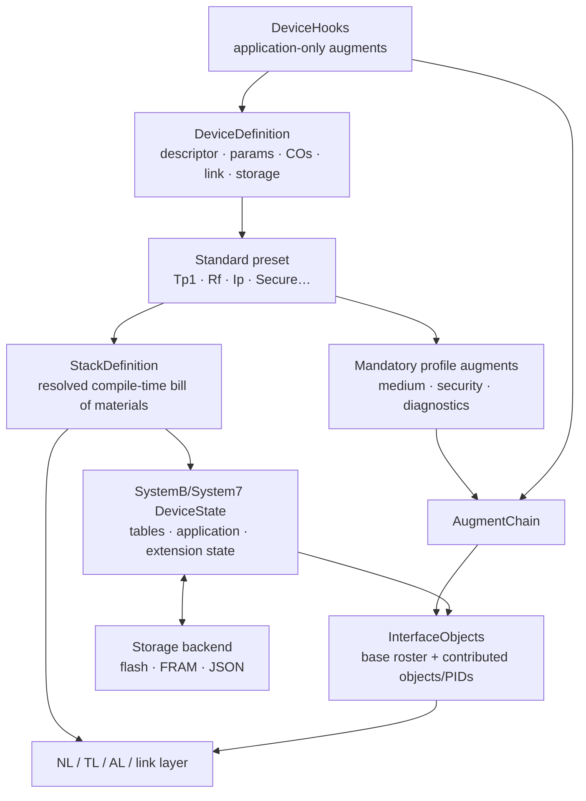

# Device Definition Guide

This document explains how to define, configure, and run a KNX device
using the zweidraehte stack. It covers the state model, extension state,
augments, persistence, and the full startup sequence.

## Overview

A device definition brings together:

1. **Device descriptor** — hardware identity, table capacities, mask version
2. **Application parameters** — ETS-configurable values (`#[derive(EtsParams)]`)
3. **Communication objects** — group object definitions (`#[derive(EtsComObjects)]`)
4. **Extension** — medium-specific state + augmentation (IP config, retry count, etc.)
5. **Link layer** — physical transport (TPUART, KNX/IP, USB)

Normal firmware supplies these independent choices through
`DeviceDefinition` and selects a standard profile type such as
`system_b::Tp1<MyDefinition>`. The preset implements the low-level
`StackDefinition` bill of materials, including correlated state, services,
interface objects, augments, and layer composition. Implement
`StackDefinition` directly only when a standard preset cannot express the
device.

## State Model

### SystemBDeviceState

All runtime device state lives in a single struct:

```rust
pub struct SystemBDeviceState<
    const ADT_SIZE: usize,      // Address table byte size
    const AST_SIZE: usize,      // Association table byte size
    const COT_SIZE: usize,      // Comm object table byte size
    D: StackDefinition,         // Stack definition (provides P, CO, Mutex)
    ES: ExtensionState = (),    // Extension state (IP config, augment state)
    const MAX_CONN: usize = 1,  // Max concurrent transport connections
> {
    // Runtime (volatile)
    individual_address: Cell<IndividualAddress>,
    programming_mode: Cell<bool>,

    // Factory-programmed identity (serial number; FDSK for Data Secure).
    // Serial number is read through `DeviceIdentity::serial_number()`.
    identity: D::Identity,

    // ETS-loaded tables (persisted)
    adt: RefCell<Table<AddrTab7Impl<ADT_SIZE>>>,
    ast: RefCell<Table<AssoTab6Impl<AST_SIZE>>>,
    cot: RefCell<Table<CoTab7Impl<COT_SIZE>>>,
    app: RefCell<Application<D::P>>,

    // Communication objects (runtime-only, not persisted)
    comm_objs: RefCell<D::CO>,

    // Extension state (persisted)
    extension_state: ES,

    // Dirty tracking
    dirty: Cell<bool>,
    // ...
}
```

The `D: StackDefinition` parameter provides `D::P` (parameters) and
`D::CO` (communication objects) as associated types, eliminating the
need for separate `P` and `CO` generic parameters.

The const generics for table sizes are derived from the `DeviceDescriptor`:

```rust
const DEVICE_DESCRIPTOR: DeviceDescriptor = DeviceDescriptor {
    mask_version: MaskVersion::SystemBKnxIp,
    manufacturer_id: 0x00FA,
    hardware_type: [0x00, 0x00, 0x00, 0x00, 0x00, 0x01],
    application_id: 0x0100,
    application_version: 0x01,
    max_address_table_entries: 16,
    max_association_table_entries: 16,
    max_comm_objects: 8,
    pei_type: 0,
};

const ADT_SIZE: usize = DEVICE_DESCRIPTOR.address_table_size();
const AST_SIZE: usize = DEVICE_DESCRIPTOR.association_table_size();
const COT_SIZE: usize = DEVICE_DESCRIPTOR.comm_object_table_size();
```

### Resolved State Types

These aliases explain the concrete state selected by the low-level stack.
Standard-preset users normally write
`type State = <MyStack as StackDefinition>::State` rather than selecting one
manually.

**KNX/IP devices** — use `IpDeviceState` parameterized on a `FeatureSet`
type (the same `F` used for the link layer builder). Tunneling capacity
and device capabilities (PID 68) are derived from `F` at compile time:

```rust
// Routing device (KnxIpDeviceUdp → no tunneling, routing + remote config)
type MyState = IpDeviceState<ADT_SIZE, AST_SIZE, COT_SIZE, MyStack, KnxIpDeviceUdp>;

// Tunneling interface (KnxIpInterfaceUdp<4> → 4 tunneling slots)
type MyState = IpDeviceState<ADT_SIZE, AST_SIZE, COT_SIZE, MyStack, KnxIpInterfaceUdp<4>>;
```

**TP1 devices:**

```rust
type MyState = Tp1SystemBDeviceState<ADT_SIZE, AST_SIZE, COT_SIZE, MyStack>;
```

Under the hood, `IpDeviceState` uses `IpExtensionFor<F>` as the extension
state, a type alias for `IpExtensionState<CAPS>` with the capability
bits derived from `F`:

```rust
pub type IpExtensionFor<F: FeatureSet> =
    IpExtensionState<{ F::KNXNETIP_DEVICE_CAPABILITIES }>;  // CAPS (PID 68)

pub type IpDeviceState<..., D: StackDefinition, F: FeatureSet> =
    SystemBDeviceState<..., D, IpExtensionFor<F>>;
```

Tunneling capacity is not part of `IpExtensionState`: devices that
serve tunneling connections compose `IpInterfaceExtension<N, CAPS>`
instead, which pairs `IpExtensionState<CAPS>` with a
`TunnellingExtension<N>` (the additional individual addresses live on
the latter). The low-level aliases `IpExtensionState<CAPS>` and
`IpSystemBDeviceState<..., CAPS>` still exist for cases where you need
explicit control over the const generics.

## Extensions

An extension contributes both **persistent state** and **interface
object augmentation** to the device. The `Extension<Platform>` trait
combines an `ExtensionState` (the persisted/runtime state) with a
recipe for producing the `Augment<D>` impl that exposes that state
on the wire.

### The Extension Trait

```rust
pub trait Extension<Platform = ()>: ExtensionState {
    /// The augment type this extension creates.
    type Augment<'a, D: StackDefinition>: Augment<D>
    where Self: 'a, Platform: 'a;

    /// Create the augment from this extension state and the platform.
    fn create_augment<'a, D: StackDefinition>(
        &'a self, platform: &'a Platform,
    ) -> Self::Augment<'a, D>
    where Platform: 'a;
}
```

Each extension declares what platform type it needs. `Platform` flows
from `StackDefinition::Platform` — the stack ensures compatibility.

### The ExtensionState / ExtensionConfig Traits

`Extension` is a supertrait of `ExtensionState`, which handles persistence:

```rust
/// Configuration data model: the persisted fields as plain values
pub trait ExtensionConfig: Default {}

/// Runtime form (with interior mutability)
pub trait ExtensionState: Sized {
    type Config: ExtensionConfig;
    /// Construction inputs that are not configuration (the FDSK copy,
    /// …). Use `()` if the extension needs none.
    type Resources;
    fn from_config(config: Self::Config, resources: Self::Resources) -> Self;
    fn to_config(&self) -> Self::Config;
    /// Handle a master-reset erase code. Each extension decides per
    /// code what to clear (see [`EraseCode`](crate::restart::EraseCode)).
    /// Called from `SystemBDeviceState::factory_reset()` and
    /// `execute_reset()`.
    fn on_erase(&self, code: EraseCode);
}
```

`ExtensionConfig` is the extension's configuration data model; the
extension persists it as its persistent sections
(`ExtensionSections`, derived for leaf extensions). `ExtensionState` is
the runtime representation with `Cell`/`RefCell` fields for interior
mutability. `Resources` is the construction-time bundle that is not
configuration — typically `()`, but secure extensions use it to receive
the FDSK copy.

### Built-in Extensions

**`()` — no extension.** Only useful for test/mock scenarios.
Implements `Extension<()>` with `Augment = ()`.

**`Tp1ExtensionState`** — TP1 retry count (PID 52).
Implements `Extension<()>`; `create_augment` returns a separate
[`Tp1Augment<'a>`] that borrows `&'a Tp1ExtensionState`. Adds
PID\_MAX\_RETRY\_COUNT to the Device Object.

```rust
pub struct Tp1ExtensionState {
    max_retry_count: Cell<u8>, // 0x33 = 3 busy, 3 NAK retries
}
```

**`IpExtensionState<CAPS>`** — full IP configuration.
Implements `Extension<P>` for any `P: IpPlatform`. Creates an
`IpAugment<'a, P, CAPS>` that combines the persisted config with the
platform reference for IP property dispatch.

```rust
pub struct IpExtensionState<const CAPS: u16 = 0> {
    friendly_name: Cell<[u8; 30]>,        // PID 76
    configured_ip: Cell<Ipv4Addr>,        // PID 60
    configured_subnet: Cell<Ipv4Addr>,    // PID 61
    configured_gateway: Cell<Ipv4Addr>,   // PID 62
    ip_assignment_method: Cell<u8>,       // PID 55
    routing_multicast: Cell<Ipv4Addr>,    // PID 66
    ttl: Cell<u8>,                        // PID 67
    project_installation_id: Cell<u16>,   // PID 51
    // + runtime-only rebind channel for live IGMP re-joins
}
```

- `CAPS` — KNXnet/IP device capabilities bitfield (PID 68), compile-time
  constant derived from the link layer's `FeatureSet`

Tunneling state is separate: devices that serve tunneling connections
compose **`IpInterfaceExtension<N, CAPS>`**, which pairs
`IpExtensionState<CAPS>` with a `TunnellingExtension<N>` holding the
additional individual addresses (`N` = tunneling slot count).

You typically don't specify `CAPS` directly. Use `IpExtensionFor<F>`
(or `IpInterfaceExtensionFor<F>` for tunneling devices), which derives
it from a `FeatureSet` type. `IpAugmentFor<'a, P, F>` does the same
for the augment type (needed when spelling out `InterfaceObjects` for
devices with extra augments):

```rust
// These are equivalent:
type ES = IpExtensionFor<KnxIpDeviceUdp>;
type ES = IpExtensionState<0x0015>;  // CAPS=routing+devmgmt+remoteconfig
```

### One Extension State Per Device

Each device has exactly one extension state type. There is no tuple
composition for extension states — if a device needs multiple concerns
(e.g., IP config + custom persistent data), define a single struct that
contains both and implements `ExtensionState` + `Extension` directly:

```rust
pub struct MyBridgeState {
    ip: IpFields,
    custom: Cell<u32>,
}

impl ExtensionState for MyBridgeState {
    type Config = MyBridgeConfig;
    // ... implement from_config, to_config, on_erase
}

impl<P: IpPlatform> Extension<P> for MyBridgeState {
    type Augment<'a, D: StackDefinition> = MyBridgeAugment<'a, P>
    where Self: 'a, P: 'a;

    fn create_augment<'a, D: StackDefinition>(&'a self, platform: &'a P) -> Self::Augment<'a, D>
    where P: 'a {
        MyBridgeAugment { state: self, platform }
    }
}
```

## Augments

Augments extend the device's interface objects. They can do two things:

1. **Add properties to existing objects** — e.g., add PID 52 (retry count)
   to the Device Object
2. **Provide entirely new interface objects** — e.g., provide the IP
   Parameter Object (Type 11) at index 6

### The Augment trait

```rust
//! crates/zweidraehte-device/src/service/traits.rs

pub trait Augment<D: StackDefinition> {
    fn additional_object_count(&self) -> u16 { 0 }
    fn additional_object_type_at(&self, _index: u16) -> Option<InterfaceObjectType> { None }
    fn get_property_descriptor(&self, _ot: InterfaceObjectType, _pid: u16) -> Option<PropertyDescriptor> { None }
    fn property_description_read(&self, _ctx: &ServiceCtx<'_, D>, …) -> Option<…> { None }
    fn property_value_read   (&self, _ctx: &ServiceCtx<'_, D>, …) -> Option<…> { None }
    fn property_value_write  (&self, _ctx: &ServiceCtx<'_, D>, …) -> Option<…> { None }
    fn function_property_command   (&self, _ctx: &ServiceCtx<'_, D>, …) -> Option<…> { None }
    fn function_property_state_read(&self, _ctx: &ServiceCtx<'_, D>, …) -> Option<…> { None }
}
```

All hook methods return `Option<…>` — returning `None` delegates to
the next augment in the chain or the base object.

### How Augments Relate to Extensions

For built-in mediums, the `Extension` trait handles augment creation
automatically. You don't construct medium-specific augments manually:

- **TP1**: `Tp1ExtensionState::create_augment` returns a `Tp1Augment<'a>`
  that holds `state: &'a Tp1ExtensionState`. Writes to property storage
  (e.g. PID 52 retry count) reach the same `Cell<u8>` the device state
  owns, via that borrow.
- **IP**: `IpExtensionState` produces an `IpAugment<'a, P, CAPS>`
  wrapper that bundles state + platform.

Both follow the same shape — a small augment struct borrowing the state
(and the platform, for IP).

For ergonomics, devices spell their `D::Augments<'a>` either as a
direct projection or as a `#[derive(ServiceRegistry)]` struct
(see "The Augment chain — `D::Augments<'a>`" below).

### Stateless extra augments

Stateless augments (no persistent state, no resources) just
implement `Augment<D>`:

```rust
#[derive(Debug, Clone, Copy, Default)]
pub struct EasterEggAugment;

impl<D: StackDefinition> Augment<D> for EasterEggAugment {
    fn function_property_command(
        &self,
        _ctx: &ServiceCtx<'_, D>,
        object_type: InterfaceObjectType,
        req: &FunctionPropertyRequest<'_>,
    ) -> Option<FunctionPropertyResult> {
        if object_type != InterfaceObjectType::Device || req.prop_id != 255 {
            return None;
        }
        Some(match req.service_data {
            b"knock knock" => FunctionPropertyResult::success_with_data(
                b"Who's there? ...a lost packet. Wrong subnet.",
            ),
            _ => FunctionPropertyResult::not_supported(),
        })
    }
}
```

For descriptor-table-driven augments (the common case where the
augment exposes a fixed list of PIDs), use the
`#[interface_object_augment]` attribute macro — it auto-generates
the `Augment<D>` impl from a small DSL.

### The Augment chain — `D::Augments<'a>`

Each device's complete augment set lives behind the
`D::Augments<'a>` GAT on `StackDefinition`. The IO container
borrows `&'a D::Augments<'a>` and routes every property hook
through the `Augment<D>` trait. There are three idiomatic
ways to spell `D::Augments<'a>`:

#### 1. Bare projection (no extras)

When the device only has the medium extension's augment:

```rust
type Augments<'a> = <Self::ES as Extension<Self::Platform>>::Augment<'a, Self>;

fn create_augments<'a>(state, platform, _lctx) -> Self::Augments<'a> {
    state.extension_state().create_augment::<Self>(platform)
}
```

#### 2. `#[derive(ServiceRegistry)]` struct

When the device adds extra augments alongside the medium's, give
each one a name and let the macro build the `Augment<D>`
impl:

```rust
#[derive(zweidraehte_device::service::ServiceRegistry)]
pub struct PicoTp1Augments<'a> {
    #[service(augment)] tp1:    Tp1Augment<'a>,
    #[service(augment)] easter: EasterEggAugment,
}

type Augments<'a> = PicoTp1Augments<'a>;

fn create_augments<'a>(state, platform, _lctx) -> Self::Augments<'a> {
    PicoTp1Augments {
        tp1:    state.extension_state().create_augment::<Self>(platform),
        easter: EasterEggAugment,
    }
}
```

The macro emits `Augment<D>` walking the fields
left-to-right: hooks chain via `or_else()` (first `Some` claims),
IO list counts sum, lifecycle delegates to each augment.

#### 3. `#[service(flatten)]` for nested composition

Useful when one chain wants to inherit another wholesale — for
example, sharing a "conformance extras" bundle across stacks:

```rust
#[derive(ServiceRegistry)]
pub struct ConformanceExtras<'a> {
    #[service(augment)] cert: CertificationObjectAugment,
    #[service(augment)] diag: DiagnosticsAugment<'a>,
}

#[derive(ServiceRegistry)]
pub struct SecureConformanceAugments<'a> {
    #[service(augment)] sec:    SecAugment<'a>,
    #[service(flatten)] extras: ConformanceExtras<'a>,
}
```

The outer `Augment<D>` impl walks `sec` first, then
delegates the rest of the chain into `extras`. `flatten` is
**augment-only** — it cannot be combined with `#[service(handler)]`
on the same struct because the const dispatch table can't route
through a flattened sub-table. The macro emits a clear
compile-time error if you try.

#### Composing legacy tuple shapes

The `()`, `(Head, Tail)`, and `&A` shapes also implement
`Augment<D>` directly (see
`crates/zweidraehte-device/src/service/registry.rs`), so legacy
tuple augment chains and the `<D::ES as Extension<…>>::Augment<'a,
D>` projection types all work without per-device migration to the
derive. Mix and match as suits the device.

## Persistence

### How State is Saved and Restored

Configuration persists **write-through**, as numbered persistent sections
of the device state:

```
SystemBDeviceState<..., ES>          (runtime, interior mutability)
        |
        | PersistentSections: each section's bytes, changed ranges
        v
NvConfig<store, State>               (flushed by the router after a change)
        |
        | NvStore: ByteNv (file, FRAM, shared memory) / FlashLog (flash)
        v
Non-volatile medium ──── NvConfig::load at boot ───> the same state
```

- **At boot** `zweidraehte_device::new` creates the stack with a
  factory-fresh state and applies the durable sections before returning
  (`DeviceStorage::load`); `stack.loaded_at_boot()` says which
  happened. A blank medium, or one written by a firmware with another
  section layout, is formatted with the factory state. A medium the device
  cannot use is `new`'s error.
- **On a change** (property write, memory write, load control, ...) the
  state marks itself dirty and the router flushes before the response
  leaves the device: the changed byte ranges of the Image sections, and
  every Record whose bytes differ from the durable copy.
- **On a restart** the storage task applies the erase code, flushes until
  the result is durable, and then resets the device.

**`HasDeviceConfig`** remains as the state's configuration data model:
`to_config()` projects the state to a `DeviceConfig`, which conformance
fixtures and tests use as a preconfigured boot image
(`SystemBStateInit` with `boot_image: Some(..)`) and the section tests
use as their completeness oracle. Devices never persist it.

### Application readiness and configuration progress

Consume communication-object inputs through their generated typed fields:

```rust,ignore
let brightness = stack
    .consume_object(|objects| &mut objects.white)
    .map_or(0, u8::from);
```

The stack returns an owned DPT value and acknowledges the selected object's
update. It returns `None` while the application is unavailable, so the caller
chooses a safe fallback. Consumption retains the commanded value for bus reads;
it returns the current value even when no new telegram has arrived.

Use `stack.status().application.is_operational()` to gate other application
activity. The protocol's `stack.is_running()` still reports only the APP run state.
Readiness additionally requires the profile's necessary resources to be loaded,
so unloading an address or association table immediately makes the application
unavailable even if the APP run state has not changed.

`stack.watch_status()` returns an optional receiver for complete current
snapshots. Late subscribers receive the current value; slow subscribers receive
the latest snapshot without reconstructing a lifecycle event history. The
existing lifecycle events remain protocol run-state events. Direct users of
`stack.state()` must call `stack.publish_status()` after mutations to wake
observers; ordinary router and persistence operations publish automatically.

### Dirty Tracking

`HasPersistence::mark_dirty()` is called on accepted persistent changes,
including property, memory and memory-bit writes; volatile programming
mode, RAM writes and rejected writes leave the state clean. The flag only
says "flush now": the router flushes after the dispatch and clears it on
success. A failed flush leaves it set; the storage task retries on its
tick, and `stack.status().persistence` reports the failure count.

### Storage Backends

**Write-through config file** (for Linux userspace, in `examples/support`):
the device state's persistent sections in a binary `ByteNv` image, flushed
by the router before each response. See
`firmware/linux/eth_light_switch` for the complete wiring.
```rust
use support::storage::{FileIdentity, LinuxConfigNv, dump_config, open_config_nv};
use zweidraehte_device::storage::{ConfigStorage, Loaded};

pub type MyStorage = ConfigStorage<LinuxConfigNv>;

let identity = FileIdentity::load_or_provision("device_identity.json", SERIAL)?;
static STORAGE: StaticCell<MyStorage> = StaticCell::new();
let storage = &*STORAGE.init(ConfigStorage::new(open_config_nv("device_config.bin")?));

// The state starts factory-fresh: the StateInit carries no loaded config.
// `new` applies the stored sections (or formats a blank file) before it
// returns.
let state_init = SystemBStateInit::new(StaticIdentity::new(*identity.serial_number()), None);
let (stack, runner) = zweidraehte_device::new(resources, link, state_init, platform, memory_map, storage)
    .unwrap_or_else(|error| panic!("cannot use the config file: {error:?}"));
```

`dump_config(path, &factory_fresh_state, &mut stdout)` prints what a
config file holds, section by section, without writing to it.

A medium the stock stores do not cover plugs in below `NvConfig`: implement
`zweidraehte_nv::NvStore` for it (or `ByteIo` / `SectorIo` to reuse `ByteNv`
/ `FlashLog`).

**Embedded backends** (RP2040 / STM32 flash, FRAM) implement the
storage-layer seams (`SectorIo`, `ByteIo`, `SequenceNumberStorage`, …)
for their medium. A device declares each durable region once as a
`Placed<Region, Chip, Layout>` alias; the store type and its `open()`
derive from that declaration, and the live stores group in one `Storage`
struct, named through its aliases (`ConfigStorage` / `SecureStorage` /
`SecureIpStorage`) in `StackDefinition::Storage` and handed to `new()` as a
`&'static`:

```rust
pub struct StorageMap;
type Cfg = Placed<StmConfigRegion, StmFlash, StorageMap>;
type Seq = Placed<StmSiatRegion<SIAT_SIZE>, FramChip, StorageMap>;
impl StorageLayout for StorageMap {
    const REGIONS: &'static [RegionSpec] = &[Cfg::SPEC, Seq::SPEC];
}
// main(): STORAGE.init(SecureStorage::new(Cfg::open(io)?, Seq::open(fram_io)?))
```

The firmware family commons provide the chip pieces: the `Chip`
markers (`StmFlash`, `RpFlash`), the `Io` handles (`StmFlashIo`,
`RpFlashIo`, FRAM), and chip-sized region aliases
(`StmConfigRegion`, `RpConfigRegion`, `StmSiatRegion<SLOTS>`)
over the core `ConfigLogRegion` / `FlashSiatRegion` / `FramSiatRegion`
markers — see `docs/STACK_ARCHITECTURE.md` §3.14 for the full
vocabulary.

## Defining a New Device

### Step 0: Pick a BCU family

**Use System B.** It carries all three media (TP1, KNX-RF, KNX/IP),
KNX Data Secure and KNX IP Secure, and the deepest conformance
coverage; everything below this line is written for it.

The full stack also implements **System 7 on TP1** (mask 0705h), with
Data Secure available through `system_7::SecureTp1`. Choose it only when
a device has to match an existing System 7 installed base or toolchain —
the mask a product declares is the manufacturer's choice, and nothing in
ETS rewards the older family. Building on it costs no extra effort: select
`system_7::Tp1<Definition, COT_ADDRESS>` instead of
`system_b::Tp1<Definition>` (or the matching `SecureTp1` preset); see
[`firmware/stm32/g0_tp1_system7_light_switch`](../firmware/stm32/g0_tp1_system7_light_switch/)
next to its System B sibling, both running the same
`devices::light_switch` definition. You give up RF and KNX/IP, not Data
Secure. The family differences are catalogued in
[`STACK_ARCHITECTURE.md` §3.11](STACK_ARCHITECTURE.md#311-bcus--system_b-and-system_7).

`zweidraehte-microdevice` is a separate choice for fixed-map BCU1/BCU2 or
very small System 7 TP1 targets. It does not consume `DeviceDefinition` or
the presets below: firmware owns a `Microdevice<F>` and polls it directly.
Use it for the hardware/runtime constraints it models, not merely as a
shorter full-stack API — and note that it is **experimental**: much less
tested than the full stack, with no production use behind it.

One difference reaches the device definition either way:
`#[ets(index = N)]` on a communication object is a **0-based logical
index**, and the object number ETS shows is `N + FIRST_ASAP` — 0 on
System 7, 1 on System B, whose CO table cannot express ASAP 0. Write
definitions from 0 and a shared one works on both families.

### Step 1: Device Descriptor

```rust
pub const DEVICE_DESCRIPTOR: DeviceDescriptor = DeviceDescriptor {
    mask_version: MaskVersion::SystemBKnxIp,  // or SystemBTp1
    manufacturer_id: 0x00FA,
    hardware_type: [0x00, 0x00, 0x00, 0x00, 0x00, 0x01],
    application_id: 0x0100,
    application_version: 0x01,
    max_address_table_entries: 16,
    max_association_table_entries: 16,
    max_comm_objects: 8,
    pei_type: 0,
};
```

### Step 2: Parameters and Communication Objects

```rust
#[ets_params]
#[derive(Debug, Clone, Copy)]
pub struct MyParams {
    #[ets(display = "Brightness")]
    pub brightness: u8,
}

#[ets_com_objects]
pub struct MyComObjects {
    #[ets(index = 0, display = "Switch", function = "Switching", flags = C | W | T | U)]
    pub switch: DPT_Switch,
}
```

`#[ets_com_objects]` emits stack-neutral metadata and, for full-stack builds,
the runtime container and typed `Index` enum. A micro product can derive its
raw table rows from the same declaration instead of maintaining a second
communication-object inventory.

### Step 3: `DeviceDefinition` and Preset

Implement only the independent product/application/hardware choices, then
select the profile as a type alias:

```rust
#[derive(Debug, Clone, Copy)]
pub struct MyDefinition;

impl DeviceDefinition for MyDefinition {
    const DEVICE: &'static DeviceDescriptor = &DEVICE_DESCRIPTOR;
    const MAX_APDU_LENGTH: u16 = MAX_APDU_LENGTH_EXTENDED;

    type Params = MyParams;
    type ComObjects = MyComObjects;
    type LinkLayer = TpUartLinkLayerBuilder<MyUartTx, MyUartRx>;
    type Identity = FlashIdentityData;
    type Storage = MyStorage;
}

pub type MyDevice = zweidraehte_device::bcus::system_b::Tp1<MyDefinition>;
type MyState = <MyDevice as StackDefinition>::State;
```

The state projection is useful for declaring a storage region, but firmware
does not choose the state's internal generic parameters. The descriptor is
the source of truth for table capacities; presets validate their derived
const sizes during state construction.

Message storage is also configured here. `type Buffers = BufferManager<N>;`
selects the pool capacity (default: eight), and `const BUFFER_SIZE: usize`
selects the bytes per buffer. The size defaults to
`buffer_size_for_apdu(Self::MAX_APDU_LENGTH)`, including framing and headroom.
Override it only when more storage is needed; it does not change the advertised
APDU limit. Presets forward both settings, so startup only names
`StackResources<MyDevice>`.

For KNX/IP, the definition also implements `KnxNetIpDefinition`, and the
preset consumes the same feature set as the link-layer builder:

```rust
impl KnxNetIpDefinition for MyDefinition {
    type Transport = LinuxIpTransport;
    type Features = KnxIpDeviceUdp;
}

type MyDevice = zweidraehte_device::bcus::system_b::Ip<MyDefinition>;
```

The available System B preset types are:

| Device | Preset |
|---|---|
| TP1 | `Tp1<C>` |
| KNX-RF | `Rf<C>` |
| KNX/IP device | `Ip<C>` |
| KNX/IP-to-TP1 interface | `IpInterface<C>` |
| Data Secure TP1 | `SecureTp1<C, P2P = NoP2p>` |
| Data Secure RF | `SecureRf<C, P2P = NoP2p>` |
| Data Secure RF retransmitter | `SecureRfRetransmitter<C, P2P = NoP2p>` |
| KNX IP Secure + Data Secure | `SecureIp<C, P2P = NoP2p>` |

System 7 provides `Tp1<C, COT_ADDRESS>` and
`SecureTp1<C, COT_ADDRESS, P2P = NoP2p>`. The COT address is a product
layout fact absent from `DeviceDescriptor`, so it remains explicit.

### Step 4: Optional Device Hooks

Most devices use the default `NoDeviceHooks`. To add an application-specific
interface-object augment, implement `DeviceHooks` and select it in the
definition:

```rust
pub struct MyHooks;

impl DeviceHooks for MyHooks {
    type Augments<'a, D: StackDefinition> = EasterEggAugment;

    fn create_augments<'a, D: StackDefinition>(
        _state: &'a D::State,
        _platform: &'a D::Platform,
        _layer_ctx: &'a LayerContext<D>,
    ) -> Self::Augments<'a, D> {
        EasterEggAugment
    }
}

impl DeviceDefinition for MyDefinition {
    // ...the Step 3 inputs...
    type Hooks = MyHooks;
}
```

The preset always installs its required medium/security augments first and
appends this bundle using `AugmentChain`. `DeviceHooks` therefore describes
only what is unique to the application. For several hooks, return a
`#[derive(ServiceRegistry)]` bundle; do not copy the preset's augment list.

Hooks cannot add fields to persistent device state. A custom memory map,
state shape, interface-object container, persisted extension, AL service
set, or layer composition is the boundary for a custom preset or direct
`StackDefinition`. That low-level API remains supported for advanced users
and is used by conformance fixtures whose memory maps intentionally differ
from production devices.

### Step 5: Startup

The runner takes ownership of the stack resources, link-layer
builder, the `D::StateInit` envelope, the platform, and the memory
map, plus the storage-capability bundle — six arguments to
`zweidraehte_device::new()`. The runtime
state is **not** built by the binary; the runner constructs it
internally via `D::create_state(state_init)` so it can hand the
freshly built state a reference to the `LayerContext` from birth (no
two-phase init).

```rust
use zweidraehte_device::{
    StackResources, StackDefinition,
    bcus::system_b::SystemBStateInit,
};

#[embassy_executor::main]
async fn main(spawner: Spawner) {
    // 1. Load factory identity and open the declared stores.
    let identity = load_identity();
    let storage = STORAGE.init(MyStorage::new(Cfg::open(flash)?));

    // 3. Build the StateInit envelope. The runner consumes it inside
    //    D::create_state. For System B, SystemBStateInit::new() handles
    //    the no-resources case (resources defaulted to ()); the state
    //    starts factory-fresh.
    let state_init = SystemBStateInit::new(identity);

    // 4. Create link layer builder.
    //    Features, transport type, and sizing knobs all flow from MyDevice's
    //    KnxNetIpDefinition impl — no explicit const generics at the call site.
    let link_layer_builder = KnxNetIpBuilder::<MyDevice>::new(
        "eth0", local_addr, control_endpoint, (),
    );

    // 5. Allocate static stack resources for the resolved preset type.
    static RESOURCES: StaticCell<StackResources<MyDevice>> = StaticCell::new();

    // 6. Create the stack, which applies the stored configuration before
    //    it returns. The final argument is a `&'static MyDefinition::Storage`;
    //    only a stack with no storage passes `&()`.
    let (stack, runner) = zweidraehte_device::new(
        RESOURCES.init(StackResources::new()),
        link_layer_builder,
        state_init,
        platform,
        MyDevice::memory_map(),
        storage,
    )
    .expect("the config store is usable");

    // 7. Report what the config log replay saw on the flash.
    stm32_common::log_config_flash_diagnostics();

    // 8. Spawn the stack runner.
    spawner.spawn(run_stack(runner)).expect("stack runner spawns once");

    // 9. Let the shared storage task handle restarts, flush retries and
    //    log compaction.
    spawner.spawn(storage_task(stack)).expect("storage task spawns once");
}
```

Note what is **not** an argument: there is no `MyComObjects::new()`
parameter and no separate "hook context". The CO container is part
of `D::State` (built inside `create_state`), and any per-device
context the layers need is reached through `D::Augments<'a>` and
`D::AlExtensions`.

## Architecture Diagram



## Writing a Custom Extension with Persistent State

To create an extension that owns persistent state and provides augmentation:

### 1. Define the runtime state and derive its config

`#[derive(ExtensionState)]` treats the runtime `*State` struct as the
source of truth and generates the persisted `*Config` mirror (the
`Cell`/`RefCell` fields unwrapped), its `Default`/`ExtensionConfig` impls,
and the `ExtensionState` impl (`from_config`/`to_config`/`on_erase`):

```rust
#[derive(ExtensionState)]
#[extension_state(config = MyConfig)]
pub struct MyExtension {
    // Generated config field: `pub counter: u32`. `#[erase(default = …)]`
    // is the value a factory reset restores (defaults to `Default`).
    #[erase(default = 0)]
    counter: Cell<u32>,
}
```

This generates `pub struct MyConfig { pub counter: u32 }` (with
`Debug`/`Clone`/`PartialEq`/`Default`/`ExtensionConfig`, and its section
impls) plus the
`ExtensionState` impl. Field/struct attributes cover the cases the plain
`Cell<T>` → `T` unwrap can't:

- `#[config(ty = U, from = |c| …, to = |s| …)]` — wire type differs from the
  runtime type (e.g. an `Ipv4Addr` field persisted as `[u8; 4]`).
- `#[config(default = "path")]` — the field's factory value in the generated
  `Default` is `path()` instead of `Default::default()`.
- `#[runtime_only]` — a field that is never persisted (rebuilt in
  `from_config`; `#[runtime_only(init = expr)]` for a non-`Default` init).
- struct-level `resources = <type>` — sets `ExtensionState::Resources`
  (defaults to `()`); the value arrives as `from_config`'s second argument.
- struct-level `on_erase = manual` / `default = manual` — hand-write those
  two pieces when a field reset needs a side-effect, or the factory defaults
  aren't per-field. The derive also emits an inherent
  `apply_config(&self, Config)` (in-place reset through interior
  mutability) that `on_erase = manual` impls typically call. (The composing
  `SecureExtensionState` and the tuple-config retransmitter hand-write the
  whole impl — the derive is for flat leaf extensions.)

### 2. Define the augment

The augment is a *separate* struct that borrows the state. For a fixed list
of PIDs, `#[interface_object_augment]` generates the `Augment<D>` impl from
the `#[io(…)]` field DSL — the read/write closures reach the state through
`this.state`:

```rust
#[interface_object_augment(target_objects = [InterfaceObjectType::Device])]
pub struct MyAugment<'a> {
    pub state: &'a MyExtension,

    #[io(pid = MY_PID, pdt = PDT_UnsignedLong, access = RW,
         policy = AccessPolicy::READ_OPEN_WRITE_TOOL, rl = 3, wl = 3, intercepts,
         read  = |this: &Self| this.state.counter.get().to_be_bytes(),
         write = |this: &Self, data: &[u8]| -> Result<WriteResponse, PropertyError> {
             this.state.counter.set(u32::from_be_bytes(data[..4].try_into().unwrap()));
             Ok(WriteResponse::Echo)
         })]
    _counter_io: (),
}
```

Use `target_objects` + `intercepts` to add PIDs to an existing object (as
above, on the Device Object), or `additional_objects = [X]` to provide a new
object — the latter needs a PID 1 `OBJECT_TYPE` entry. (Augments needing
hand-written dispatch can `impl Augment<D>` directly instead.)

### 3. Implement Extension

Since this extension needs no platform, use `Extension<()>`; `create_augment`
returns the augment borrowing the state:

```rust
impl Extension<()> for MyExtension {
    type Augment<'a, D: StackDefinition> = MyAugment<'a> where Self: 'a;

    fn create_augment<'a, D: StackDefinition>(
        &'a self, _platform: &'a (),
    ) -> Self::Augment<'a, D> where (): 'a {
        MyAugment { state: self }
    }
}
```

### 4. Wire it into the device

```rust
type MyState = SystemBDeviceState<ADT, AST, COT, MyDevice, MyExtension>;

zweidraehte_device::system_b_standard_stack! {
    stack: MyDevice, device: &DEVICE_DESCRIPTOR,
    params: Params, com_objects: MyComObjects,
    link_layer_builder: …, platform: (),
    extension_state: MyExtension, state: MyState,
    al_extensions: (SystemBAlServices, DomainAddressService),
    layer_builder: PlainDeviceBuilder,
}
```

The counter is automatically persisted and restored across power
cycles because the derived `ExtensionState::to_config()` / `from_config()`
captures it.

To compose this extension's augment with one or more extra augments
(e.g. `EasterEggAugment`), wrap them in a `#[derive(ServiceRegistry)]`
struct and hand it to the macro's `augments: { bundle, create }` slot,
as shown in the "Augments" section earlier.
