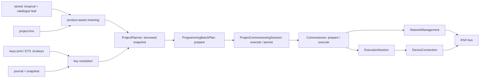

# Programming Real Devices

The generic compilation and execution pipeline is documented in
[`COMMISSIONING_ENGINE.md`](COMMISSIONING_ENGINE.md). This page focuses on
project authoring, credentials, persistence, and operator-facing workflows.

The host tools compile and commission supported BCU1, BCU2, System 7, and
System B profiles on authored TP, RF, and IP topology from a human-editable
project. Exact profile, extension, and connector capability checks still
apply. Product structure comes from an immutable project-local copy of the
selected `.knxprod`, while mask procedures come independently from
`knx_master.xml`; the project supplies the installation-specific
identity, parameters, object flags, group memberships, medium configuration,
and security policy.
Powerline and KNX IoT profiles are retained in the Master Data catalog for
diagnostics but cannot be authored or executed by these tools.



The project layer is host-only. It does not add code or data to either embedded
stack. `ProjectPlanner` borrows a project snapshot and evaluates each requested
device and required secure peer once. Status, preview and batch planning use
that same configuration, selector values, credentials, SIAT and catalog binding.
The peer scope supplies image inputs without expanding the physical target set.
`ProgrammingBatchPlan` materializes keys and prepares devices;
`ProjectCommissioningSession` owns execution and journal updates. It delegates
every physical device operation to the same
`Commissioner` used by library callers. The commissioner reuses the existing
`NetworkManagement`, `DeviceConnection`, and `ExecutionSession` wire
implementations rather than defining a second management stack.

`project.knx` is the custom `zweidraehte-project` commissioning format, not an
ETS `.knxproj` archive. Generic ETS XML, `.knxprod`, `.knxproj`, `.knxkeys`,
master-data, and signing support live in `zweidraehte-ets-files`; see
[`ETS_FILES.md`](ETS_FILES.md). The client owns only mask interpretation,
configuration lowering, procedure compilation, and bus execution.

> Hardware coverage includes BCU1, plain and secure BCU2, and plain and secure
> micro System 7 targets. The micro System 7 secure light switch has also been
> exercised on hardware. System B and the full System 7 paths have software-DUT
> coverage; qualify each connector/product combination before deploying it.

## Project directory

```text
bench/
├── project.knx
├── keys.toml
└── .zweidraehte/
    ├── packages/
    │   └── sha256-<digest>/
    │       ├── source.knxprod
    │       ├── index.json
    │       └── materialized/    # selected baggage, when needed
    ├── snapshot.json
    ├── journal.jsonl
    └── project.lock
```

- `project.knx` is authored desired state. Each device selects one immutable
  package digest and one exact `CatalogItem/@Id`; it never refers to a product
  outside this directory.
- `keys.toml` is the authoritative credential store. Keep it out of
  source control when appropriate.
- `.zweidraehte/packages/` is required immutable project input. Import keeps
  the original compressed `.knxprod` plus a small derived index, rather than a
  fully extracted mirror. Back it up with `project.knx`. Committing it can make
  the project portable, but a vendor's
  copyright or licence may prohibit redistributing its package, so this is a
  project/legal decision rather than a blanket VCS rule.
- `snapshot.json`, `journal.jsonl`, and `project.lock` are machine-written
  mutable state. Do not edit or merge them. A lock is held for the entire
  mutable bus session.

Import validates the archive's ZIP structure and resource limits, then records
only catalogue/relation metadata, referenced application declarations, and
manufacturer names from bundled Master Data. Subsequent opens read the index.
Any present directory and registration signing chains are checked during the
explicit import. Mismatches produce non-fatal notices and are not retained in
the catalogue; declared registration status remains visible. Future-use
statuses remain blocked from instantiation.

The catalogue shown by project tools is a virtual read-only tree derived from
all stored `Catalog.xml` files. Identical presentation branches may be
coalesced, but every leaf keeps its package digest and exact Product/H2P/AP
chain. No merged `Catalog.xml` is written, and importing never rewrites or
re-signs the original package members.

Opening, checking, and dry-running a project do not create keys or state. Use
`knx-loader init` to initialize the credential and mutable-state stores with
the same random `state_id`. A mismatch or missing mutable state blocks secure
group sending until explicit recovery.

## Project language

The following focuses on topology and configuration. Product clauses are
shown as comments so this conceptual description does not promise the final
package-selector spelling before the model and CLI land together:

```knx
language "de-DE"

ga kitchen_switch = 1/0/1
ga all_off = 0/0/1

net kitchen_switch : 1.001 {
    name "Kitchen switch"
    security authentication_confidentiality
}

net all_off : 1.001 {
    name "All off"
    security automatic
}

area 1 bench {
    line 1 main {
        medium tp1

        device button {
            # exact imported-package digest + CatalogItem/@Id selector
            address 1.1.10
            serial "00FA:00000001"
            data_secure enabled

            param "M-00FA_A-0001_P-1" = 3

            object 0 {
                on kitchen_switch
                flags {
                    communication true
                    transmit true
                }
            }
        }

        device relay {
            # exact imported-package digest + CatalogItem/@Id selector
            address 1.1.20
            data_secure enabled

            object 0 {
                on kitchen_switch
                also on all_off
                flags {
                    communication true
                    write true
                    update true
                    priority low
                }
            }
        }
    }
}

external_sender visualisation {
    address 1.1.250
    data_secure enabled
    on kitchen_switch
}
```

The durable product value consists of the SHA-256 of the exact imported
`.knxprod` bytes and the exact `CatalogItem/@Id` in that package, never a
filename. Changing the external archive after import has no effect on the
project. The source archive remains authoritative for the selected application
and is read only when that application is needed.

Every packaged XML document retains the KNX project schema from its own
versioned `KNX` namespace. That provenance controls lossless parsing and
schema defaults for the document; it does not select Master Data. Recognized
older product schemas remain valid, and one project or programming batch may
contain products imported from different schema revisions. A namespace-free
or otherwise unprovable product cannot be rescued by a project-side schema
assertion and is not instantiable. Obtain the authoritative package instead of
guessing from `CreatedBy`, `ToolVersion`, the mask version, or Master Data.

Programming resolves one canonical, audited Master Data catalog for the whole
operation, normally the current supported revision or the revision explicitly
selected by the caller. Each device's selected application program names its
mask and programming options; live DD0, the optional management descriptor,
and legacy selectors then choose the exact variant within that catalog. A
missing mask or ambiguous variant fails before mutation. The product and
Master Data schema numbers do not need to match because they version separate
XML documents; identity references, not schema equality, connect them. This is
the same model used when ETS normalizes products imported from mixed source
schemas and performs per-device application and mask lookups against one
project Master Data provider.

Topology values have scopes which match the KNX resources. An RF domain is a
line value, while RF type and coupler routing policy are device values:

```knx
area 1 ground_floor {
    line 2 radio {
        medium rf
        domain "00:FA:12:34:56:78"

        device radio_coupler {
            # exact imported-package digest + CatalogItem/@Id selector
            address 1.2.0
            routing filter
        }

        device window_contact {
            # exact imported-package digest + CatalogItem/@Id selector
            address 1.2.10
            rf_mode multi
        }

        device wall_button {
            # exact imported-package digest + CatalogItem/@Id selector
            address 1.2.11
            rf_mode ready
        }
    }
}
```

Tool-managed classic KNX/IP uses line-scoped routing identity and
device-scoped IP settings:

```knx
area 1 ground_floor {
    line 1 ip_backbone {
        medium ip
        domain "224.0.23.12"
        project_installation_id 42.3
        multicast_latency_tolerance 2000
        sync_latency_fraction 2

        device ip_router {
            # exact imported-package digest + CatalogItem/@Id selector
            address 1.1.10

            ip_assignment fixed
            ip_address "192.0.2.10"
            subnet_mask "255.255.255.0"
            default_gateway "192.0.2.1"
            multicast_ttl 16
            friendly_name "Ground-floor IP router"
            additional_address 1.1.11

            ip_routing secure
            ip_device_management secure
            ip_tunnelling secure
            ip_password_user 1
            ip_tunnelling_user 1 1
        }
    }
}
```

The supported standard overlay is exact: only `MV-5705` and `MV-57B0`, on a
profile which resolves medium `MT-5`, use this Object Type 11 configuration.
The product's `ApplicationProgram/@IPConfig` decides ownership. `Tool` (the
schema default) requires the complete device block shown above. `Custom`
forbids all `ip_assignment` through `ip_tunnelling_user` fields because its
manufacturer parameters own them; keep the IP line's `domain` and
`project_installation_id`, then configure the product-specific parameters.
An unknown `IPConfig` value fails product-aware lowering.

`project_installation_id PROJECT.INSTALLATION` accepts project `0..4095` and
installation `0..15`; PID 51 stores `(project << 4) | installation` in
big-endian order. `domain` is the routing multicast address written to PID 66.
`multicast_latency_tolerance` is milliseconds (`0..65535`) and
`sync_latency_fraction` is one octet; both line values are required when an IP
Secure policy is present and must agree with the keyring backbone metadata.

`ip_assignment dhcp` writes PID 55 value `04h` and forbids `ip_address`,
`subnet_mask`, and `default_gateway`. `ip_assignment fixed` writes value
`01h` and requires all three four-octet values, which become PIDs 60, 61, and
62. `multicast_ttl` must be `1..255`. `friendly_name` accepts at most 30
ISO-8859-1 characters. Compilation trims its ends and NUL-pads PID 76 to 30
elements. PID 64 is read only as live MAC-address scratch; it is not authored
or included in the desired-image fingerprint.

Each `additional_address` must be unique, differ from the primary IA, and be
on the same area and line. `AdditionalAddressesCount` in the product is the
hard PID 53 capacity. The compiler writes the complete capacity and fills
unused two-octet slots with `FFFFh`; a zero capacity means PID 53 is not
touched.

An IP Secure-capable product requires all three `ip_routing`,
`ip_device_management`, and `ip_tunnelling` policies, each `plain` or
`secure`, even when all three are plain. Secure device management or
tunnelling requires password users dense from `1` through `N`; user 1 is the
management user. Repeat `ip_password_user` for each user. A tunnelling row is
`ip_tunnelling_user USER ADDRESS_INDEX`; it binds one declared password user
to one product `<BusInterface AccessType="Tunneling" AddressIndex="...">`
and project IA. Address index 0 selects the primary IA; index `1..N` selects
that `additional_address` slot. Users and address indices may each occur only
once. Secure tunnelling needs at least one row, secure routing needs a product
`Routing` BusInterface, and the product's user, tunnelling-user, and
additional-address capacities are enforced before bus access.

This policy configures the target's stored KNX/IP Secure state through secure
device management. It does not provide an IP Secure client tunnel. The current
KNXnet/IP connector still lacks the secure session handshake and
`SecureWrapper`; that independent link-layer work is not implied by a secure
OT11 download.

The accepted line media are exactly `tp1`, `rf`, and `ip`. RF lines require a
six-octet `domain`; all-zero and all-FF are rejected because they are invalid
and ex-factory/void values. IP lines require an IPv4 multicast `domain` and a
`project_installation_id`; TP1 rejects every domain. There is no `medium pl`
or PL domain syntax.

`rf_mode ready|multi` belongs inside each RF `device`. It is rejected on TP1
and IP devices, and a line-wide `rf_mode` declaration is invalid. The exact
resolved profile decides whether the field is required: `MV-2705` and
`MV-27B0` expose `RfDeviceMode` and require an authored value. A Ready profile
without that resource needs no write; asking such a profile for Multi is an
error.

The current bus connectors cannot yet perform PID 51's required
connectionless Ready/Multi transition. `check` and offline compilation retain
the desired per-device value, but live preparation of a download containing
the Configuration section fails before mutation for a profile which exposes
`RfDeviceMode`. RF domain and IA assignment are a separate supported path,
subject to the system-broadcast contract below; this does not make complete
initial RF Multi commissioning available yet.

An individual address ending in `.0` denotes a topology coupler. A nonzero
line selects a line coupler; `area.0.0` selects a backbone coupler. Such a
device must declare `routing filter`, `routing route_all`, or
`routing block_all`; ordinary devices may not declare `routing`. For `filter`,
the project includes a group address only when an active project device or
declared external sender exists on each side of the boundary. A line
coupler's secondary side is its exact area and line; a backbone coupler's
secondary side is its area. Inactive devices are ignored. The derived table is
part of the coupler's medium-configuration fingerprint, so changing topology,
membership, or activity makes that configuration stale.

Legacy `Lc_10`/`Lc_11` and modern `Lc_12` selector/table layouts are compiled
from the exact Master Data resource flavours. `MV-2920` is different: its
standard PID 67 only enables use of the filter table and does not encode
Filter/Route All/Block All. Programming it therefore requires a typed
`knx.coupler-model-2-routing` product extension; without one preparation fails
instead of guessing a product parameter.

Remote RF domain assignment also has an explicit library-caller contract.
`CommissionerOptions::caller_manages_open_medium_path` defaults to false. A
caller may enable it only after configuring the direct RF interface or an
intervening router to carry the required system broadcasts and RF mode, and
must establish and restore that temporary path around each preparation and
execution call. The commissioner cannot infer or modify router state from a
tunnelling connection. The CLI and TUI currently leave this option false, so
they reject RF domain-changing operations during preflight rather than
assuming the installation path is suitable.

The catalog keeps the exact PL masks `MV-1011` (`1011h`), `MV-1012`
(`1012h`), `MV-1013` (`1013h`), `MV-17B0` (`17B0h`), and `MV-1900`
(`1900h`) for lossless inspection but classifies them as non-executable
Powerline profiles. `MV-1310` (`1310h`) is separately non-programmable because
Master Data declares `ManagementModel="None"`.

`max_apdu` is an optional safety cap, not a declaration of device
capability. The programmer reads `PID_MAX_APDU_LENGTH` when the target has
properties and the local interface supports extended frames; a missing or
invalid property selects the standard-frame value 15. Secure management also
reserves the S-A_Data envelope inside that detected wire limit. Specify, for
example, `max_apdu 32` only to force smaller chunks for a problematic target.

`language` is an optional project-wide product-editor preference. It changes
only translated labels; it does not change compiled device
configuration or make devices stale. A product which does not provide the
preferred translation remains in its declared default language. Selecting a
language with `l`/`L` updates the in-memory project draft, and the normal `e`
save command persists it. Selecting the product's default language removes
the declaration.

`active false` parks a device without deleting its authored configuration.
Omission means active. Project-wide and stale-device operations skip inactive
devices, and inactive devices do not participate in secure-topology or SIAT
derivation. A command which names that device explicitly is a deliberate
override; it can still inspect, unload, or program the parked device without
pulling active devices into the operation as dependencies.

`name` is an optional display label for a net. The identifier stays stable
because it also identifies memberships, group keys, SIAT dependencies, and
deployment state. In `knxproj-tui`, select a group address in the project pane
and press `r` to edit the label.

`on` is the sole primary/sending association. `also on` adds listening
associations. Flags belong to the communication object, not an association,
and layer over product defaults and visible `ComObjectRef` overrides. Each
field is optional: `communication`, `read`, `write`, `transmit`, `update`,
`read_on_init`, and `priority`.

An object with memberships needs exactly one primary. Effective `T`, `R`, or
`I` without one is rejected. `I` without `U`, and traffic flags with `C =
false`, are warnings. All memberships of one object must resolve to one Data
Secure protection mode because PID 61 is per object. Net DPTs are checked
against the effective product DPT and payload width.

Security policies are `plain`, `automatic`, `authentication`, and
`authentication_confidentiality`. `automatic` becomes authentication plus
confidentiality when every active managed and declared external participant
uses Data Secure; one insecure participant makes the complete net plain. An
unused automatic net is plain. Saving in the TUI creates a missing project
group key for every effectively secured net unless an imported ETS keyring
already supplies it.

Data Secure capability and enablement are separate. The referenced product's
MTXML `IsSecureEnabled` attribute says whether the application supports Data
Secure; the device's `data_secure enabled|disabled` declaration says whether
this project enables it. Omission defaults to `disabled`. Enabling it for an
unsupported product is an error. Linking a disabled device to an explicitly
secured net is rejected during project validation. Primary and additional
memberships are treated identically.

An unmanaged `external_sender` has no product file to inspect, so
`data_secure enabled` is the operator's assertion that it supports and uses
Data Secure. A disabled external sender is likewise rejected from a secured
net. One communication object still cannot mix plain and protected nets.

## Keys

`keys.toml` separates per-device credentials from group keys and epochs:

```toml
version = 1
state_id = "generated-project-state-id"

[device.button.fdsk]
kind = "fdsk"
encoding = "knx_fdsk"
value = "AD5N5L-N654AA-CAQDAQ-CQMBYI-BEFAWD-ANBYHX"
origin = "device_label"

[device.button.tool_key]
kind = "tool_key"
encoding = "hex"
value = "00112233445566778899AABBCCDDEEFF"
origin = "generated"

[group.kitchen_switch]
active_epoch = 1

[group.kitchen_switch.epochs.1]
kind = "group_key"
encoding = "hex"
value = "102132435465768798A9BACBDCEDFE0F"
state = "active"
origin = "manual"

[ip_backbone.backbone_key]
kind = "backbone_key"
encoding = "hex"
value = "2031425364758697A8B9CADBECFD0E1F"
state = "active"
origin = "manual"

[ip_interface.ip_router.device_authentication_code]
kind = "device_authentication_code"
encoding = "hex"
value = "30415263748596A7B8C9DAEBFC0D1E2F"
state = "active"
origin = "manual"

[ip_interface.ip_router.password_hash.1]
kind = "ip_password_hash"
encoding = "hex"
value = "405162738495A6B7C8D9EAFB0C1D2E3F"
state = "active"
origin = "manual"
```

FDSKs accept 32 hexadecimal digits or a CRC-checked KNX label. Labels also
carry a serial number; disagreement with `project.knx` or an ETS keyring is an
error. Tool and group keys contain 32 hexadecimal digits. Equal project and
keyring values merge; conflicts fail before bus access. Merely supplying a
keyring never copies its secrets into `keys.toml`; `import-keyring` is the
explicit operation for making matching device and group credentials part of
the authoritative project store.

The IP entries also contain exactly 32 hexadecimal digits, but PID 92 and
PID 93 values are already derived 16-byte secrets, not the operator's
Device Authentication Code or password text. Plaintext IP credentials never
enter `project.knx`, `keys.toml`, a public commissioning plan, fingerprints, or
debug output. A direct library caller supplies the same pre-derived values
through `ResolvedIpSecureConfiguration::with_device_authentication_code`,
`with_password_hash` and `with_backbone_key`. Bind that configuration with
`ResolvedKeyMaterial::with_ip_secure` on the `MaterializedDevice`.
`ManagementAccessOptions` controls management access; it carries no IP credentials.

An ETS keyring carries plaintext Device Authentication Code and password
fields. Resolution and `import-keyring` derive their stored values with
PBKDF2-HMAC-SHA256, 65,536 iterations and a 16-byte result. The exact salts
are `device-authentication-code.1.secure.ip.knx.org` for PID 92 and
`user-password.1.secure.ip.knx.org` for each PID 93 user. The keyring's binary
backbone key is used directly. Equal derived project/keyring values merge;
conflicts, duplicate differing keyring values, a keyring multicast mismatch,
or a backbone-latency mismatch fail before bus access.

`knx-loader add --fdsk ...` accepts either spelling;
`--device-certificate ...` is its descriptive alias. A certificate supplies
the device serial automatically. Supplying `--serial` as well is allowed only
when both values agree.

If a device has only an FDSK, programming generates and atomically persists a
random tool key before opening the bus. A retry therefore tries the same tool
key first even if the first acknowledgement was lost. Group keys are never
generated implicitly. Changing an already deployed active group key is
rejected until a rotation workflow exists.

Use `--keyring FILE` with `--keyring-password` or
`KNX_KEYRING_PASSWORD` to merge a read-only ETS `.knxkeys` export.
To stop depending on that external file, import the entries which match
project devices by serial and project nets by group address:

```bash
knx-loader --project project.knx --keyring project.knxkeys \
  --keyring-password "$KNX_KEYRING_PASSWORD" import-keyring
```

For Tool-managed IP Secure devices, the import also reconciles and persists
the matching backbone key, derived Device Authentication Code, and derived
password hashes for the authored users. Matching uses the project device and
its desired/imported IA; ambiguous or conflicting plaintext sources are an
error. The import also advances managed-device and declared external-sender
sequence observations from the ETS export. It does not import an ETS client
sending counter, because a device `SequenceNumber` is that device's last
observed outgoing value.

The reverse operation exports the active key epoch for every project net,
device tool keys, FDSK/serial certificate components, the single representable
IP backbone key and metadata, and last-valid device or external-sender sequence
observations. The password option may be replaced by
`KNX_KEYRING_PASSWORD`. Existing output files are never overwritten:

```bash
knx-loader --project project.knx \
  --keyring-password "$KNX_KEYRING_PASSWORD" \
  export-keyring --out project-export.knxkeys
```

The project client's own `client_next` is not exported because `.knxkeys` has
no field for it; it remains authoritative in `.zweidraehte/snapshot.json`.
Historical/retired group-key epochs likewise remain in `keys.toml`, while the
single active epoch representable by ETS is exported.
Pre-derived PID 92 and PID 93 values cannot be reversed into the plaintext
Device Authentication Code/password fields required by `.knxkeys`, so export
intentionally omits those device and tunnelling-interface password fields.
Multiple authored IP backbones also cannot be represented by the one keyring
backbone element and make export fail explicitly.

## Sequence numbers and SIAT

Application Layer §5.3.1 gives the client one outgoing sequence counter for
secure management and group communication. Its successor is appended and
fsynced before a protected frame is handed to the transport layer. Authenticated
incoming floors are persisted before plaintext delivery. Imports and sync may
only move floors forward.

A secure management connection performs point-to-point S-A_Sync before it is
exposed to the caller. The only exception is an immediately preceding sync of
the same serial number and key in the same bus session; that result is reused
for two seconds so a SIAT query followed by preparation, or preparation
followed by execution, does not violate the device's one-second sync-response
rate limit. Persisted counters initialize the channel but do not suppress this
first live agreement. `knx-loader sync` and `recover-state` deliberately force
a new synchronization even when the short-lived cache is fresh. A `T_ACK`
alone proves transport delivery, not secure acceptance.

Batch preflight applies this decision independently per credential. It neither
inserts a project-wide delay nor forces a second sync after querying the same
sender: the immediately following Commissioner connection reuses the exact
credential's fresh result.

Managed sender observations are keyed by serial; unmanaged senders are keyed
by IA. A target SIAT is rebuilt completely from effective `C && (T || R || I)`
senders on primary associations, declared external senders, keyring sender
lists, retained live rows, and stored observations. PID 54 stores last-valid,
so an observed sender `next` value is written as `next - 1`. Obsolete rows are
removed. Exact status comparison includes the resulting row identities but
normalizes each row's six-byte last-valid value. That value is monotonic
runtime replay state, so advancing it must not make another device stale.

`knx-loader sync` authenticates with all managed secure devices and advances
local floors. `recover-state` additionally reads PID 59 and every relevant
SIAT. Recovery fails when a required receiver is unavailable unless the
operator supplies a conservative higher `--client-floor`; group sending stays
blocked until recovery completes.

## Commands

Project commands select Master Data from each participating product's
application-document schema. Products sharing a generation share its catalog;
mixed-generation batches retain separate catalogs. `--master-data` explicitly
overrides that selection for the operation.

Missing generations are fetched through the shared resolver from
`https://update.knx.org/data/XML/project-{version}/knx_master.xml` and cached
under the usual platform cache directory (`~/.cache/knxprod/` on Linux) as
`knx_master_v{version}.xml`. Subsequent loads reuse that file. A failed fetch
does not fall back to a different generation. Supplied and downloaded catalogs
must have a supported canonical namespace and pass the complete catalog audit
before live commissioning.

Creating a device imports the complete `.knxprod` into the project's immutable
package store and instantiates one leaf from the derived catalogue. `add`
performs both steps, selecting a sole instantiable leaf or offering a choice
when there are several; `--catalog-item` selects an exact leaf non-interactively.
`import-product` imports and lists a package without adding a device; the TUI
exposes the same catalogue choices.
Loose MTXML, an application-program ID without its catalogue relation, and an
external archive path are not accepted as live project sources.

```bash
# Create a blank project plus its matching key and mutable-state stores.
cargo run --bin knx-loader -- --project project.knx init

# Inspect/import a complete package without creating a device.
cargo run --bin knx-loader -- --project project.knx import-product button.knxprod

# Add a device; choose a catalogue leaf interactively, or pass --catalog-item ID.
cargo run --bin knx-loader -- --project project.knx \
  add button button.knxprod --address 1.1.10

# Validate products, keys, DPTs, capacities, and compile every device.
cargo run --bin knx-loader -- --project project.knx check

# Explicitly make matching ETS credentials authoritative project keys.
cargo run --bin knx-loader -- --project project.knx \
  --keyring project.knxkeys --keyring-password "$KNX_KEYRING_PASSWORD" \
  import-keyring

# Export active credentials and device sequence observations for ETS/tools.
cargo run --bin knx-loader -- --project project.knx \
  --keyring-password "$KNX_KEYRING_PASSWORD" \
  export-keyring --out project-export.knxkeys

# Show exact stale/current and recovery state.
cargo run --bin knx-loader -- --project project.knx status

# Offline compile; creates neither keys nor mutable state.
cargo run --bin knx-loader -- --project project.knx load button --dry-run

# Assign the IA and establish secure management only. BCU2, System 7,
# and System B use the serial automatically when the project has one.
cargo run --bin knx-loader -- --project project.knx --usb address button

# Explicit programming-button assignment (required for BCU1).
cargo run --bin knx-loader -- --project project.knx --usb address button --program-ia

# Download only the application and Security IO tables. This never changes
# the IA and refuses an FDSK-only factory device.
cargo run --bin knx-loader -- --project project.knx --usb load button

# Commission when necessary and then load, as one automatic operation.
cargo run --bin knx-loader -- --project project.knx --usb program button

# Program every device affected by edits since its last successful deployment.
# This includes receivers whose complete SIAT changed because a secure sender,
# primary association, sender IA, or secured-net membership changed.
cargo run --bin knx-loader -- --project project.knx --usb program --affected

# Read addressed product regions.
cargo run --bin knx-loader -- --project project.knx --usb read button --out dumped/

# Unload only the application, retaining IA and secure management.
cargo run --bin knx-loader -- --project project.knx --usb unload button --application

# Return the selected device completely to factory state.
cargo run --bin knx-loader -- --project project.knx --usb unload button --all

# Synchronise or reconstruct secure mutable state.
cargo run --bin knx-loader -- --project project.knx --usb sync
cargo run --bin knx-loader -- --project project.knx --usb recover-state
```

`add` accepts exactly the authored topology values; it does not infer them
from a mask family. `--domain` is six hexadecimal octets for RF and an IPv4
multicast address for IP. `--rf-mode` accepts `ready|multi`, and `--routing`
accepts `filter|route-all|block-all` for an address-zero coupler. KNX/IP adds
the line flags `--project-installation-id`,
`--multicast-latency-tolerance`, and `--sync-latency-fraction`, plus the
device flags shown above. DHCP replaces the three fixed-address flags. The
three service-policy flags must be supplied together when any IP security
field is present. CLI tunnelling mappings use `USER:ADDRESS_INDEX`, while the
project file renders the same mapping as two space-separated integers.

After loading the product, `add` enforces `IPConfig`: Tool requires the
complete device flag set, Custom rejects it. This means a Custom product still
needs `--medium ip`, its multicast `--domain`, and
`--project-installation-id`, but no `--ip-assignment`/TTL/friendly-name block.

A bare `unload button` remains a complete unload for compatibility with the
older CLI; use the explicit scope flags in scripts so the destructive intent
is visible.

`address` corresponds to ETS `LoadNetworkConfiguration`: it assigns the IA
and, for a factory-secure device, enables Security Mode, installs the Tool Key,
sets PID 59, and performs a confirmed restart. `load` corresponds to ETS
`LoadApplicationProgram`; it assumes network configuration is complete and
never falls back to changing the IA or installing a Tool Key. `program` runs
the two phases in that order, but treats an already matching IA with working
Tool-Key access as a no-op network phase.

BCU2, System 7, and System B use serial assignment automatically when a serial
is available. The operation locates exactly one serial, refuses an occupied
destination, writes the IA, and verifies it by serial. BCU1 uses the explicit
programming-button path. `load`, `read`, and application-only unload never
change the address. Complete unload resets it to `15.15.255`, disables
Security Mode, removes the active Tool Key from the device, and clears the
recorded serial so the next commissioning uses physical programming mode. It
also marks every active SIAT consumer `Grp`-stale because recommissioning the
sender establishes a new security sequence base.

Before mutating any application, a load/program batch resolves all relevant
keys, reads live DD0, selects the real mask, reads live SIAT where needed, and
compiles every explicitly selected member. Address-only commissioning
preflights identity, mask compatibility, and management credentials but
intentionally does not depend on group keys or application compilation.
Partial failures record successful devices and mark the batch visibly
inconsistent.

AP2 presence is product-package metadata, not something programming discovers
from the bus or infers from the primary application procedure. `Hardware.xml`
declares `Hardware/@HasApplicationProgram2` with an XSD default of `false`.
The selected `Hardware2Program` then binds one or two ordered application
references: the first document is `ProgramType="ApplicationProgram"`; the
second, when present, is `ProgramType="PeiProgram"`. In a System B
`MergedProcedure`, MergeId 3 (AP2 allocation) and MergeId 5 (AP2 data) belong
to that second document. The same pair in the primary document is invalid and
must not be interpreted as AP2.

A selected stored-package leaf supplies the relation. Loose MTXML remains
supported for generators, editors, inspection, tests, and low-level callers;
in those contexts an extracted application may use a sibling `Hardware.xml`
only when it resolves to one unambiguous relation. It is never a live
project's durable product authority. A standalone primary MTXML without either
relation has unknown AP2 status, not known absence, while a standalone
`PeiProgram` is not a complete product. The current loader/compiler does not
yet combine two application documents: known AP2, unknown AP2 required for
programming, and a loose `PeiProgram` therefore fail before any bus I/O. A
package-bound one-reference product is authoritatively AP1-only and remains
supported. Reading the fixed Peiprog object cannot fill this metadata gap.

Semantic partials have a separate installed-application precondition. After
the exact procedure is selected, an AP1, AP2, parameter, or group partial must
read a unique `ApplicationLoadStatus`/`ApplicationId`, require `Loaded`, and
match the product's exact 4- or 5-byte identity encoding. A fixed Peiprog
object alone is not AP2 evidence. Once two-program compilation is implemented,
an authoritatively bound AP2 selection must also require
`PeiprogLoadStatus`/`PeiprogId` to be readable, correctly sized, loaded, and
identity-matched. The legacy AP2 mismatch option waives only that last
identity comparison. For now the unsupported-product preflight prevents an
AP2 product from reaching this read. Configuration-only partials skip this
gate because they do not reuse application memory. Preparation binds the
values and execution re-reads them before its first write. This check is
required even when differential programming is disabled.

At the device API boundary, `Commissioner::prepare` returns an owned immutable
`PreparedProgram`; preparation performs discovery and complete plan
compilation but no device writes. `Commissioner::execute` consumes it,
revalidates the bound physical target, and performs no second compilation.
Download-stamp candidates are derived from the compiled product and image, not
from every generic mask resource. In particular, an AP1-only product excludes
`PeiprogStamp` only when the authoritative hardware binding says AP2 is absent.
An unknown standalone AP1 fails instead of taking that path. Peiprog can
participate only after an authoritative second-program binding and a supported
two-program compilation; consequently no successful current plan includes
`PeiprogStamp`.

The differential decision first uses only offline evidence. Disabled
differential operation, no application procedure, missing deployment history,
or structurally invalid history reaches `Undifferenced`, the configured fallback,
or a required-verification error without reading live stamp values. This is
also required by PID 27 semantics: its MCB CRC is valid only while the owning
load machine is `Loaded`, not on a factory or unloaded object.

Only a structurally eligible verified decision makes preparation probe the
product-relevant candidates. It binds every required plus actually present
optional resource and its value; only an optional read with the exact typed
`ResourceNotFound` cause counts as absence. Execute repeats that exact probe
only for `VerifiedDifference` and `VerifiedUndifferenced`, requiring the same
set and bytes before mutation. The latter retains the exact verified base when
masking would not save traffic; it keeps the selected semantic procedure and
is not an unverified fallback. `RequireVerified` instead rejects that
`NoUsefulDifference` result. Changed presence or values abort execution and
require new preparation; execute never widens the immutable plan. Partial
project persistence requires the exact previous-image fingerprint carried by
either verified state.

Do not interpret a classic `A_PropertyValue_Response` with element count zero
as `ResourceNotFound` or as return code zero. The response has no return-code
field and may mean a missing object/property, insufficient response space, or
denied access. The client reports `PropertyValueUnavailable`; when it occurs
for a relevant stamp candidate, preflight fails. The AP1-only case is handled
by an authoritative hardware binding which excludes `PeiprogStamp` before
I/O, not by treating this ambiguous negative response as optional absence. A
standalone AP1 remains unknown after this response.

Final capture occurs after successful load completion, when the new PID 27
values are valid. Verified decisions capture the exact prepared set again.
`Undifferenced` and `FellBackToUndifferenced` instead derive the same product-relevant
candidates after the load, presence-probe them, and persist every required plus
present optional stamp for the next download.

`ProgrammingBatchPlan::prepare` prepares every device in the deterministic
batch before the first mutation. Construct each planner from a short-lived
snapshot; queued devices are replanned after preceding results are persisted. A
`ProjectCommissioningSession` owns the project store and lock through journal
updates and final compaction, so a frontend cannot release the lock early.
CLI and TUI use `ProjectCommissioningSession::program_queued`: it replans each
stable target from the latest persisted state, prepares it, executes it, and
records its result before proceeding. Explicit prepared batches remain available
to callers needing all preflight before the first mutation. Retained writable
security adapters keep the same lock alive after the session is finished or dropped.
The journal fsyncs and applies one factual `RecordCommissioningOutcome` per
physical result. If persisting that outcome fails, the batch retains the
successful report and labels the failure `SuccessPersistence`; the client then
attempts to mark the physically selected device inconsistent under the same
store guard. There are no dependency-invalidation events: the next compiled
manifest comparison exposes downstream SIAT changes directly. Do not blindly
repeat a physically completed device; reconcile live state first.

Deployment evidence uses version 3 and the explicit
[semantic product fingerprint](PRODUCT_FINGERPRINT.md). Older image baselines
become unknown on reopening: Automatic selects a full download, while explicit
partial and verified-differential requests need a new baseline. Independent
section evidence, credential commitments, and secure sequence counters remain.

Project `check`, dry-run, and TUI previews resolve IP Secure material inside
`ProjectPlanner`/`PlannedProjectDevice` and place it in the plan's image, as
preparation does. `ProgrammingInput::compile` accepts the same explicit input
and key material and returns the same plan. Neither offline path is executable;
only live commissioner preparation can create the bus- and target-bound value.

## TUI

`knxproj-tui` reuses the same product/object editors in both modes; only
project mode exposes the programming worker:

```bash
cargo run -p knxproj-tui -- project.knx --device button --usb
cargo run -p knxproj-tui -- product.mtxml
cargo run -p knxproj-tui -- product.knxprod
```

The latter two invocations are product inspection/editor modes. Loose MTXML
and directly opened archives remain useful there, but neither can be saved or
programmed as a live project. Import the complete archive into a project store
and instantiate its catalogue leaf first.

Project mode keeps a navigator on the left. Its upper tree groups every
device by area and line; its lower list shows the project's group-address
nets, DPTs, security policies, and membership counts. Use `Tab` to focus it,
the arrow keys to select an entry, and `Enter` to open a device or inspect a
net. Device changes are staged in the in-memory lossless project source, so
switching devices does not discard edits; `e` remains the explicit file-save
operation. Confirming a programming or unload operation also runs that same
save first and aborts before bus access if it fails. Status feedback clears
after four seconds to reveal the shortcut
legend again. `Ctrl+Left`/`Ctrl+Right` resizes the horizontal split nearest
the focused pane; with the project navigator focused, `Ctrl+Up`/`Ctrl+Down`
also moves its topology/group-address divider. These are preferred dimensions:
terminal-window resizing temporarily clamps them while preserving enough room
for the editor, and restores them when space returns. Long page, segment,
object, topology, and group-address lists keep the selection in view.

Every active device row includes the `Adr Prg Par Grp Cfg` indicators. Opening
the project displays a read-only progress dialog while a worker loads each
unique selected product once and compiles exact status for every active
device. The complete view is installed atomically after comparing desired
manifests with durable programming evidence; startup never touches the bus.
Opening another device, opening the programming selector, programming, and
saving refresh the exact product- and key-aware comparison for the required
dependency closure. Parameter, group-link, object-flag, net-security, and Data
Secure edits regenerate the union of the dependency closure before and after
the edit. The compiler compares every section in that closure with durable
evidence, so only actually changed sections become gray; unrelated device
rows retain their existing exact status. If regeneration fails, only that
closure becomes unknown and the full error is reported. Image ownership comes
from each producer's declared write mask, not from which bits differ from the
product seed; a parameter bit remains `Par`-owned even when its value happens
to equal the corresponding application byte.

Some desired images require device facts which the product archive does not
declare, such as the System B association-row width or current Data Secure
mode. Until those observations are available, the TUI displays the pending
reason and `Prg? Par? Grp? Cfg?`; separately evidenced `Adr` status remains
known. Missing image evidence never counts as a synchronized empty image.
The memory preview preserves native allocation boundaries, reserved holes,
per-bit ownership masks, and complete property object selectors, including
their occurrences.

Project mode exposes an add-device catalogue form over every stored package's
virtual `Catalog.xml` tree. The details pane shows the exact package digest,
CatalogItem, Product, Hardware, H2P, ordered AP references, and separate
Product/H2P registration statuses before instantiation. The form then collects
the project-local device ID and individual address. Reopening a project
resolves the stored digest and CatalogItem again and fails if their exact
relation no longer resolves; it never prompts against an external archive or
silently chooses another application.

Press `a` or `+` to open the catalogue. `Up`/`Down` selects a row,
`Left`/`Right` collapses or expands a branch, `Home`/`End` moves to the first
or last row, `Enter` opens the selected leaf, and `Esc` returns or closes the
dialog. Every leaf row includes a package-digest prefix, so two immutable
package revisions which reuse the same KNX IDs remain distinct. Unsigned and
explicitly Unregistered leaves remain selectable; FutureUse leaves remain
visible with their reason but cannot open the form. Product and H2P
registration statuses are shown without signer or package-envelope details.

The add form suggests a unique device ID and the first unused individual
address on the current device's authored area/line. `Tab` changes between the
two fields. The ID must be a project identifier, the address must be unused,
and its area/line must remain the current authored line. Confirmation resolves
the package and CatalogItem again, verifies that the leaf is still
instantiable, binds its exact AP1/AP2 relation, and checks H2P `MediumTypes`
against that line (`MT-0` TP1, `MT-2` RF, or `MT-5` IP). It then inserts only
`product package:"sha256:..."` plus `catalog_item "..."` into the lossless
in-memory project source and opens the new device. No package member is
rewritten, and merely adding the row does not write `project.knx`; use `e` to
persist it (or confirm a programming/unload operation, which saves first).

The parameter editor follows product visibility. Communication-object group
addresses and object-wide flag overrides are edited separately; the table
shows the effective values and whether each came from the product, visible
reference, or project. `s` cycles the selected primary net's policy, and `P`
opens the project/net/masked-key/state dashboard. `d` toggles Data Secure for
the selected device, but refuses products without the capability. `K` opens the masked key
editor for device FDSKs/tool keys and active group-key epochs; entered secret
text is never rendered and each accepted value is written atomically. `p`
opens the programming dialog for the selected device or an explicit
project-wide affected-device operation. Programming a selected device never
silently programs another physical device. If its network/security
configuration changes, secure SIAT consumers are instead marked `Grp` stale.
`A` performs a partial combined operation for every stale active device, and
`u` opens the selected device's unload dialog.

## What the download does

`Commissioner` reads DD0 before address mutation, reads PID 72 when DD0 is
ambiguous, resolves the exact Master Data variant, negotiates APDU size,
selects Tool-Key/FDSK/plain management access, and compiles the complete plan.
It then orders network configuration, security bootstrap, and the application
procedure and verifies IA, DD0, completed load-state machines, Security Mode,
and readable security-table structure. The network phase uses the existing
`NetworkManagement` services. The normalized load procedure runs through
`ExecutionSession`, which executes bound service operands and delegates ordinary
point-to-point traffic to `DeviceConnection`.

The Data Secure phase addresses Security Interface Object type 17 (`0011h`),
Master-Data occurrence zero. On the AN163 wire this is one-based instance 1;
PID 5 carries ten-octet load-control writes and one-octet load-state reads via
extended property services. This is the sole typed fallback when a classic
mask omits that standard profile-module resource from its own resource list.
Security IO follows the reference download's own insertion cursors. It
unloads right after the last authored unload. Its load block (StartLoading,
the PID 54 count reset and rows, the PID 53 key rows, the PID 61 flags and
CompleteLoading) goes before the first ordinary LoadCompleted; without one it
goes before the last restart, erase-code-one master reset or disconnect, in
that order. Every table write is verified. Enabling and disabling Data Secure
use the same block; only the tables differ.

Loading the tables does not change Security Mode. Before an application
download that enables Data Secure, commissioning opens a session of its own,
reads Security Mode (Object Type 17, PID 51) and enables it only if it is
off. The download then follows. A device observed with the mode already on
receives no such session. This step is separate from the FDSK bootstrap,
Tool-Key rotation, PID 59 advance and reconnect.

An installed Tool Key establishes live sequence agreement before management
traffic, reusing only a fresh same-credential sync as described above. Initial
FDSK access instead uses the serial-addressed system-broadcast sync required by
Configuration Procedures §1.5.4.3.1; it then enables Security Mode under the
FDSK, replaces the FDSK with the persisted Tool Key, and establishes PID 59. A
confirmed restart commits that network configuration; the commissioner waits
for the reported processing time and reconnects under the Tool Key before an
optional application download.

Management and application security remain independent. A Data Secure-capable
application with `data_secure disabled` may be downloaded over secure
management without receiving Security IO tables. An enabled application always
receives a Security IO phase, even with no secured group objects. During
network configuration PID 59 is advanced to the maximum of the live device
value, stored observation, and KNX-epoch millisecond floor; its confirmation
is authenticated with the newly written number. Application-only downloads do
not rewrite PID 59.

BCU1 uses direct diffed memory writes. BCU2 and System 7 use their mask/product
load-state procedures and table layouts. On secure BCU2, the confirmed
extended-memory service is sufficient verification; read-before-write diffing
is restricted to segments declared as EEPROM because volatile segments need
not implement extended reads. System B uses property-addressed,
device-allocated tables. Primary memberships lower first, preserving the
sending-address convention in every association-table coding.

For Tool-managed `MV-5705` and `MV-57B0`, the final management session uses
Object Type 11 occurrence zero. It first reads PID 64 scratch, then writes the
basic PIDs in order 51, 53 when the product has capacity, 55, fixed-only
60/61/62, 66, 67, and 76. On an IP Secure product it then configures routing,
device management, and tunnelling in that order through PIDs 91–97 and PID 94
family calls 5, 3, and 4. Every secure-family operation is restricted to
secure device management, including selecting a plain family version.
Confirmed secret writes produce non-secret transition receipts in the
procedure report; partial-failure errors carry the same confirmed prefix, so
credential persistence/recovery code never has to infer success from a sent
request. See [`COMMISSIONING_ENGINE.md`](COMMISSIONING_ENGINE.md#classic-knxip-tool-configuration)
for the exact property shapes and error mapping.

## Troubleshooting

- `device identity mismatch` means the product application/version does not
  match the hardware.
- `project state: identity mismatch` or `recovery required` means secure group
  sending is deliberately disabled; run `recover-state`.
- A selected-device operation touches only that physical device. When its
  network/security configuration changes, SIAT consumers become `Grp` stale.
  `program --affected` compares every desired deployment fingerprint with the
  last successful deployment and explicitly repairs the global stale set.
  `status` reports the changed components, including SIAT-only changes.
- `parameter ... is not visible` means another product selection owns that
  field or union member.
- Vendor-bundled ETS5 master data may be too old for the parser. Let the
  resolver use the current cache/download instead.
