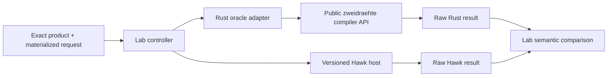

# ETS/HawkNET compatibility

The sibling `zweietscompat` repository compares zweidraehte's commissioning
compiler with versioned ETS/HawkNET output. It owns the oracle adapters, request
contracts, private corpus, caches and semantic comparison tools. Normal
zweidraehte builds and tests do not require that repository or ETS binaries.

This page documents the boundary with the lab. Its own README and
`contract/v1/` documentation are authoritative for commands, supported request
versions and corpus results. [CLIENT.md](../CLIENT.md) describes the Rust API;
[COMMISSIONING_ENGINE.md](COMMISSIONING_ENGINE.md) describes compiler and
execution semantics.

## Ownership

| Component | Owner |
| --- | --- |
| Product parsing, checked selection and editable evaluation | `zweidraehte-ets-files` |
| Configuration lowering, images and programming procedures | `zweidraehte-client` |
| Local device fixtures and configuration conformance runner | This repository's `conformance/` |
| Rust process adapter using public crate APIs | `zweietscompat/tools/rust-oracle` |
| Proprietary Hawk host and its runtime dependencies | `zweietscompat/tools/hawk-product-oracle` and private storage |
| Request contracts, controller, normalization and result caches | `zweietscompat` |
| Catalog acquisition and private `knxcat` corpus | The lab's `ets_dongle_proj_prod` dependency |



The Rust adapter translates a lab request into existing public APIs. It does
not carry a second compiler, evaluator, simulator or programming policy.
Proprietary dependencies stay with the Hawk process. The lab's Rust adapter
has no ETS binary dependency.

On Linux, the Hawk execution host uses Microsoft .NET Framework 4.8 under
Wine. Mono was sufficient for reflection probes but failed to initialize the
required ETS ObjectModel in the tested version. Runtime compatibility and
assembly discovery belong to the lab, not to the Rust client.

## Materialized input boundary

Three representations have distinct responsibilities:

1. **Definition:** an exact product archive, selected catalogue/hardware/
   application relation and exact Master Data document.
2. **Evaluated instance:** active parameters and communication objects, flags,
   bindings, module layout and resolved product geometry.
3. **Commissioning input:** installation topology, target observations, intent,
   credentials and any prior deployment evidence.

The Rust path uses `SelectedProduct` and `Device::from_product`, then
`Device::evaluate`. A borrowed `EvaluatedProduct` prevents edits while its
facts are being lowered. `MaterializedDevice::from_evaluated` combines it with
`InstallationConfiguration`; `into_keyed(keys)` produces the compiler input.
Low-level adapters can also supply an `EncodedConfiguration` to
`configuration::MaterializedDevice::from_parts` when the request already
contains evaluated facts. That constructor does not evaluate or cross-check the supplied
parts; the adapter owns their consistency. Compiler validation checks supported
programming constraints, not parity with ETS dynamic evaluation.

`ProgrammingInput::compile` produces an inspectable `CompiledProgram`;
`preview` produces the same compiler's public `ProgramImage`.
`commissioning::inspection` exposes the procedure and operand vocabulary needed
by the adapter. Compiler and runtime internals remain private.
`ResolvedKeyMaterial` and `ResolvedIpSecureConfiguration` belong to
`configuration`; their compatibility exports in `security` still serve
existing oracle imports.

The request must identify the exact product and Master Data bytes, selected
catalogue relation, profile, programming intent and relevant observations.
DD0, PID 72, association-table row width, management credential, prior address
and application-security mode cannot be guessed from a vendor name or a
similar mask. Missing required facts produce a structured unsupported or
observation failure.

The lab's v1 Rust adapter supports full download, application unload and
all-configuration unload. It rejects partial/difference requests that lack
section or verified prior-image identity, even though the client supports
those modes through richer inputs. The adapter's APDU requirement is labelled
conservative; it is not an exact minimum comparable to every Hawk result.

## What agreement proves

Feeding the same materialized instance to both compilers isolates image and
procedure generation. It does **not** independently verify dynamic evaluation:
both compilers can agree on wrongly selected parameters, visibility or modules.
Evaluator parity needs independently evaluated configurations.

Comparison preserves:

- Typed memory/property locations, including object occurrence and property
  element geometry.
- Bytes and ownership masks; reserved or firmware-owned bits are not silently
  made product-owned.
- Ordered controls, conditions, error handlers, reads, restart policy and
  required observations.
- Explicit limitations for operations or operands the comparison contract
  cannot represent.

Diagnostic procedure strings are useful evidence, but typed operations are the
comparison boundary. Key material is ordinary image content, as in the
reference tool's image. Exact telegram order matters where the specification or
a retained device witness requires it; equivalent text alone proves neither
equivalent execution nor final device state.

A compiler match is not a hardware qualification. The configuration conformance
runner exercises the real client download API against local DUT processes.
Physical connector/product coverage is separate again; see
[DEVICE_PROGRAMMING.md](DEVICE_PROGRAMMING.md).

## Reproducibility and validation

Every comparison needs product/Master Data hashes, the complete selected
relation, canonical request identity, Rust revision/dirty state and Hawk
assembly provenance. Preserve raw responses independently of normalized
results so a normalizer fix does not require rerunning the engines. Unsupported
and failed stages remain distinguishable from equality.

Oracle/corpus tests are opt-in. Ordinary crate tests remain offline and
independent of private catalog availability. Licensed products, specifications,
ETS binaries and derived artifacts reproducing their contents stay in private
or ignored storage.

After changing a public API consumed by the adapter:

```sh
cargo test -p zweidraehte-ets-files -p zweidraehte-client
cargo test --workspace --no-run
cargo xtask conformance configuration
```

Run Cargo commands serially, including the entire conformance run, whose
children are respawned from `target/`. Separately validate the lab adapter
using its documented local-source override and toolchain. The override selects
local dependencies explicitly and records the source revision; a published
Git pin must name a revision available on its remote. Passing workspace checks
does not compile this external consumer.

The lab's README and result artifacts carry current corpus coverage. Incidental
client/compiler gaps belong in the local `SESSION.md`, rather than a second
implementation checklist here.
