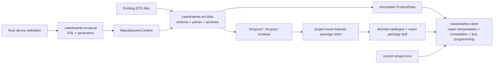

# ETS File Formats and Packages

`zweidraehte-ets-files` is the host-side foundation for data exchanged with
ETS. It owns the XML representations and package mechanics; it does not know
how to talk to a KNX device or how a Rust device definition is authored.

This boundary keeps ownership explicit:



- `zweidraehte-knxprod` turns Rust definitions into manufacturer XML. Its
  `KnxprodBuilder` retains convenient MTXML and signed `.knxprod` output, but
  delegates XML/package mechanics to this crate.
- `zweidraehte-ets-files` reads, writes, normalizes, preserves, and signs ETS
  files. It is usable without the generator.
- `zweidraehte-client` interprets mask data and compiles installation-specific
  configuration for the wire. Protocol identifiers remain in
  `zweidraehte-proto`.
- `zweidraehte-project` remains the separate, human-authored commissioning
  syntax and durable deployment-state store. It is not an ETS `.knxproj`
  representation.

## Modules

| Module | Responsibility |
|---|---|
| `schema` | Serde DTOs, shared KNX namespace parsing, and generation schema versions |
| `master_data` | Shared file/XML/product-document acquisition, source identity, exact-generation validation and optional versioned download/cache |
| `xml` | Canonical UTF-8 XML serialization with a declaration and two-space indentation |
| `runtime` | Editable product-configuration model, dynamic-page traversal, translations, and baggage lookup |
| `runtime::presentation` | Shared form tree, controls, table cells and serializable page snapshots; no terminal or HTML dependency |
| `product` | Immutable normalized `ProductData`, `ManufacturerContent`, decoded segments, parameter/property locations, communication objects, fixups, security capacities, and load procedures |
| `archive` | Lossless ZIP storage, header-indexed product reading, selected-product assembly, baggage materialization, and the indexed project package store |
| `project` | `ProjectDefinition`, topology placement, validation, and `KnxprojBuilder` |
| `keyring` | Password-protected ETS `.knxkeys` import/export with redacted, zeroizing secret storage |
| `signing` | Converter-key parsing, hashes, signatures, and package creation; compatibility re-exports of schema versions and Master Data sources |

`runtime::Device::from_product` opens an editable configuration from a retained
`Arc<SelectedProduct>`. `evaluate` validates its edits and returns a borrowed
`EvaluatedProduct` containing effective settings, objects, resolved geometry and
the active module roster used to compute it. `modules()` borrows that roster in
instance-ID order; `into_parts()` transfers it and the resolved product without
cloning. Final allocator arguments come from the same evaluation throughout
client lowering. `into_product()` remains available to geometry-only consumers.
The borrow prevents edits from invalidating an evaluation still in use. Raw
`Device::new` remains useful for schema inspection but cannot publish an evaluation.
The client lowers that evaluation with installation choices; callers cannot pair
an editor with independently supplied product facts through that checked route.
Its `configuration::MaterializedDevice::new` also accepts expert-supplied facts
without running this evaluator; compiler validation cannot certify their dynamic
evaluation. `parameter_description` exposes effective values, defaults, access
and types to presentation consumers.

Interactive previews can use `FormPresentation::snapshot` to obtain a full
navigation tree, one selected page and visible communication objects.
`Device::try_set_parameter_value` validates an individual visible edit and
rolls it back if derivation fails. Hidden parameter and inactive module values
remain temporary draft state. `with_language` retains those edits while rebuilding
translated presentation; exporting an active programming configuration is a
separate operation. The TUI consumes the same page/control builder but retains
its own navigation, sizing and keyboard commands.

The consuming knxcat repository owns the `tools/knx-form` worker and its
versioned JSON-lines protocol. This crate supplies the shared form engine;
process supervision and browser integration belong to that consumer.

Programming uses `EvaluatedProduct::parameter_overlays()` instead. Its typed
inputs carry storage width, type and source (default, exact reference, base value
or derived output), in application order. Composite IDs retain the concrete
module instance. UI-only controls and inactive module instances are omitted;
hidden legacy/property values and derived outputs remain eligible. Authored
settings export stays independent from these programming inputs.
`procedure_selector(id)` resolves a requested root or module selector and its
dynamic activity, which can differ from editor visibility. Byte encoding,
reference conflicts after encoding, and procedure-language type restrictions
belong to the consumer. In particular, derived overlays replace the first
matching storage entry so property lowering receives the derived value.

Root objects, base tables without references, and instantiated module objects
share one effective-value resolver. It returns flags and provenance together,
preserves the first visible reference, and applies project overrides by the
resolved object number. Module text interpolation remains instance-specific.
Base and evaluated object flags use the protocol's named `ComObjectFlagFields`
conversion; bit 5 remains uninterpreted until the table realization is known.

`master_data::MasterDataLoadRequest` loads a parsed document for inspection or
commissioning. Product requests reuse the associated `Arc<MasterData>` or resolve
the loose product's declared generation; explicit files and XML never fall back.
The shared loader checks namespace identity. The client separately limits live
commissioning to its supported schemas and computes catalog fingerprints.
Its `ProgrammingCatalogLoadError::MasterData` retains this crate's original
error and source chain; `Policy` carries the client's schema-policy diagnostic.
Consumers format those causes when presenting an error instead of replacing
them with strings during acquisition.

Package builders retain an owned `master_data::MasterDataSource` and resolve its
exact XML through the same acquisition module, without parsing or rewriting the
bytes they embed. The existing `signing` source/resolver paths are re-exports.
Resolvers now return `MasterDataError`; packaging wraps it in
`SigningError::MasterData`, preserving the error source chain. Local resolution
requires neither signing nor download features.

The TUI uses `EditorDocument::prepare` for both startup and device switching.
It binds the programming catalog, applies translations and project settings,
and produces one `PreparedEditorProduct`. `App::new` and `open_project_device`
install that complete product together, sharing its Master Data document across
editing and compilation and retaining baggage for later language changes.

## Cargo features

The crate has no default features. The XML schemas, canonical codec, runtime
model, normalized product model, project-document generation, and local
master-data parsing are always available.

| Feature | Adds |
|---|---|
| `archives` | `.knxprod` and `.knxproj` ZIP reading/writing, catalogue indexing, selected-product loading, and reading existing package stores |
| `signing` | RSA signing and verification, signed package creation, and explicit package-store imports; imports report signature mismatches without retaining trust metadata; implies `archives` |
| `knxkeys` | Encrypted ETS keyring parsing and export |
| `javascript` | Product scripts through Boa: parameter calculations and validations, which run only while `Device::try_set_parameter_value` edits a parameter. Without it, such an edit returns an explicit error; defaults and stored projects never need it |
| `master-data-download` | Versioned cache and retrieval from `update.knx.org` |
| `test-fixtures` | Synthetic product builders for downstream compiler tests only |

Consumers should enable only the boundary they use. In particular, parsing
loose MTXML does not require ZIP, HTTP, or RSA dependencies.

Keyring secret storage comes from `zweidraehte-util::secret::SecretBytes`,
enabled through the utility crate's `secrets` feature.
The `knxkeys` feature does not depend on the custom project crate, its parser
or filesystem locking. Secret encoding and encryption remain in this crate.

## Product selection

Use `archive::PackageArchive` to inspect a standalone `.knxprod` without
importing it. It shares the package store's header-only catalogue index and
keeps each `CatalogItem` as a separate choice, including multiple items that
share Product/H2P/AP identities. `load_product(catalog_item_id)` loads that
exact choice; `load_application(id)` requires an unambiguous or absent
catalogue relationship. Neither operation verifies signatures or creates a
store. `KnxprodArchive` remains the eager preservation/editing view; its
catalogue listing delegates to the same index.

Both readers use the hardware schema's borrowed catalogue-chain traversal and
AP1/AP2 capability validation. The schema's exact resolver validates only its
selected relation; unscoped resolution checks the whole hardware document.
Package indexing validates every catalogue leaf and additionally requires
complete referenced application members and unique metadata IDs. Those archive
policies stay separate from the shared relationship rules.

Both `PackageArchive::load_product` and `StoredPackage::load_product` return
`product::SelectedProduct`: the parsed application document, normalized `ProductData`,
and selected catalogue/hardware relationship. AP2 absent/present metadata and
bundled Master Data are bound by ETS-files, before client evaluation. Stored
project loading also enforces the leaf's instantiation status; standalone
inspection can read products whose registration blocks project instantiation.
Generated fixtures use `SelectedProduct::from_document` with an explicit
relationship, without duplicating the binding logic.
The checked selection and its relation metadata live in the product module and
are available without `archives`. Archive re-exports retain the loader-facing
API; the neutral owner does not depend on ZIP. Client project handles share the
selection. It lazily retains one immutable runtime definition (program, lookup
tables and default-value templates) shared by untranslated `Device` instances.
Each instance owns its mutable values, derived visibility, module expansion and
bindings. Translated editors build a private definition from pristine text;
translations cannot mutate another editor or the compiler's source document.
Geometry resolution produces an owned `ProductData` per evaluation. Sharing
trades a larger first-instance allocation and retained default templates for
cheaper repeated instances. Dropping an editor does not evict the definition
while its selection remains alive; dropping the selection and its editors
releases it. Translated definitions and evaluated geometry have independent
lifetimes and are not cached across instances.

`ProductError` retains typed diagnostics and their source chains. Its rare
`ApplicationProgram2BindingConflict` stores boxed `current` and `selected`
bindings, keeping ordinary product/archive results compact. Runtime
`ConfigurationError::Product` and the client's `ProductFormat`/`ProductLoad`
variants carry their errors directly, with derived `From` conversions.

All archive readers select one root or nested `knx_master.xml` and reject
multiple candidates when binding product metadata. Catalogue manufacturer
labels may still be indexed from multiple documents; that does not make any
one document authoritative for a selected product. Baggage materialization
shares reference discovery, path checks, and cache publication. Standalone
callers supply a cache directory and own its lifetime; the TUI uses a temporary
directory retained throughout the editor session.

Use `archive::load_program` for loose MTXML and direct `.knxprod` inputs at
generator, editor, inspection, test, and low-level API boundaries.
`ProgramSelection` carries optional catalogue-product and application-program
IDs. The loader rejects missing, ambiguous, or mismatched selectors instead
of silently choosing the first application program.

`LoadedProgram::product_data` and `ProductData::from_knxprod` use the same
product assembly, including authoritative AP2 metadata when available.
`LoadedProgram::product_data` reports `ProductLoadError`, and
`KnxprodArchive::importable_devices` reports `PackageStoreError`, preserving
relationship/index failures rather than representing them as XML parse errors.

Schema namespace parsing is shared by product provenance, Master Data,
package indexing, and signature hashing. Parsing retains any numeric declared
generation; generation (`schema::KnxSchemaVersion`, currently 20–23) and
commissioning keep their own support limits. The former `signing` type paths
remain re-exports.

A live custom project deliberately does not use a loose MTXML path or an
external archive path as product authority. It selects the SHA-256 identity of
an archive already imported into its local store plus one exact
`CatalogItem/@Id`. Resolution then follows the untouched package's catalogue,
Product, Hardware, Hardware2Program, and ordered AP references. That complete
chain is what establishes capabilities such as AP2; an application-program ID
alone is insufficient.

Generated `KnxprodOutput` converts into `product::ManufacturerContent`.
Imported `.knxprod` and `.knxproj` archives can produce the same neutral
manufacturer bundles, so `project::KnxprojBuilder` accepts generated and
imported content uniformly. Devices in the generated ETS `.knxproj` reference
catalogue-product and application-program IDs; the builder validates that
relationship and supports multiple manufacturer directories and topology
areas/lines.

## Project package store

`archive::PackageStore` is rooted at `.zweidraehte/packages` and addresses each
import by the SHA-256 of the original ZIP bytes:

```text
.zweidraehte/packages/
└── sha256-<digest>/
    ├── source.knxprod
    ├── index.json
    └── materialized/            # optional selected-resource cache
```

The compressed source archive is retained under the SHA-256 of its import
bytes, but it is not expanded into a second full tree. Import rejects unsafe
ZIP paths and resource-limit violations, parses `Catalog.xml` and
`Hardware.xml`, and streams only the small declarations needed from referenced
application programs and bundled Master Data. It writes those results to an
unsigned, versioned `index.json`. Opening a stored package reads that small
index; loading a project device inflates and fully parses only the application
program selected by its catalogue leaf. A present directory signature makes
the explicit import stream its members once for hashing, but it does not parse
or persist those payloads outside `source.knxprod`. Plug-ins and unrelated
baggage otherwise stay compressed and untouched. Selected baggage resources
may be materialized into `materialized/` when an editor actually needs them.

The store derives one read-only catalogue tree across all packages. Equal
presentation branches may be coalesced and conflicting revisions remain
separate, but every leaf retains its package digest, CatalogItem ID, Product,
Hardware, H2P, and ordered AP identities. This index is never serialized as a
combined `Catalog.xml`.

Package-store import checks present directory and registration signing chains.
A mismatch is returned as a non-fatal import notice; absence is silent. The
derived catalogue retains only registration status and descriptive metadata
from `Hardware.xml`, not signer or verification results. Lossless archive
editing and signed package generation remain separate APIs and still require
their normal signing rules.

The store is immutable required project input, unlike the mutable deployment
snapshot, journal, and lock. Back it up with `project.knx`. It may be committed
for reproducibility only when the vendor package's copyright and licence allow
redistribution; secret-bearing `keys.toml` has a separate policy again.

## Archive preservation

`archive::RawArchive` retains every ZIP entry's path and byte payload. Typed
archive views parse known documents on demand, but unsupported XML, baggage,
and auxiliary entries stay opaque. Replacing a known document changes only
that entry; untouched entries remain byte-identical.

An unmodified archive can return its original bytes. Once a signed directory
is dirty, writing requires a caller-supplied `signing::ConverterKey` and
refreshes that directory's signature. The low-level `RawArchive` and typed
archive views do not automatically turn a read into a trust decision;
an explicit `PackageStore` import checks the envelope and registration chain
only to produce mismatch notices. Those checks neither gate catalogue leaves
nor become stored trust metadata. Re-signing modified certified content with
the converter key creates a new converted package envelope; it does not
preserve or manufacture the vendor's certification provenance.

## Signing and secrets

Private converter-key material is never embedded or discovered implicitly.
The caller must construct `ConverterKey` from explicitly selected XML or a
file and pass it to the package builder/writer. `converter_key.xml` is
git-ignored and must never be committed.

The `.knxkeys` API keeps decrypted passwords, authentication strings, FDSKs,
tool keys, backbone keys, and group keys private. Construct them through the
checked builders and borrow them through accessors. Their diagnostics are
redacted and the owning storage has an explicit zeroization path.

## Verification

Use both feature extremes when changing the foundation:

```bash
cargo test -p zweidraehte-ets-files --no-default-features
cargo test -p zweidraehte-ets-files --all-features
cargo clippy -p zweidraehte-ets-files --all-features --all-targets --no-deps -- -D warnings
```

Archive/signing changes also require generator and project-tool tests.
Changes that can affect normalized product bytes or client lowering require a
fresh `conformance-configuration` run after rebuilding DUTs. Never run another
Cargo command concurrently with a conformance runner.
